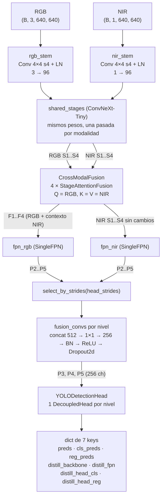

# Arquitectura técnica del modelo maestro

| | |
|:--|:--|
| **Modelo** | `MasterModel` con `fusion_mode="cross_attention"` (`arch_version = 1`) |
| **Configuración de referencia** | [`configs/experiment/twostream.yaml`](../../configs/experiment/twostream.yaml) (`head_strides: [8, 16, 32]`) |
| **Código** | [`src/models/master/`](../../src/models/master/) |
| **Verificado contra** | `main` en `649eebb` (2026-10-23). Conteo de parámetros, shapes y cómputo medidos ejecutando el modelo en CPU, entrada 640×640. |
| **Rutas de código** | `loop.py:218` significa `src/training/loop.py`, línea 218. Los archivos `backbone.py`, `fusion.py`, `neck.py`, `head.py`, `master_model.py` y `distill_projections.py` están en `src/models/master/`; el resto, en `src/training/` |
| **Documento hermano** | [`src/models/master/README.md`](../../src/models/master/README.md) (vista de usuario de ambos modos de fusión) |
| **Estado** | **Explorado.** Documenta el maestro de dos streams de 46.6M parámetros. La propuesta vigente lo reemplaza por un maestro pequeño con la arquitectura del estudiante (M2): ver [`rediseno-maestro-y-experimento-central.md`](rediseno-maestro-y-experimento-central.md) |

Este documento describe, bloque por bloque, el maestro de dos streams de la tesis actual
(sección 5.3.2, Figura 5.8): qué entra y qué sale de cada parte, qué decisión técnica se tomó y
por qué, y qué limitaciones están medidas. Cada afirmación lleva su referencia de código o de
reporte.

> **Qué arquitectura se documenta.** El código soporta dos modos de fusión. Este documento
> describe el de **dos streams con atención cross-modal**, que produjo el mejor resultado medido
> (AP50 de daño en test 0.398,
> [`reports/final-run-20261014/`](../../reports/final-run-20261014/README.md)). La fusión
> temprana de 4 canales con ConvNeXt
> ([`master_early_fusion_architecture.drawio`](master_early_fusion_architecture.drawio)) se
> evaluó y se descartó para este maestro; la sección 9 resume por qué y con qué reservas.

---

## 1. Rol del maestro en el sistema

El daño mecánico temprano en mango es interno: el tejido dañado cambia su absorción en el
infrarrojo cercano (850 nm) antes de que la lesión sea visible en RGB. El sistema explota esa
asimetría con **destilación de conocimiento cross-modal**:

| | Maestro | Estudiante |
|:--|:--|:--|
| Modalidades | RGB + NIR | solo RGB |
| Arquitectura | ConvNeXt-Tiny de dos streams + atención cross-modal + DualFPN + head YOLO desacoplado | YOLOv8-nano (CSPDarknet + PAN) |
| Parámetros | 46,642,930 | ≈6.87M |
| Se despliega | **No.** Solo existe en entrenamiento | Sí (edge, sin cámara NIR) |
| Función | Detector de alta capacidad y fuente de features privilegiadas | Detector final |

Dos consecuencias guían todo el diseño:

1. **El maestro no tiene restricciones de latencia ni de memoria de inferencia.** Su presupuesto
   lo fija la VRAM de entrenamiento (GTX 1660 SUPER de 6 GB en la fase local), no el dispositivo
   final.
2. **Sus representaciones intermedias son parte del contrato.** El maestro no solo detecta:
   expone features de backbone, FPN y head con shapes compatibles con el estudiante, porque son
   el target de la destilación (sección 6).

---

## 2. Vista general



### Shapes de punta a punta (entrada 640×640, `head_strides = [8, 16, 32]`)

| Punto del grafo | Tensor(es) | Stride |
|:--|:--|--:|
| Entrada | RGB `(B, 3, 640, 640)`, NIR `(B, 1, 640, 640)` | 1 |
| Salida de stems | `(B, 96, 160, 160)` por modalidad | 4 |
| S1 / S2 / S3 / S4 | `(B, 96, 160, 160)` · `(B, 192, 80, 80)` · `(B, 384, 40, 40)` · `(B, 768, 20, 20)` por modalidad | 4 / 8 / 16 / 32 |
| F1..F4 (fusionadas) | mismos shapes que S1..S4 | 4 / 8 / 16 / 32 |
| P2..P5 de cada FPN | `(B, 256, 160, 160)` … `(B, 256, 20, 20)` | 4 / 8 / 16 / 32 |
| Pirámide emitida | `(B, 256, 80, 80)` · `(B, 256, 40, 40)` · `(B, 256, 20, 20)` | 8 / 16 / 32 |
| `preds` por nivel | `(B, 6, 80, 80)` · `(B, 6, 40, 40)` · `(B, 6, 20, 20)` | 8 / 16 / 32 |

### Presupuesto por bloque (medido)

| Bloque | Parámetros | % | GMACs / imagen | % |
|:--|--:|--:|--:|--:|
| Stems (`rgb_stem` 4,896 + `nir_stem` 1,824) | 6,720 | 0.0 | 0.2 | 0.1 |
| Stages ConvNeXt compartidas | 27,813,696 | 59.6 | 72.5 (dos pasadas) | 55.6 |
| `CrossModalFusion` | 9,421,920 | 20.2 | 4.2 | 3.2 |
| `DualFPN` (2 × `SingleFPN` 2,729,984 + `fusion_convs` 395,520) | 5,855,488 | 12.6 | 43.6 | 33.4 |
| `YOLODetectionHead` (3 niveles × 1,181,702) | 3,545,106 | 7.6 | 9.9 | 7.6 |
| **Total** | **46,642,930** | 100 | **130.4** | 100 |

GMACs medidos con `torch.utils.flop_counter.FlopCounterMode` sobre una imagen 640×640 (los
porcentajes de GMACs suman 99.9 por redondeo). Con `head_strides = [4, 8, 16, 32]` el total sube
a 47,956,472 parámetros: un `DecoupledHead` más (1,181,702) y una `fusion_conv` más (131,840).

---

## 3. Contrato de entrada

El maestro recibe pares RGB+NIR ya **registrados, letterboxeados y normalizados**. Todo ese
trabajo ocurre en `YOLODataset` (`src/training/dataset.py`), no dentro del modelo.

| Paso | Qué hace | Código |
|:--|:--|:--|
| 1. Emparejado | cada `*.jpg` de `rgb_dir` se empareja con su NIR reemplazando `_rgb` por `_nir` en el nombre (sin NIR: se descarta con aviso); la etiqueta es `labels/<split>/<rgb_stem>.txt`. Los pares sin etiqueta se descartan y un `splits.json` que no coincide con las etiquetas aborta | `dataset.py:259-314` |
| 2. Lectura | RGB con `cv2.imread` (BGR → RGB); NIR en escala de grises | `dataset.py:392-401` |
| 3. Registro NIR → RGB | homografía 3×3 de `notebooks/matriz_homografia_aruco.npy` (validada finita y no singular). `H` mapea RGB → NIR, así que el NIR se deforma con `H⁻¹` al tamaño del RGB (`INTER_LINEAR`, borde constante 14 = `nir_mean·255`) | `nir_registration.py:27-83`, `dataset.py:408-412` |
| 4. Recorte al ROI (opcional) | solo con `roi_crop: true` (variantes `twostream_roi_crop*`): recorta ambas imágenes a la caja del mango más un margen, después del registro y antes del letterbox | `dataset.py:414-427` |
| 5. Letterbox a 640 | resize que preserva el aspecto y centrado en un cuadrado; relleno 114 en RGB y 14 en NIR. Las cajas pasan a cxcywh normalizado del letterbox y se recortan a [0, 1] | `dataset.py:38-73`, `dataset.py:430-431`, `dataset.py:516-557` |
| 6. Aumentación (solo train) | ver abajo | `augmentations.py`, `dataset.py:575-607` |
| 7. Normalización | RGB: `/255` y media/desviación de ImageNet `[0.485, 0.456, 0.406]` / `[0.229, 0.224, 0.225]`. NIR: `(x/255 − 0.0569) / 0.0546` | `dataset.py:34-35`, `dataset.py:88-90`, `dataset.py:631-633` |
| 8. Batch | `rgb (B, 3, 640, 640)` y `nir (B, 1, 640, 640)` en float32; `bboxes` lista de `(N_i, 4)` cxcywh normalizado y `labels` lista de `(N_i,)` int64 (0 = mango, 1 = dañado) | `dataset.py:660-672` |

**Aumentación.** Las transformaciones espaciales se muestrean una vez y se aplican **idénticas**
a RGB, NIR y cajas (`additional_targets={"nir": "image"}`): flip horizontal 0.5, flip vertical
0.1, rotación 90° 0.3, rotación ±20° 0.4, perspectiva 0.02-0.05 0.2, transposición 0.1; una caja
sobrevive si conserva visibilidad ≥ 0.15 y área ≥ 2 (`augmentations.py:44-55`). Las fotométricas
(brillo/contraste, HSV, color jitter, CLAHE, blur, ruido, CoarseDropout) se aplican **solo a RGB**
(`augmentations.py:72-99`).

**Muestreo.** El split de train usa siempre un `WeightedRandomSampler` con reemplazo: el peso de
cada clase es la frecuencia inversa `total / (nc · count_c)` y el de cada imagen, el mayor peso
entre las clases que contiene (1.0 si no tiene cajas) (`dataset.py:687-719`, `train.py:237-245`).
**En este corpus no tiene efecto:** todas las imágenes contienen un mango y el mango es la clase
con menos instancias (188 frente a 288 de daño en train), así que todas reciben el mismo peso
(1.27) y el muestreo es uniforme ([auditoría de aumentación](../findings/2026-10-22-augmentation/README.md),
mecanismo 1; conteos reproducidos desde `data/mango_dataset_v3.zip`).

**Decisiones y razones.**

- **Registrar el NIR al marco RGB en tiempo de carga.** Las etiquetas viven en el marco RGB. Sin
  registro, las lesiones en NIR quedaban ≈168 px fuera de sus cajas y el stream NIR veía el lugar
  equivocado en cada lesión. El AP50 de daño en test pasó de 0.177 ± 0.102 (3 semillas, sin
  registro) a 0.398 (1 semilla, con registro); cambiaron varias cosas a la vez, así que no es una
  comparación controlada ([final-run](../../reports/final-run-20261014/README.md)).
- **Aumentación espacial idéntica y fotométrica solo en RGB.** Lo espacial debe preservar el
  alineamiento píxel a píxel del que dependen la atención y la fusión por nivel. Lo fotométrico
  se limita al RGB para conservar la distribución de reflectancia medida del NIR
  (`augmentations.py:61-63`). El efecto de cada transformación sobre el AP no se ha medido, y
  perturbar solo una modalidad confunde las ablaciones de modalidad
  ([auditoría](../findings/2026-10-22-augmentation/README.md), sección 3).
- **Normalización propia del NIR** (media 0.0569, desviación 0.0546): el NIR del rig es muy oscuro;
  normalizarlo con las estadísticas de ImageNet lo dejaría lejos de media cero.
- **Muestreador ponderado por la clase más rara.** Pretendía sobremuestrear la clase minoritaria,
  pero aquí no tiene efecto (ver arriba). Quien da más peso al daño es `class_weights` en la
  pérdida (5.2).

---

## 4. Componentes

Cada componente sigue la misma plantilla: responsabilidad, entradas, salidas, parámetros,
decisiones técnicas con su razón, y limitaciones conocidas.

### 4.1 Stems por modalidad — `DualConvNeXtBackbone.rgb_stem` / `.nir_stem`

**Responsabilidad.** Convertir cada modalidad, con su número de canales y sus estadísticas
propias, a un mapa de 96 canales a stride 4 que las stages compartidas puedan consumir.

| | RGB | NIR |
|:--|:--|:--|
| Entrada | `(B, 3, H, W)` normalizada | `(B, 1, H, W)` normalizada |
| Operación | `Conv2d(3, 96, k=4, s=4)` + `LayerNorm2d(96)` | `Conv2d(1, 96, k=4, s=4)` + `LayerNorm2d(96)` |
| Salida | `(B, 96, H/4, W/4)` | `(B, 96, H/4, W/4)` |
| Parámetros | 4,896 | 1,824 |
| Inicialización (con `pretrained_backbone=True`) | Copia verbatim del stem ImageNet-1K | `mean(W_imagenet, dim=1)`: promedio por canal de entrada del kernel ImageNet |
| Inicialización (sin preentrenado) | default de PyTorch | Kaiming normal (`fan_out`), bias 0 |

Código: `backbone.py:102-113` (stem), `backbone.py:339-353` (construcción), `backbone.py:442-478`
(inicialización).

**Decisiones y razones.**

- **Un stem por modalidad en lugar de apilar 4 canales.** RGB y NIR tienen distinto número de
  canales y distinta distribución (reflectancia visible frente a 850 nm). Un stem propio por
  modalidad cuesta 6.7K parámetros y permite filtros de bajo nivel específicos de cada sensor,
  mientras el resto del encoder se comparte. Es también la condición para que existan dos
  streams que la atención pueda cruzar (4.3).
- **Patchify 4×4 con stride 4.** Es el stem estándar de ConvNeXt; reutilizarlo hace que los
  pesos ImageNet de las stages reciban la entrada en la escala y la resolución que esperan.
- **NIR inicializado con el promedio del kernel RGB, no con ceros ni aleatorio.** El indicio de
  daño medido en NIR es textural; el promedio del kernel ImageNet le da al stream NIR priors de
  bordes y textura desde la época 0 en vez de aprenderlos con ≈190 imágenes de entrenamiento
  (`backbone.py:460-465`). No se reescala: la `LayerNorm` que sigue al conv normaliza cada
  posición sobre sus 96 canales, de modo que una diferencia de escala global del kernel queda
  absorbida (inferencia por construcción, no medida).
- **Guardia de precisión acotada a fp16.** Si el entrenamiento corre con autocast fp16, el
  backbone completo (stems y stages) se ejecuta en fp32 (`backbone.py:392-412`). En fp32 y bf16
  es un no-op: bf16 tiene el rango de exponente de fp32, así que el mecanismo de overflow que
  motivó la guardia no aplica (fusion-redesign D-I).

**Limitaciones.** El stem NIR ve una sola banda; cualquier información espectral adicional
(otra longitud de onda) requeriría cambiar `in_channels` del stem y rompería la compatibilidad
de checkpoints.

### 4.2 Stages ConvNeXt-Tiny compartidas — `DualConvNeXtBackbone.shared_stages`

**Responsabilidad.** Extraer la jerarquía de features de 4 escalas de cada modalidad con un
único conjunto de pesos.

- **Entrada:** salida de cada stem, `(B, 96, H/4, W/4)`.
- **Operación:** las 4 stages de `torchvision.convnext_tiny(IMAGENET1K_V1)` sin stem ni
  clasificador (`backbone.py:61-74`): stage 1 (3 bloques), downsample + stage 2 (3), downsample +
  stage 3 (9), downsample + stage 4 (3). Cada modalidad recorre las mismas stages por separado
  (`backbone.py:421-426`).
- **Salida:** dos listas `[S1, S2, S3, S4]`, una por modalidad, con canales `[96, 192, 384, 768]`
  y strides `[4, 8, 16, 32]`.
- **Parámetros:** 27,813,696 (una sola copia). **Cómputo:** 72.5 GMACs por imagen (72.7 con los
  stems), porque cada imagen atraviesa las stages dos veces.

**Decisiones y razones.**

- **ConvNeXt-Tiny como encoder.** CNN moderna con bloques 7×7 depthwise, LayerNorm y GELU
  (Liu et al., 2022): un encoder de alta capacidad con pesos ImageNet-1K disponibles en
  torchvision, entrenable en 6 GB con batch físico 2. La variante `small` (`backbone_variant`)
  tiene los mismos canales por stage, así que es un cambio de config sin tocar el resto del
  grafo.
- **Stages compartidas entre modalidades.** Con un dataset de pocos cientos de pares, dos
  encoders independientes duplicarían los parámetros (+27.8M) y el riesgo de sobreajuste. Compartir
  pesos actúa como regularización (`backbone.py:303-305`) y, además, proyecta RGB y NIR al
  **mismo espacio de features**: es lo que hace comparables las queries RGB y las keys NIR en la
  atención (4.3). El precio es cómputo: dos pasadas por imagen.
- **Entrenamiento end-to-end con learning rate discriminativo.** Ver sección 5. `freeze_backbone(n)`
  sigue disponible para ablaciones y congela stems y stages de forma simétrica; la asimetría
  previa (stem RGB siempre congelado, stem NIR siempre entrenable) se eliminó porque era el
  defecto E6/Q10 detrás de un maestro que rendía menos que su propio estudiante
  (`master_model.py:333-359`).

**Limitaciones.** Compartir pesos obliga a que una misma convolución sirva para dos
distribuciones de entrada distintas; los stems son el único lugar donde el modelo puede
especializarse por modalidad antes de la fusión.

### 4.3 Fusión cross-modal — `CrossModalFusion` / `StageAttentionFusion`

**Responsabilidad.** Inyectar información NIR en el stream RGB en cada una de las 4 escalas,
produciendo features RGB "enriquecidas" que el estudiante, que solo verá RGB, pueda aprender a
imitar.

- **Entrada por stage i:** `rgb_i` y `nir_i`, ambos `(B, C_i, H_i, W_i)`.
- **Salida por stage i:** `F_i` con el mismo shape que `rgb_i`. `nir_i` pasa sin cambios al
  `fpn_nir`.
- **Parámetros:** 9,421,920 en total; 112,032 / 445,248 / 1,775,232 / 7,089,408 por stage. La
  stage 4 concentra el 75% (escala con C²). **Cómputo:** 4.2 GMACs.

**Operación de un `StageAttentionFusion`** (`fusion.py:132-231`):

```
P      = min(H, W, 20)                                  # max_tokens_side
r, n   = adaptive_avg_pool(rgb_i, P), adaptive_avg_pool(nir_i, P)   # si H o W > P
q, k   = LN_rgb(flatten(r)), LN_nir(flatten(n))         # Pre-LN, (B, P², C)
[q, k += PE_2d]                                         # solo con fusion_pos_encoding=True
x      = flatten(r) + MHA(Q = q, K = k, V = LN_nir(flatten(n)))
x      = x + FFN(x)                                     # LN → Linear(C, 4C) → GELU → Dropout → Linear(4C, C) → Dropout
F_i    = upsample_bilinear(x, H×W) + rgb_i              # si hubo pooling
F_i    = x                                              # si no (stage 4 a 640 px)
```

| Stage | C | Cabezas | dim por cabeza | Grilla original → tokens | Celdas de feature por token | Píxeles de imagen por token |
|--:|--:|--:|--:|:--|--:|--:|
| 1 | 96 | 4 | 24 | 160×160 → 20×20 | 8×8 | 32×32 |
| 2 | 192 | 8 | 24 | 80×80 → 20×20 | 4×4 | 32×32 |
| 3 | 384 | 8 | 48 | 40×40 → 20×20 | 2×2 | 32×32 |
| 4 | 768 | 8 | 96 | 20×20 (sin pooling) | 1×1 | 32×32 |

**Decisiones y razones.**

- **RGB como query, NIR como key/value.** En inferencia el estudiante solo tiene RGB. Con RGB
  preguntando y NIR respondiendo, la salida queda anclada al stream RGB y se interpreta como "lo
  que el RGB debería saber de NIR en esta posición", que es exactamente lo que se quiere
  destilar (`fusion.py:18-22`). El valor transportado es contenido NIR puro.
- **Fusión en las 4 escalas.** El daño es pequeño (mediana ≈30 px de lado corto a 640 px,
  [`reports/damage-map-audit/h7-mechanism.md`](../../reports/damage-map-audit/h7-mechanism.md)) y
  su indicio NIR es textural; fusionar desde la stage 1 permite que la información NIR llegue
  tanto a los niveles finos como a los semánticos.
- **Pooling a una grilla de 20×20 tokens.** Sin pooling, la stage 1 tendría 25,600 tokens y una
  matriz de atención de 25,600² por cabeza: inviable en memoria. Promediar a 400 tokens fija el
  costo de la atención en todas las stages (patrón usado en CMX y TokenFusion,
  `fusion.py:147-150`). Un efecto lateral útil: en todas las stages un token cubre 32×32 px de
  imagen.
- **Residual con el RGB de resolución completa.** La atención opera a 20×20; sumar `rgb_i`
  después del upsample preserva el detalle fino que el pooling destruye (`fusion.py:223-227`).
- **Pre-LN y FFN 4× (bloque transformer estándar).** Pre-LN es más estable de entrenar que
  Post-LN; el FFN da capacidad no lineal por token después de la mezcla.
- **Atención forzada a fp32.** `nn.MultiheadAttention` es numéricamente frágil bajo autocast con
  magnitudes de feature grandes; el bloque corre en fp32 y castea de vuelta (`fusion.py:166-197`).
- **Codificación posicional 2D opcional (`fusion_pos_encoding`, default `false`).** Senoidal fija,
  sumada solo a Q y K, sin parámetros ni buffers: el `state_dict` es idéntico con o sin ella
  (`fusion.py:24-35`, `fusion.py:43-67`). Motivo: ver la primera limitación.

**Limitaciones medidas** ([`reports/fusion-gradient-collapse/diagnosis.md`](../../reports/fusion-gradient-collapse/diagnosis.md)).
Se midieron sobre `checkpoints/mastermodel_mango/best_model.pt`, el checkpoint de dos streams
previo al rediseño (NIR sin registrar), con una semilla y 4-8 imágenes de val. No se repitieron
sobre la corrida final con NIR registrado.

- **La atención colapsa a casi uniforme.** Entropía normalizada 0.9989 / 0.9974 / 0.9840 /
  0.8872 por stage. Con pesos casi uniformes cada query recibe aproximadamente el mismo promedio
  NIR: el NIR entra como un **vector global por imagen**, no como señal por posición. El NIR sí
  se usa (anularlo cambia los logits de clasificación un 22%), pero globalmente.
- **Causa raíz identificada:** los logits `(W_q·LN(rgb_i))·(W_k·LN(nir_j))` dependen solo del
  contenido. RGB y NIR están alineados píxel a píxel, así que la correspondencia útil es
  posicional, y nada le dice a una query cuál es su key. La codificación posicional existe para
  esto, pero **no se ha entrenado ningún modelo con ella**: su efecto en AP no está medido.
- **Doble residual en las stages con pooling.** `F_i = upsample(r + attn + ffn) + rgb_i` suma el
  RGB dos veces (una promediada, otra a resolución completa) en las stages 1-3 y una sola vez en
  la stage 4. Escala distinto el camino RGB por stage y puede diluir el delta NIR. Se dejó así a
  propósito para que el experimento de codificación posicional sea atribuible a un único cambio.
- **Resolución de la atención frente al tamaño del daño.** Un token cubre 32×32 px y el daño
  mediano mide ≈30 px: la atención no puede localizar nada por debajo de un token.
- **La stage 1 no recibe gradiente con `head_strides = [8, 16, 32]`.** `F1` solo alimenta el
  nivel P2 de la FPN, que esta pirámide descarta (4.4).

### 4.4 Neck — `DualFPN` (dos `SingleFPN` + fusión por nivel)

**Responsabilidad.** Construir una pirámide de features multiescala por modalidad (FPN, Lin et
al., 2017) y fusionarlas nivel a nivel en una única pirámide de 256 canales para el head.

- **Entrada:** `[F1..F4]` (de 4.3) y `[S1..S4]` NIR (sin cambios).
- **Salida:** pirámide de los niveles nombrados por `head_strides`, de fino a grueso, 256 canales
  cada uno. Con `[8, 16, 32]`: P3 `(B, 256, 80, 80)`, P4 `(B, 256, 40, 40)`, P5 `(B, 256, 20, 20)`.
- **Parámetros:** 5,855,488 (`fpn_rgb` 2,729,984 + `fpn_nir` 2,729,984 + `fusion_convs` 395,520).
  **Cómputo:** 43.6 GMACs.

**Operación** (`neck.py:48-122`, `neck.py:250-285`):

1. Cada `SingleFPN`: lateral `Conv 1×1` de cada stage a 256 canales → camino top-down (upsample
   nearest del nivel más profundo y suma) → `Conv 3×3` de suavizado. Produce siempre
   `[P2, P3, P4, P5]`.
2. `select_by_strides` elige en ambas pirámides los niveles de `head_strides` **por stride, no
   por posición**.
3. Por nivel emitido: `concat(P_rgb, P_nir)` (512 canales) → `Conv 1×1` (256) → `BatchNorm2d`
   (o `GroupNorm`) → `ReLU` → `Dropout2d(0.1)`.

**Decisiones y razones.**

- **Una FPN por modalidad y fusión tardía por nivel.** Mantener una pirámide NIR independiente
  de la atención da al head una segunda vía de NIR, **alineada píxel a píxel**: la concatenación
  por nivel. Dado el colapso medido de la atención (4.3), esta es la única ruta por la que el NIR
  llega al head con información espacial (inferencia a partir de la arquitectura y del
  diagnóstico; no hay una ablación que la aísle).
- **Fusión con `concat + Conv 1×1`.** Es la fusión aprendible más barata: deja que el modelo
  pondere RGB contra NIR por canal y por nivel, con 131,840 parámetros por nivel.
- **Selección por stride.** Un `zip` posicional entre una pirámide de 4 niveles y una lista de 3
  trunca en silencio y desalinea niveles; seleccionar por stride convierte ese error en una
  excepción (`neck.py:269-273`, `src/training/strides.py`).
- **Exactamente una `fusion_conv` por nivel emitido.** El número de convs depende de
  `head_strides`, así que ningún nivel puede fusionarse sin conv ni construirse sin consumidor
  (`neck.py:238-248`).
- **`neck_norm` configurable.** Las únicas BatchNorm de todo el maestro están en estas
  `fusion_convs` (el backbone y la atención usan LayerNorm y el head no normaliza). Con batch
  físico 2 en la GTX 1660S las estadísticas de batch son ruidosas; `neck_norm: group` las
  reemplaza por GroupNorm (32 grupos), sin estadísticas de batch. Cambia el esquema del
  `state_dict` (`src/training/neck_norm.py`).
- **Inicialización Kaiming uniforme (`a=1`)** en las convs de las FPN, bias a cero
  (`neck.py:90-95`).

**Limitaciones.**

- **P2 se calcula y se descarta con `head_strides = [8, 16, 32]`.** Ambas FPN construyen P2 a
  160×160 aunque el head no lo use. Solo la `Conv 3×3` de suavizado de P2 cuesta 15.1 GMACs por
  FPN: **≈30 GMACs por imagen, ≈23% del cómputo total del maestro, se descartan**. Además, 22
  tensores de parámetros quedan con `grad is None` en cada backward: toda la fusión de la stage 1
  y las `lateral_convs.0` / `output_convs.0` de ambas FPN
  ([diagnóstico §5](../../reports/fusion-gradient-collapse/diagnosis.md)). Se conserva tal cual
  para que los checkpoints de dos streams existentes sigan cargando clave por clave.
- **`head_strides = [4, 8, 16, 32]` lo resuelve** (`configs/experiment/twostream_p2.yaml`): P2 se
  fusiona y se emite, ningún parámetro queda sin gradiente, y el daño mediano (≈30 px) pasa de
  ≈3.8 a ≈7.6 celdas de lado. Coste: +1,313,542 parámetros (una `fusion_conv` y un
  `DecoupledHead`).

### 4.5 Head — `YOLODetectionHead` (un `DecoupledHead` por nivel)

**Responsabilidad.** Predecir, en cada celda de cada nivel, la puntuación de las 2 clases y la
caja, y exponer las features internas de cada rama para la destilación.

- **Entrada:** la pirámide emitida, 256 canales por nivel.
- **Operación por nivel** (`head.py:56-105`):
  - rama de clasificación: `cls_stem = Conv 3×3 (256→256) + SiLU` → `cls_pred = Conv 1×1 (256→2)`
  - rama de regresión: `reg_stem = Conv 3×3 (256→256) + SiLU` → `reg_pred = Conv 1×1 (256→4)`
- **Salida por nivel:** `cls (B, 2, H_i, W_i)`, `reg (B, 4, H_i, W_i)`, `pred = cat(cls, reg)`
  `(B, 6, H_i, W_i)`, y las salidas de `cls_stem` / `reg_stem` `(B, 256, H_i, W_i)` como features
  de destilación.
- **Parámetros:** 1,181,702 por nivel; 3,545,106 con 3 niveles. **Cómputo:** 9.9 GMACs.

**Decisiones y razones.**

- **Anchor-free, de una etapa.** Sin anchors ni propuestas, la predicción es densa por celda.
  Esto elimina el ajuste de anchors a un dataset pequeño y, sobre todo, da un formato de salida
  idéntico al del estudiante YOLOv8-nano: `(B, 6, H_i, W_i)` en strides 8, 16 y 32.
- **Head desacoplado.** Clasificación y regresión tienen ramas separadas (patrón YOLOv8 / TOOD):
  las dos tareas compiten menos por la misma representación y convergen mejor. También produce
  dos features de destilación distintas, una por tarea.
- **Un head independiente por nivel**, sin pesos compartidos entre escalas.
- **Inicialización estilo YOLOv8.** Pesos `N(0, 0.01)`, bias a cero, y bias de `cls_pred` a
  `−log((1 − 0.01) / 0.01) ≈ −4.595`, es decir, una probabilidad previa de 0.01 por celda. Evita
  que en la época 0 el modelo prediga "objeto en todas partes" y que la pérdida de clasificación
  la dominen miles de negativos fáciles (`head.py:72-84`).
- **Stems calculados una sola vez.** La misma salida de `cls_stem` / `reg_stem` sirve para la
  predicción y para la destilación; antes se recalculaba, duplicando cómputo y memoria de
  activaciones (fusion-redesign W5, `head.py:170-176`).
- **`strides` es obligatorio, sin default.** Un argumento olvidado falla con `TypeError` en vez de
  asumir `[8, 16, 32]` en silencio sobre una pirámide de 4 niveles (`head.py:117-120`).
- **Sin capas de normalización.** El head no tiene BatchNorm, así que su comportamiento en train y
  eval es el mismo y no depende del tamaño de batch.

**Limitaciones.** La regresión predice 4 valores directos por celda, no una distribución
discreta (no hay DFL); ver la sección 11 sobre la discrepancia con la tesis.

### 4.6 Contrato de salida

`MasterModel.forward(rgb, nir)` devuelve siempre un diccionario de 7 keys, idéntico en los dos
modos de fusión, de modo que `dataset.py`, el loop de entrenamiento y `KDTrainer` no ramifican
por arquitectura (`master_model.py:267-327`). Shapes para 640×640 y `head_strides = [8, 16, 32]`:

| Key | Contenido | Shapes | Consumidor |
|:--|:--|:--|:--|
| `preds` | `cat(cls, reg)` por nivel | `(B, 6, 80, 80)`, `(B, 6, 40, 40)`, `(B, 6, 20, 20)` | pérdida de detección, decode |
| `cls_preds` | logits de clase por nivel | `(B, 2, ·, ·)` × 3 | pérdida, decode |
| `reg_preds` | 4 valores de caja por nivel | `(B, 4, ·, ·)` × 3 | pérdida, decode |
| `distill_backbone` | `[F1..F4]`, features fusionadas | `(B, 96, 160, 160)` … `(B, 768, 20, 20)` | KD (usa `[2:]`: F3, F4) |
| `distill_fpn` | pirámide emitida | `(B, 256, ·, ·)` × 3 | KD |
| `distill_head_cls` | salida de `cls_stem` por nivel | `(B, 256, ·, ·)` × 3 | KD |
| `distill_head_reg` | salida de `reg_stem` por nivel | `(B, 256, ·, ·)` × 3 | KD |

No existe una key de mapas de atención: `CrossModalFusion.forward(..., return_attention=True)`
los devuelve, pero `MasterModel` no los pide.

---

## 5. Entrenamiento del maestro

### 5.1 Asignación de etiquetas — `TaskAlignedAssigner`

- **Entrada:** predicciones de todas las celdas de todos los niveles, centros de anclaje
  `((i + 0.5)·stride, (j + 0.5)·stride)` y las cajas GT en píxeles (`loss.py:312-323`,
  `loss.py:460-475`).
- **Salida:** máscara de positivos y la caja/clase objetivo de cada celda positiva.
- **Regla:** alineación `t = s^α · IoU^β` con `α = 1.0`, `β = 6.0`, `topk = 13`, fijos en
  `YOLOv8Loss` (`loss.py:373-380`). Solo son candidatas las celdas cuyo centro cae dentro de la
  caja GT (`assigner_center_radius: 0.0`). Si una GT queda sin positivos, se toman las 3 celdas
  más cercanas a su centro en su nivel. Si una celda coincide con varias GT, gana la de mayor
  alineación (`loss.py:147-205`).
- **Restricción de nivel por tamaño (`assigner_level_ranges: [64, 128]`).** Con `s = max(w, h)`
  en píxeles: `s < 64` → solo stride 8; `64 ≤ s < 128` → solo stride 16; resto → stride 32
  (`loss.py:256-262`). La longitud debe ser `len(head_strides) − 1` (`strides.py:101-108`).

**Razón.** TAL elige positivos según la calidad conjunta de clasificación y localización, no por
una IoU fija con anchors que no existen; `β = 6` pondera fuerte la IoU, lo que favorece cajas
bien localizadas. La restricción por tamaño evita que una caja de daño pequeña compita con la de
mango en el mismo nivel: el mango (caja grande) va a los niveles gruesos y el daño a P3.

### 5.2 Pérdida de detección — `YOLOv8Loss`

| Término | Fórmula | Peso |
|:--|:--|:--|
| Clasificación | focal BCE con logits, `(1 − p_t)^γ · w_clase · BCE`, `γ = 2.0`, objetivo one-hot en positivos, suma sobre todas las celdas y clases dividida por `num_pos` | `cls_weight = 0.5`; `class_weights = [0.5, 1.5]` (mango, dañado) |
| Caja | CIoU (`torchvision.ops.complete_box_iou_loss`) sobre positivos, dividida por `num_pos` | `box_weight = 7.5` |
| **Total** | `L_det = 7.5 · L_box + 0.5 · L_cls` | |

Código: `loss.py:485-533`.

**Decodificación de la caja** (pérdida y `decode.py`): `cx = ancla_x + dx`, `cy = ancla_y + dy`
(desplazamientos en píxeles, sin escalar por stride), `w = exp(rw)`, `h = exp(rh)` en píxeles. Es
cxcywh directo, no ltrb ni DFL (`loss.py:559-574`, `decode.py:114-125`).

**Razones.** La focal BCE baja el peso de los miles de negativos fáciles del fondo; el peso 1.5
sobre daño y 0.5 sobre mango compensa que el mango es fácil (AP50 ≈ 1.0) y el daño es pequeño y
de bajo contraste. CIoU penaliza a la vez solapamiento, distancia entre centros y relación de
aspecto, y da gradiente aun sin solapamiento. Los pesos 7.5 / 0.5 son los de YOLOv8.

### 5.3 Optimización y schedule

| Aspecto | Valor (`twostream.yaml`) | Código |
|:--|:--|:--|
| Optimizador | AdamW, `weight_decay = 5e-4` en todos los grupos | `loop.py:319-323` |
| Schedule | `end_to_end`: una sola fase, nada congelado desde la época 0 | `loop.py:218-227` |
| LR discriminativo | stages ConvNeXt a `lr · 0.1 = 1e-4`; stems, fusión, neck y head a `lr = 1e-3` | `loop.py:529-541` |
| Warmup + LR | warmup lineal de 5 épocas y luego `CosineAnnealingWarmRestarts(T_0 = 95, T_mult = 2)`, por época | `loop.py:326-354` |
| Batch | `effective_batch = 8` constante experimental; batch físico del perfil de máquina y `grad_accum_steps = 8 / batch_físico` derivado (GTX 1660S: 2 × 4; RTX 3080: 4 × 2; RTX A5000: 8 × 1) | `machine.py:80-103` |
| Clipping | norma máxima 10, una vez por paso efectivo | `loop.py:632-651` |
| Precisión | `fp32` en todos los perfiles; `fp16` (autocast + GradScaler) y `bf16` (solo autocast) disponibles | `precision.py:51-72` |
| Épocas / paciencia | 100 / 20; la corrida final y el LOLO usaron `patience=1000` (sin parada temprana) | `twostream.yaml:56-61`, [final-run](../../reports/final-run-20261014/README.md) |
| Selección del checkpoint | `selection_metric`, default `map50`; las corridas reportadas usan `damage_ap50` | `config.py:268` |
| Guardas | lotes con NaN/Inf se saltan y se cuentan; OOM tolerado solo en la época 1; una época sin pasos de optimizador es fatal | `loop.py:674-743` |
| EMA de pesos | opcional (`ema: false` por default); con `ema: true` valida, selecciona y guarda los pesos EMA | `ema.py`, `loop.py:168-172` |

**Razones.**

- **End-to-end con LR discriminativo en vez de backbone congelado.** Las stages preentrenadas se
  adaptan despacio (×0.1) para no destruir los priors de ImageNet, mientras los módulos nuevos
  (stems, atención, neck, head) aprenden a ritmo completo. Los stems van al grupo "nuevo" porque
  el stem NIR está fuera de la distribución de ImageNet por construcción (fusion-redesign D-F).
  El schedule `two_phase` (congelar 4 stages y luego descongelar las 2 últimas) sigue disponible.
- **`effective_batch` fijo y separado del hardware.** Lo que se mide (YAML de experimento) no
  cambia entre máquinas; solo cambia cómo se ejecuta (perfil de máquina). Un perfil que intente
  tocar otra clave falla (`machine.py:36-53`, fusion-redesign D-H).
- **fp32 por default.** La GTX 1660S (Turing) no soporta bf16, y la estabilidad del backbone y de
  la pérdida bajo fp16 nunca se midió; fp32 elimina esa variable.
- **Selección por AP de daño.** El mAP de dos clases está dominado por el mango (≈1.0) y elegía
  checkpoints lejos del pico de daño ([twostream-v3-3seeds](../../reports/twostream-v3-3seeds/README.md)).

### 5.4 Postproceso — `decode_detections`

`sigmoid(cls_preds)` → candidatos (clase, celda) con score > umbral → NMS por clase
(`batched_nms`, IoU 0.5) → top-300 por score → coordenadas normalizadas (`decode.py:96-156`). La
evaluación decodifica con `eval_conf_threshold = 0.001` para calcular AP y usa 0.25 solo como
punto de operación de precisión/recall/F1.

### 5.5 Coste de entrenamiento medido

- GTX 1660 SUPER (6.44 GB), fp32: ≈2.10 GB de VRAM por muestra + 0.22 GB; batch 2 usa 4.42 GB y
  batch 4 ya no entra (8.64 GB, el driver de WSL derrama a RAM del host). El throughput es plano
  entre batch 1 y 2 (2.32 frente a 2.25 img/s): la tarjeta está saturada con batch 1
  ([`openspec/changes/fusion-redesign/design.md`](../../openspec/changes/fusion-redesign/design.md)
  §4). Se midió con lotes sintéticos **antes de W5** (los stems del head se calculaban dos
  veces); el modelo actual guarda menos activaciones y no se ha vuelto a medir.
- RTX 3080: 34.3 s por época con 188 imágenes de train; 100 épocas ≈ 57 min
  ([final-run](../../reports/final-run-20261014/README.md)).
- Optimizador: parámetros + gradientes + 2 momentos de Adam = 16 B/parámetro ≈ 0.75 GB. Las
  activaciones dominan la memoria.

### 5.6 Contenido del checkpoint

`best_model.pt` (y `checkpoint_epoch{N}.pt` cada `save_interval`) guarda `model_state_dict`,
`arch_version`, la config completa, `experiment_sha256`, el path y SHA-256 de la homografía
(`nir_registration`), las métricas, la métrica de selección y, si aplica, el estado EMA
(`loop.py:927-954`). Guardar el hash de la homografía y del YAML hace trazable cada número a los
datos y a la config exactos que lo produjeron.

---

## 6. Interfaz con la destilación

Una vez entrenado, el maestro se congela y `KDTrainer` lo usa como fuente de targets para el
estudiante RGB.

**Carga** (`kd_trainer.py:143-160`). El maestro se construye con `fusion_mode`, `head_strides` y
`backbone_variant` **de la config de KD** (por eso existe `configs/kd_training_twostream.yaml`),
mientras `fusion_pos_encoding` y `neck_norm` se leen del checkpoint. Luego `load_state_dict`
estricto, `eval()`, `requires_grad = False`, y se guarda como atributo simple, no como submódulo:
nunca entra en los grupos del optimizador ni en el `state_dict` del estudiante. Se vuelve a poner
en `eval()` en cada época.

**Forward** (`kd_trainer.py:222-262`): el maestro corre bajo `torch.no_grad()` con el par RGB+NIR
del batch; después, el estudiante corre sobre el mismo RGB.

| Grupo | Feature del maestro | Selección | Canales maestro ← estudiante | Peso |
|:--|:--|:--|:--|--:|
| `backbone` | `distill_backbone[2:]` = F3, F4 (fusionadas) | posicional | `[384, 768]` ← `[128, 256]` | 1.0 |
| `fpn` | `distill_fpn` | por stride → (8, 16, 32) | `[256, 256, 256]` ← `[128, 256, 256]` | 0.1 |
| `head_cls` | `distill_head_cls` (salida de `cls_stem`) | por stride | `[256, 256, 256]` ← `[64, 128, 256]` | 0.3 |
| `head_reg` | `distill_head_reg` (salida de `reg_stem`) | por stride | `[256, 256, 256]` ← `[64, 128, 256]` | 0.5 |

**Pérdida** (`kd_loss.py:43-82`, `kd_trainer.py:277`):

```
L_kd    = Σ_g  w_g · mean_i MSE( adapter_g,i(student_g,i), teacher_g,i.detach() )
L_total = L_det(student) + kd_weight · L_kd          # kd_weight = 1.0
```

**Decisiones y razones.**

- **Selección por stride, no por posición.** Si el maestro emite P2 (`head_strides = [4, 8, 16,
  32]`), un `zip` posicional destilaría P2→P3, P3→P4 y P4→P5 en silencio. `select_by_strides`
  descarta P2 (solo del maestro) y empareja por stride; `ProjectionLayers` además verifica el
  número de niveles y falla si no coincide (`distill_projections.py:85-117`).
- **Adaptadores del lado del estudiante (estudiante → maestro), 1×1 sin BatchNorm.** Si la
  proyección entrenable estuviera del lado del maestro, el optimizador podría encoger el propio
  target (p. ej. gamma de BN → 0 colapsa ambos lados del MSE), y además, al correr bajo el
  `no_grad` del maestro, nunca recibiría gradiente. Con el adaptador del lado del estudiante el
  target queda fijo y la única forma de bajar la pérdida es que el estudiante sea predictivo de
  él (estilo FitNets, `distill_projections.py:14-20`). Los adaptadores pertenecen a `KDTrainer`,
  se guardan en `kd_adapters_state_dict` y no existen en la inferencia del estudiante.
- **Features fusionadas como target del backbone.** `distill_backbone` son `[F1..F4]`, que ya
  llevan información NIR; destilar F3/F4 empuja al backbone RGB del estudiante hacia una
  representación que "anticipa" el NIR.
- **El maestro no se re-ejecuta por separado ni se cachea**: sus features se recalculan en cada
  paso, con la misma aumentación que ve el estudiante.

**Lo que hoy no hace la destilación.** No usa los logits del maestro (`preds` / `cls_preds`): no
hay KD de logits ni soft labels, y `kd_temperature` se guarda pero no se usa (`kd_loss.py:31-41`).
En la corrida final, la pérdida KD fue 120-280 veces la de clasificación durante las primeras 10
épocas y el estudiante destilado no superó al estudiante solo en AP de daño (0.084 frente a
0.111 en test, dentro del ruido de una semilla), aunque sí mejoró la calidad de caja del mango
([final-run](../../reports/final-run-20261014/README.md)). Apunta primero a un problema de
escala de la pérdida (MSE de features sin normalizar con `kd_weight = 1.0`).

---

## 7. Compatibilidad de checkpoints

- Cada checkpoint guarda `arch_version`: 1 = `cross_attention`, 2 = `early`; los checkpoints sin
  etiqueta son de dos streams (`src/training/fusion_modes.py`).
- Los dos modos no comparten ninguna clave de backbone, fusión ni neck. Los scripts de evaluación
  y visualización comparan `arch_version` con el `fusion_mode` de la config antes de
  `load_state_dict` y fallan con un mensaje explícito si no coinciden.
- `neck_norm` cambia el esquema (GroupNorm no tiene running stats) y `head_strides` cambia el
  número de `fusion_convs` y `DecoupledHead`: ambos deben coincidir con la config de
  entrenamiento.
- `fusion_pos_encoding` **no** cambia el `state_dict`, así que `strict=True` no detecta una
  discrepancia; los loaders leen el flag de la config guardada en el checkpoint y avisan si la
  config del llamador difiere.

---

## 8. Variantes configurables

Todas comparten el mismo código; solo cambia el YAML de experimento.

| Config | Qué cambia respecto de `twostream.yaml` | Estado |
|:--|:--|:--|
| [`twostream.yaml`](../../configs/experiment/twostream.yaml) | referencia: `head_strides [8, 16, 32]`, BatchNorm en el neck, sin EMA | entrenado (corrida final 2026-10-14) |
| [`twostream_p2.yaml`](../../configs/experiment/twostream_p2.yaml) | `head_strides [4, 8, 16, 32]`, `assigner_level_ranges [32, 64, 128]` | definido, sin entrenar (no hay reportes) |
| [`twostream_p2_posenc.yaml`](../../configs/experiment/twostream_p2_posenc.yaml) | lo anterior + `fusion_pos_encoding: true` | definido, sin entrenar |
| [`twostream_roi_crop.yaml`](../../configs/experiment/twostream_roi_crop.yaml) | recorte del ROI del mango antes del letterbox (`roi_crop: true`, margen 0.10, jitter 0.5) y `selection_metric: damage_ap50` | entrenado en LOLO de 5 folds |
| [`twostream_roi_crop_stable.yaml`](../../configs/experiment/twostream_roi_crop_stable.yaml) | ROI crop + `neck_norm: group` + EMA de pesos (`ema_decay 0.99`, `ema_tau 50`) | implementado, sin entrenar |

---

## 9. Alternativa descartada: fusión temprana de 4 canales

`fusion_mode="early"` apila RGB y NIR en un tensor de 4 canales antes de un único stem
(inflado mean-preserving de los pesos ImageNet), un único stream de ConvNeXt y una sola FPN con
P2 reconectado. Tiene 35,276,920 parámetros (−11.4M) y es el default del constructor, pero no
es el maestro de dos streams que describe este documento.

| Modelo (semilla 42, evaluado con etiquetas limpias, 2026-09-06) | AP50 daño val | AP50 daño test |
|:--|--:|--:|
| dos streams, cross-attention (entrenado con etiquetas limpias) | **0.1282** | **0.0417** |
| early fusion V1 (`[4, 8, 16, 32]`, etiquetas limpias) | 0.0000 | 0.0000 |
| early fusion H-E (`[8, 16, 32]`, etiquetas sucias) | 0.0000 | 0.0000 |
| early fusion V1 (`[4, 8, 16, 32]`, etiquetas sucias) | 0.0038 | 0.0034 |

Fuente: [`reports/session-2026-09-06/experiments.md`](../../reports/session-2026-09-06/experiments.md)
(sección 3). Ninguna configuración de fusión temprana pasa de AP50 de daño 0.004. V1 con
etiquetas sucias conserva recall 0.52 en val, pero con 2,117 falsos positivos. Mientras tanto, el
mAP@0.5 agregado en val **subió** de 0.4567 (dos streams anterior, etiquetas sucias) a 0.5019
(V1 con etiquetas sucias) porque la clase mango estaba cerca de 1.0. Es una semilla y splits de
18-20 imágenes, pero el resultado es cualitativo (casi nada contra algo) y se replicó en dos
splits. Por eso el camino de dos streams se restauró como modo seleccionable en vez de revertir el
rediseño.

**Reserva.** Todos esos modelos se entrenaron con NIR sin registrar (anterior a #24). La fusión
temprana a nivel de píxel es la más sensible a ese desalineamiento, así que el resultado no
descarta la fusión temprana con NIR registrado. El rediseño la retoma para el maestro pequeño
([`rediseno-maestro-y-experimento-central.md`](rediseno-maestro-y-experimento-central.md), sección 5).

> El diagrama [`master_early_fusion_architecture.drawio`](master_early_fusion_architecture.drawio)
> documenta esta alternativa, no el maestro de dos streams.

---

## 10. Evidencia y limitaciones conocidas

| Resultado | Valor | Condiciones |
|:--|:--|:--|
| AP50 de daño, test, NIR registrado | **0.398** (val 0.737) | semilla 42, split 188/23/25 con fuga de sesión ([final-run](../../reports/final-run-20261014/README.md)) |
| AP50 de daño, test, NIR sin registrar | 0.177 ± 0.102 | 3 semillas ([twostream-v3-3seeds](../../reports/twostream-v3-3seeds/README.md)) |
| AP50 de daño, test, LOLO 5 folds, ROI crop | 0.058 ± 0.046 (media ± desviación entre lotes) | semilla 42, sin fuga entre lotes, ROI oráculo ([findings 2026-10-18](../findings/2026-10-18/README.md)) |

Lectura honesta de la evidencia:

1. **El 0.398 es una cota optimista.** Una semilla, y el split tiene fuga de sesión (13 de 25
   imágenes de test están a menos de 60 s de una de entrenamiento). Bajo validación por lotes
   (LOLO) la misma arquitectura cae a 0.058 ± 0.046. La comparación está confundida: cambian a
   la vez el recorte, el split y el tamaño de batch (findings 2026-10-18).
2. **El entrenamiento es inestable, no sobreajustado.** En LOLO, 3 de 5 folds seleccionaron una
   época donde la clase mango había colapsado. La variante `twostream_roi_crop_stable.yaml`
   (GroupNorm + EMA) ataca esto y aún no se ha entrenado.
3. **El aporte del NIR registrado no está demostrado a nivel de píxel** (AUC de un proxy por
   píxel: RGB 0.709, RGB+NIR 0.693). El proxy ignora features espaciales; falta la ablación de NIR.
4. **El suelo de ruido es alto.** Con 37-43 cajas de daño por split, una imagen mueve el AP
   varias centésimas; ninguna diferencia de una sola semilla es publicable sin las tres semillas
   pre-registradas (42, 1337, 2024).
5. **Defectos estructurales conocidos:** colapso de la atención (4.3), doble residual (4.3), P2
   calculado y descartado con 22 tensores sin gradiente (4.4).

---

## 11. Discrepancias entre la tesis, el diagrama y el código

### 11.1 Tesis (`master/Copia de Gabriel Ysidro Tesis.docx`) frente al código

| Tema | Lo que dice la tesis | Lo que hace el código | Acción sugerida |
|:--|:--|:--|:--|
| Congelamiento del backbone (§5.3.2) | ConvNeXt-Tiny "se mantuvo congelado" en la fase 1 como extractor estático | `schedule: end_to_end`: nada congelado, stages a `lr · 0.1` (`twostream.yaml:55`). `two_phase` existe pero no es el que se usó en la corrida final | Actualizar el texto o declarar qué corrida usó `two_phase` |
| KD de clasificación (§5.3.3 b) | KL sobre las distribuciones de la rama `cls_stem`, con soft labels | MSE entre features de `cls_stem`; no hay KL, ni logits, ni temperatura en uso | Corregir el texto o implementar KD de logits |
| KD de regresión (§5.3.3 c) | destilación sobre la DFL de la cabeza YOLOv8 | El head no tiene DFL: regresa 4 valores cxcywh por celda; la KD de regresión es MSE sobre `reg_stem` | Corregir el texto |
| Descripción general del maestro (párrafo "Modelo Maestro" del flujo metodológico) | "procesa la fusión temprana de los canales RGB y NIR" en un tensor de 4 canales | El maestro de dos streams usa atención cross-modal; la fusión temprana se descartó para él (sección 9). La propia tesis dice en otro punto que **no** se apilan 4 canales | Unificar el texto con §5.3.2 |
| Calibración de la homografía ("Alineación Espacial Computacional", antes de §5.3.2) | tablero checkerboard | El archivo usado es `notebooks/matriz_homografia_aruco.npy` (marcadores ArUco por su nombre) | Confirmar el método y alinear el texto |
| Batch en la GTX 1660S (Fase 1) | batch size 4 | perfil `gtx1660s.yaml`: batch físico 2 × acumulación 4 = efectivo 8; batch 4 no entra en 6 GB | Actualizar |

### 11.2 Diagrama `master_early_fusion_architecture.drawio` frente al código

- Describe la variante `early` (35.3M), **no** el maestro de dos streams. La Figura 5.8 de la tesis
  sí corresponde a la arquitectura de dos streams.
- Su bloque de KD dibuja `ProjectionLayers` proyectando **maestro → estudiante** con
  `Conv 1×1 + BatchNorm2d`. El código proyecta **estudiante → maestro** y sin BatchNorm por
  default (`use_bn=False`); la dirección se invirtió precisamente para que el target no pueda
  encogerse (sección 6).

### 11.3 Riesgos de implementación detectados al documentar

No cambian la arquitectura, pero afectan cómo se entrena o se mide. Ninguno se corrigió en este
documento.

1. **El warmup no aplica en la época 1.** Construir `CosineAnnealingWarmRestarts` después de
   `LambdaLR` reinicia el LR al valor base. Reproducido con PyTorch 2.9.1 (el `.venv` del repo): el
   LR efectivo de las épocas 1-6 (grupo con `lr = 1e-3`) es `1e-3, 4e-4, 6e-4, 8e-4, 1e-3, 1e-3`.
   La primera época corre a LR completo, justo cuando el head está recién inicializado
   (`loop.py:334-354`).
2. **Rotación y perspectiva rellenan el borde con 0**, no con 114 (RGB) ni 14 (NIR), así que la
   aumentación introduce bordes que no existen en el letterbox (`augmentations.py:49-50`).
3. **`exp` se acota a [−9, 9] en la pérdida pero no en el decode** (`loss.py:568-569` frente a
   `decode.py:116-117`).
4. **`dx`, `dy` no se escalan por stride**: todos los niveles regresan desplazamientos en píxeles
   absolutos, así que la escala del target crece con el tamaño de las cajas asignadas a cada
   nivel en lugar de normalizarse por la celda (`loss.py:566-572`).
5. **`γ` de la focal no es configurable desde YAML** (`getattr(config, "focal_gamma", 2.0)` sin
   campo en `TrainingConfig`, `loop.py:130`).
6. **`selection_metric` default es `map50`** y `twostream.yaml` no lo fija: una corrida sin el
   `--override selection_metric=damage_ap50` elige el checkpoint por la clase mango.
7. **`kd_training_twostream.yaml` apunta a un maestro anterior al registro**
   (`checkpoints/mastermodel_mango/best_model.pt`); la corrida final lo sobreescribió por CLI.
8. **`KDTrainer` no acumula gradiente** (`kd_trainer.py:189-195`): `effective_batch` no se
   respeta en la destilación.
9. **Comentarios desactualizados** que describen un stem de 4 canales o un backbone "early-fused"
   en el camino de dos streams (`config.py:150-154`, `loop.py:511-514`, `kd_trainer.py:226-231`).

---

## 12. Referencias

- Liu, Z. et al. *A ConvNet for the 2020s*. CVPR 2022 (ConvNeXt).
- Lin, T.-Y. et al. *Feature Pyramid Networks for Object Detection*. CVPR 2017.
- Feng, C. et al. *TOOD: Task-aligned One-stage Object Detection*. ICCV 2021.
- Ultralytics YOLOv8, <https://github.com/ultralytics/ultralytics>.
- Romero, A. et al. *FitNets: Hints for Thin Deep Nets*. ICLR 2015 (adaptadores 1×1).
- Zhang, J. et al. *CMX: Cross-Modal Fusion for RGB-X Semantic Segmentation*. IEEE T-ITS 2023.
- Wang, Y. et al. *Multimodal Token Fusion for Vision Transformers* (TokenFusion). CVPR 2022.
