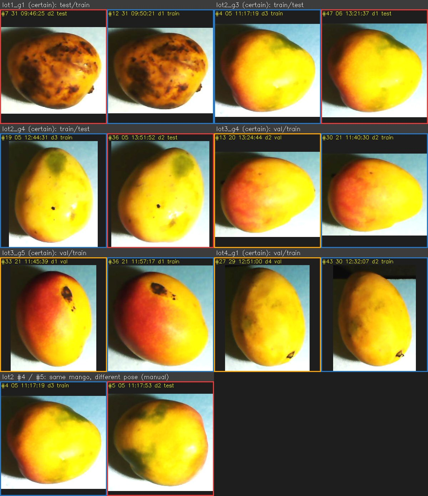
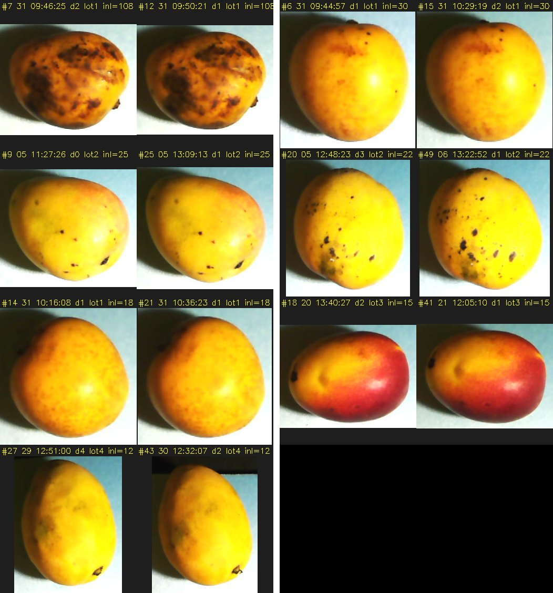
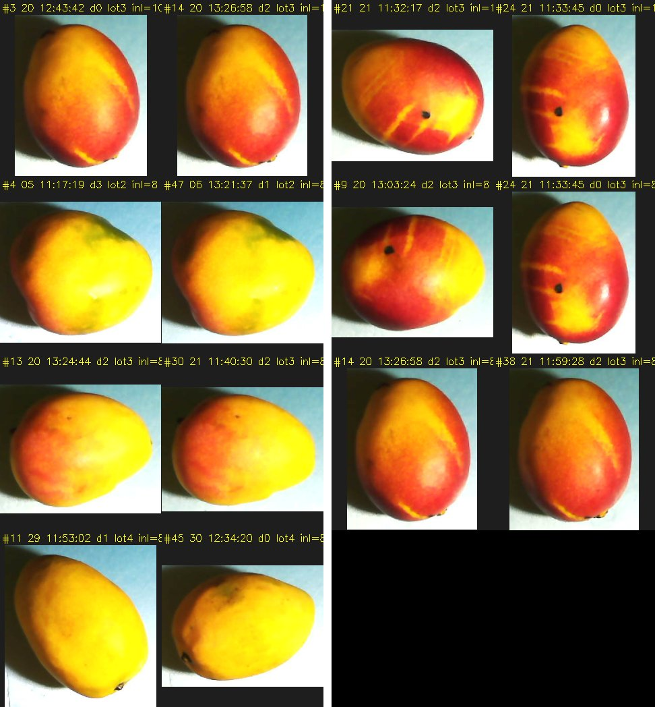
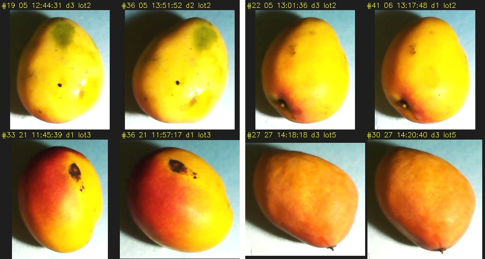
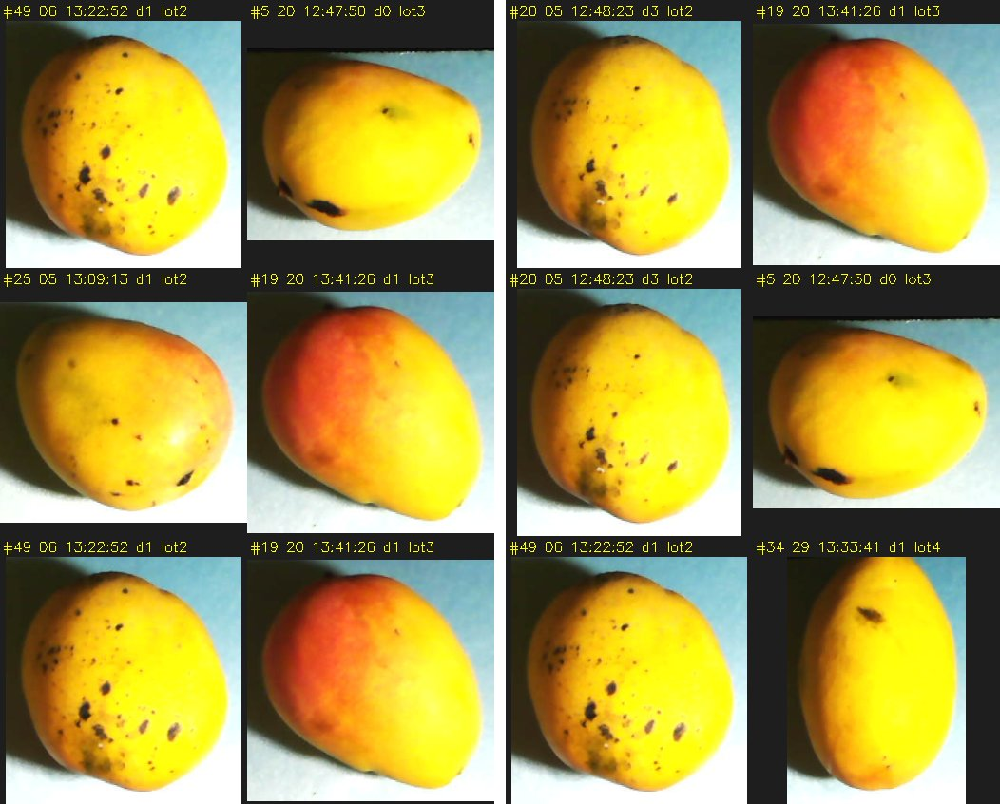

# Data leakage audit

Audit date: 2026-10-18. Scope: the 236 labeled RGB+NIR pairs of dataset v3 and the leave-one-lot-out (LOLO) folds built from them. Status: finished; the claim is limited, see [section 10](#10-what-can-and-cannot-be-claimed) and the open items in [section 12](#12-limitations-and-open-items).

## 1. Summary

**Claim.** No leakage was detected between the train, val and test splits when the model is evaluated with leave-one-lot-out folds.

| Support | Evidence |
|---|---|
| Capture protocol | The dataset owner confirmed that each capture lot used new mangos. |
| Time separation | The closest two lots are 5.02 days apart (lot1 to lot2); the others are 7.99, 13.97 and 88.90 days apart. |
| Exhaustive cross-lot search | All 21,747 image pairs from different lots were compared (SIFT + RANSAC). 6 candidates reached 8 inliers, all with homography coverage of 5% or less, and all were rejected on visual inspection. |

- It holds for both dataset variants: with duplicates (236 images) and deduplicated (218 images). Both use the same lot assignment.
- It is **not a proof**; see [section 10](#10-what-can-and-cannot-be-claimed).
- The original random per-image split `splits.json` did leak: 6 of the 16 verified same-face groups straddle its splits ([section 3](#3-the-leak-in-the-original-split)). Any metric computed on it is not comparable with LOLO results.

## 2. Dataset under audit

| Item | Value |
|---|---|
| Pairs | 236 labeled RGB+NIR pairs (each RGB stem has its NIR file with the same timestamp) |
| RGB files | 1280x720 JPEG, quality about 95 (estimated from the quantization table); all 236 have the same size |
| Capture device | Raspberry Pi (the NIR EXIF reports model `imx219`, software `rpicam-apps`) |
| Classes | 0 = mango (exactly one box per image, 236 in total), 1 = damage (368 boxes) |
| Images without damage | 50 |
| Original split `data/annotations/yolo/splits.json` | 188 train / 23 val / 25 test, assigned per image by a seeded shuffle (`scripts/prepare_yolo_splits.py`, seed 42) |

The audit compares the RGB images only. The NIR file of each pair carries the same timestamp, so the lot assignment applies to both.

## 3. The leak in the original split

Each mango was photographed on several faces, and the same mango reappears minutes to a day later. A per-image random split therefore puts the same fruit in different splits.

- lot1 #7 (05-31 09:46:25, **test**) and #12 (09:50:21, **train**) are the same face of the same heavily bruised mango (108 SIFT inliers).
- The green-patch mango of lot2: #4 (06-05 11:17:19, **train**) and #5 (11:17:53, **test**) are the same fruit in a slightly different pose, and #47 (06-06 13:21:37, **test**) is the same face as #4 a day later.

Of the 16 verified same-face groups, **6 have members in different original splits**, which involves **12 images**. This is a lower bound: only repeated faces are detectable ([section 7](#7-same-view-duplicate-audit)).

| Group | Members | Original splits |
|---|---|---|
| lot1_g1 | #7 / #12 | test / train |
| lot2_g3 | #4 / #47 | train / test |
| lot2_g4 | #19 / #36 | train / test |
| lot3_g4 | #13 / #30 | val / train |
| lot3_g5 | #33 / #36 | val / train |
| lot4_g1 | #27 / #43 | val / train |



Tile text: `#<index in the lot> <day> <local time> d<damage boxes> <original split>`. The last row is the hand-identified pair lot2 #4 / #5 (same mango, different pose), which is not a same-face pair and is not in `duplicate_groups.json`.

## 4. Can individual mangos be identified? (four attempts)

### (a) Timestamp gaps

If each mango were photographed on 4 faces in a row, the timestamps would form clean groups of 4. Over the 236 sorted timestamps (235 gaps):

| Statistic | p10 | p25 | median | p75 | p90 | p95 |
|---|---|---|---|---|---|---|
| Gap (s) | 24 | 31 | 80 | 202.5 | 516 | 1360 |

A new group starts when the gap is larger than the threshold:

| Threshold | Groups | Singletons |
|---|---|---|
| 30 s | 180 | 152 |
| 60 s | 133 | 96 |
| 120 s | 89 | 50 |

No clean 4-photo groups appear: most groups are singletons at every threshold (152 of 180 at 30 s, 50 of 89 at 120 s).

### (b) Hypothesis: the 4-per-mango rhythm is hidden by unlabeled captures

The listing of the capture bucket in OCI Object Storage has 264 RGB captures (timestamps only, versioned in [`oci_timeline.json`](leakage-audit/oci_timeline.json)). 236 of them are the labeled dataset.

| Local day | Labeled | Captured |
|---|---|---|
| 04-04 | 0 | 6 |
| 04-12 | 0 | 8 |
| 05-08 | 0 | 2 |
| 05-23 | 0 | 2 |
| 05-24 | 1 | 6 |
| 05-31 | 23 | 25 |
| 06-05 | 40 | 41 |
| 06-06 | 11 | 11 |
| 06-20 | 20 | 21 |
| 06-21 | 22 | 22 |
| 06-29 | 41 | 42 |
| 06-30 | 28 | 28 |
| 09-27 | 50 | 50 |

The 18 captures of April and May (rows with 0 labeled) are outside the dataset. Of the 9 dataset days, only 06-30 (28 captures) has a count that is a multiple of 4; the other 8 days (6, 25, 41, 11, 21, 22, 42 and 50 captures) are not. **Rejected**: counting the unlabeled captures does not recover a 4-photo rhythm.

### (c) Manual visual re-identification on contact sheets

- It works only for distinctive faces (heavy bruise, red blush, green patch). The many plain-yellow faces cannot be told apart.
- **The trap:** isolating only the distinctive faces leaks. The other faces of those same mangos are plain, and they end up in other groups (possibly in another split).
- Size feature (mango box area, thousands of px²), from `tools/mango_features.py`:

| Lot | Area range (k px²) | Note |
|---|---|---|
| lot1 | 42.5 to 54.3 | |
| lot2 | 64.7 to 98.5 | The only bimodal lot: 36 images at 64.7 to 81.2, 15 images at 90.8 to 98.5 (gap 81.2 to 90.8) |
| lot3 | 55.2 to 66.0 | |
| lot4 | 76.3 to 110.5 | |
| lot5 | 54.0 to 75.7 | |

Size cannot separate mangos except in lot 2. It also depends on camera distance, which was not controlled.

### (d) Conclusion

A leakage-free per-mango partition is **not recoverable from the images**. It needs a mango ID recorded at capture time ([section 12](#12-limitations-and-open-items)).

## 5. Grouping unit: the capture lot

The dataset owner confirmed that each lot used new mangos. Rule ([`scripts/make_grouped_folds.py`](../../scripts/make_grouped_folds.py), tracked assignment [`configs/folds/lot_5fold.json`](../../configs/folds/lot_5fold.json)): local days (America/Lima) at most 1 day apart form a lot; a lot with fewer than 5 images merges into the chronologically nearest lot (the lone 05-24 image joins 05-31).

| lot | days | images | damage boxes | negatives |
|---|---|---|---|---|
| lot1 | 05-24+05-31 | 24 | 23 | 4 |
| lot2 | 06-05+06-06 | 51 | 64 | 15 |
| lot3 | 06-20+06-21 | 42 | 44 | 14 |
| lot4 | 06-29+06-30 | 69 | 112 | 17 |
| lot5 | 09-27 | 50 | 125 | 0 |

Why consecutive days are merged: the same face was found again on the next day. 9 of the 16 verified groups have members on two consecutive days, for example lot2 #20 / #49 (06-05 to 06-06), lot2 #4 / #47, lot2 #22 / #41, lot3 #18 / #41 (06-20 to 06-21), lot3 #13 / #30, lot3 #14 / #38 and lot4 #27 / #43 (06-29 to 06-30). Splitting those days apart would leak.

## 6. Leave-one-lot-out folds

Fold k: test = lot k, val = lot k+1 (mod 5), train = the other three lots.

| Fold | Test | Val | Train | Images train / val / test | Damage boxes train / val / test | Min gap train to val or test (days) |
|---|---|---|---|---|---|---|
| 0 | lot1 | lot2 | lot3, lot4, lot5 | 161 / 51 / 24 | 281 / 64 / 23 | 13.97 |
| 1 | lot2 | lot3 | lot1, lot4, lot5 | 143 / 42 / 51 | 260 / 44 / 64 | 5.02 |
| 2 | lot3 | lot4 | lot1, lot2, lot5 | 125 / 69 / 42 | 212 / 112 / 44 | 13.97 |
| 3 | lot4 | lot5 | lot1, lot2, lot3 | 117 / 50 / 69 | 131 / 125 / 112 | 7.99 |
| 4 | lot5 | lot1 | lot2, lot3, lot4 | 162 / 24 / 50 | 220 / 23 / 125 | 5.02 |

Gap between consecutive lots (last capture of one to first capture of the next):

| From | To | Gap (days) |
|---|---|---|
| lot1 (last 05-31 10:38) | lot2 (first 06-05 11:11) | 5.02 |
| lot2 (last 06-06 13:23) | lot3 (first 06-20 12:35) | 13.97 |
| lot3 (last 06-21 12:08) | lot4 (first 06-29 11:47) | 7.99 |
| lot4 (last 06-30 13:14) | lot5 (first 09-27 10:50) | 88.90 |

`make_grouped_folds.py --check` reproduces the tracked assignment (output: `OK: the regenerated folds match .../configs/folds/lot_5fold.json`).

**Known weakness:** the folds are unequal in size and in damage content (test damage boxes range from 23 to 125, lot5 has no negatives).

## 7. Same-view duplicate audit

**Method** ([`tools/dup_detect.py`](leakage-audit/tools/dup_detect.py)): SIFT restricted to the fruit (box crop, ellipse mask), Lowe ratio test, RANSAC homography, a coverage score (share of the fruit mask covered by the convex hull of the inliers, the smaller of the two images' values), then visual verification on contact sheets. Parameters: nfeatures 2000, CLAHE clip 2.0 tile 8x8, crop long side 400 px, ellipse 0.42 of the box, ratio 0.75, RANSAC reprojection 5.0 px, candidates at 12 inliers (default) and at 8.

**Results**

- Exact byte duplicates (MD5 of the RGB files): none.
- **16 groups / 34 images / 18 removable images** (17 certain + 1 probable). Machine-readable list: [`configs/folds/duplicate_groups.json`](../../configs/folds/duplicate_groups.json).
- The detected pairs of the accepted groups have a coverage of 0.031 to 0.725 (the lowest is lot3 #33-#36, a slightly rotated pair whose inliers cover a small area); the cross-lot candidates in [section 8](#8-cross-lot-verification) have 0.049 or less. Coverage alone therefore does not separate the two sets: the visual check decides.

| Group | Status | # (capture order) | Local time | Stem `mango_rgb_` | Original split | Damage boxes | Pair evidence (inliers / coverage) | Kept |
|---|---|---|---|---|---|---|---|---|
| lot1_g1 | certain | #7 / #12 | 05-31 09:46:25 / 05-31 09:50:21 | 1780238785 / 1780239021 | test / train | 2 / 1 | #7-#12: 108 / 0.725 | #7 |
| lot1_g2 | certain | #6 / #15 | 05-31 09:44:57 / 05-31 10:29:19 | 1780238697 / 1780241359 | train / train | 1 / 2 | #6-#15: 30 / 0.472 | #15 |
| lot1_g3 | certain | #14 / #21 | 05-31 10:16:08 / 05-31 10:36:23 | 1780240568 / 1780241783 | train / train | 1 / 1 | #14-#21: 18 / 0.494 | #14 |
| lot2_g1 | certain | #9 / #25 | 06-05 11:27:26 / 06-05 13:09:13 | 1780676846 / 1780682953 | train / train | 0 / 1 | #9-#25: 25 / 0.627 | #25 |
| lot2_g2 | certain | #20 / #49 | 06-05 12:48:23 / 06-06 13:22:52 | 1780681703 / 1780770172 | train / train | 3 / 1 | #20-#49: 22 / 0.291 | #20 |
| lot2_g3 | certain | #4 / #47 | 06-05 11:17:19 / 06-06 13:21:37 | 1780676239 / 1780770097 | train / test | 3 / 1 | #4-#47: 8 / 0.408 * | #4 |
| lot2_g4 | certain | #19 / #36 | 06-05 12:44:31 / 06-05 13:51:52 | 1780681471 / 1780685512 | train / test | 3 / 2 | #19-#36: 10 / 0.093 * | #19 |
| lot2_g5 | certain | #22 / #41 | 06-05 13:01:36 / 06-06 13:17:48 | 1780682496 / 1780769868 | train / train | 3 / 1 | #22-#41: 9 / 0.171 * | #22 |
| lot3_g1 | certain | #18 / #41 | 06-20 13:40:27 / 06-21 12:05:10 | 1781980827 / 1782061510 | train / train | 2 / 1 | #18-#41: 15 / 0.410 | #18 |
| lot3_g2 | certain | #3 / #14 / #38 | 06-20 12:43:42 / 06-20 13:26:58 / 06-21 11:59:28 | 1781977422 / 1781980018 / 1782061168 | train / train / train | 0 / 2 / 2 | #3-#14: 10 / 0.316 *; #14-#38: 8 / 0.353 *; #3-#38: not detected | #14 |
| lot3_g3 | certain | #9 / #21 / #24 | 06-20 13:03:24 / 06-21 11:32:17 / 06-21 11:33:45 | 1781978604 / 1782059537 / 1782059625 | train / train / train | 2 / 2 / 0 | #9-#24: 8 / 0.210 *; #21-#24: 10 / 0.208 *; #9-#21: not detected | #9 |
| lot3_g4 | certain | #13 / #30 | 06-20 13:24:44 / 06-21 11:40:30 | 1781979884 / 1782060030 | val / train | 2 / 2 | #13-#30: 8 / 0.239 * | #13 |
| lot3_g5 | certain | #33 / #36 | 06-21 11:45:39 / 06-21 11:57:17 | 1782060339 / 1782061037 | val / train | 1 / 1 | #33-#36: 13 / 0.031 | #33 |
| lot4_g1 | certain | #27 / #43 | 06-29 12:51:00 / 06-30 12:32:07 | 1782755460 / 1782840727 | val / train | 4 / 2 | #27-#43: 12 / 0.430 | #27 |
| lot4_g2 | probable | #11 / #45 | 06-29 11:53:02 / 06-30 12:34:20 | 1782751982 / 1782840860 | train / train | 1 / 0 | #11-#45: 8 / 0.308 * | #11 |
| lot5_g1 | certain | #27 / #30 | 09-27 14:18:18 / 09-27 14:20:40 | 1790536698 / 1790536840 | train / train | 3 / 3 | #27-#30: 8 / 0.154 * | #27 |

`*` = found only at 8 inliers (`MIN_N=8`); the others are found at the default 12. The keep rule is: most damage boxes (class 1), earliest timestamp on a tie. Members of a triple that were not matched directly (lot3 #3-#38, #9-#21) are linked through the third member and confirmed by eye. Groups lot2_g4, lot2_g5, lot3_g5 and lot5_g1 were added after a second pass over the within-lot detector pairs that were first left out; the dataset owner confirmed each by eye as the same face (certain).







**Label inconsistency.** In **12 of the 16 groups (11 of the 15 certain ones)** the same face carries a different number of damage boxes in its two or three photographs. Examples: lot2 #4 has 3 boxes and #47 has 1; lot2 #20 has 3 and #49 has 1; lot3 #3 has 0 and #14 has 2; lot3 #24 has 0 and #9 has 2. Only lot1_g3 (1 / 1), lot3_g4 (2 / 2), lot3_g5 (1 / 1) and lot5_g1 (3 / 3) agree. These photographs need re-annotation before the damage labels can be trusted at the box level.

**Recall caveat.** Textureless skins give too few SIFT features, so the list is a lower bound. Lot 5 yielded no pair at the default 12 inliers; its one verified duplicate (#27 / #30) was found only at `MIN_N=8` (8 inliers, coverage 0.154). 8 of the 16 groups had no pair at 12 inliers and were found only at 8, so more may sit below that threshold.

**Within-lot candidates that were not accepted.** Six more within-lot pairs appear in the two detector runs. None was confirmed as a same-face duplicate, so none is in `duplicate_groups.json`.

| Pair | Inliers | Coverage | Found at | Note |
|---|---|---|---|---|
| lot1 #20 / #24 | 12 | 0.052 | 12 | Not accepted |
| lot1 #11 / #20 | 8 | 0.016 | 8 | Not accepted |
| lot2 #39 / #41 | 10 | 0.029 | 8 | Not accepted (different mangos) |
| lot3 #11 / #36 | 10 | 0.032 | 8 | Not accepted (different mangos) |
| lot3 #7 / #26 | 9 | 0.138 | 8 | Not accepted (different mangos) |
| lot3 #38 / #40 | 9 | 0.189 | 8 | Not accepted (different pose of the lot3_g2 mango) |

None of the same-face groups changes the leakage status, because each group sits inside one lot. Two of the four groups added in the second pass (lot2_g4 and lot3_g5) do straddle the original random split ([section 3](#3-the-leak-in-the-original-split)).

## 8. Cross-lot verification

Every pair of images from different lots was compared: 21,747 pairs (236·235/2 = 27,730, minus 5,983 within-lot pairs). At 8 inliers there are 6 candidates, all with homography coverage of 5% or less:

| lot / # | lot / # | inliers | coverage |
|---|---|---|---|
| lot2 #49 | lot3 #5 | 17 | 0.00 |
| lot2 #20 | lot3 #19 | 16 | 0.00 |
| lot2 #25 | lot3 #19 | 13 | 0.049 |
| lot2 #20 | lot3 #5 | 12 | 0.00 |
| lot2 #49 | lot3 #19 | 12 | 0.003 |
| lot2 #49 | lot4 #34 | 11 | 0.014 |

All were **rejected on visual inspection: different faces**. The densely speckled lot-2 mango (#20 / #49) matches spuriously: the inliers sit in a tiny area, which is what coverage near 0 means.



## 9. Two dataset variants

- **With duplicates:** all 236 images.
- **Deduplicated:** drop the 18 non-kept members of the 16 groups (keep rule in section 7).

| Lot | With duplicates: images / damage boxes / negatives | Deduplicated: images / damage boxes / negatives |
|---|---|---|
| lot1 | 24 / 23 / 4 | 21 / 20 / 4 |
| lot2 | 51 / 64 / 15 | 46 / 59 / 14 |
| lot3 | 42 / 44 / 14 | 35 / 36 / 12 |
| lot4 | 69 / 112 / 17 | 67 / 110 / 16 |
| lot5 | 50 / 125 / 0 | 49 / 122 / 0 |
| **Total** | **236 / 368 / 50** | **218 / 347 / 46** |

Deduplicated fold sizes (train / val / test): f0 151 / 46 / 21, f1 137 / 35 / 46, f2 116 / 67 / 35, f3 102 / 49 / 67, f4 148 / 21 / 49.

Both variants use the same lot assignment, so the leakage status is identical. Duplicates inside a lot are **not leakage under leave-one-lot-out** (a lot is never split), but they would be under any split within a lot. Nothing in the training code reads `duplicate_groups.json` yet; it is the input for building the deduplicated variant.

## 10. What can and cannot be claimed

**Can claim:** "no leakage detected between splits under leave-one-lot-out", with its three supports: the capture protocol, the 5-day minimum separation between lots and the exhaustive cross-lot search of repeated views.

**Cannot claim: a proof.** SIFT detects only repeated faces. It does not detect the reuse of a mango through a different or textureless face.

**Riskiest boundary: lot1 to lot2 (5.02 days).** Supporting evidence that it is fine:

- The lot-2 mangos look less ripe (red blush, green patches) than the lot-1 mangos (uniformly orange-yellow with brown speckles), which is inconsistent with the same fruit 5 days later.
- Their box areas do not overlap (lot1 42.5 to 54.3, lot2 64.7 to 98.5 k px²). This is weak support, because the camera distance was not controlled.

**Every within-lot split leaks**, even after deduplication: a random split, or a per-mango split with uncertain IDs, puts faces of the same mango on both sides.

### Suggested thesis wording (Spanish)

> **Partición de los datos y control de fuga.** Las 236 imágenes se agruparon por lote de captura: los días calendario consecutivos (zona horaria America/Lima) forman un lote, y los lotes de menos de cinco imágenes se fusionan con el lote más cercano en el tiempo. Se obtuvieron cinco lotes y la evaluación se realizó con validación cruzada dejando un lote fuera: en cada pliegue, un lote se reserva para prueba, el siguiente para validación y los tres restantes para entrenamiento. Se eligió el lote como unidad de agrupación porque cada lote empleó mangos nuevos y porque no fue posible reconstruir la identidad individual de cada mango a partir de las imágenes ni de sus marcas de tiempo (cada mango se fotografió por varias caras y reaparece minutos u horas después). La separación temporal mínima entre lotes distintos es de 5,02 días.
>
> **Verificación.** Se compararon mediante SIFT, RANSAC y verificación visual las 21 747 parejas de imágenes pertenecientes a lotes distintos. Seis parejas alcanzaron ocho coincidencias geométricamente consistentes, y todas se descartaron por inspección visual, ya que corresponden a caras distintas. Dentro de cada lote se identificaron 16 grupos de fotografías repetidas de la misma cara (18 imágenes prescindibles). No constituyen fuga con este esquema, porque cada lote permanece completo en una sola partición, y los resultados se reportan con y sin estas imágenes.
>
> **Afirmación.** «No se detectó fuga de datos entre las particiones de entrenamiento, validación y prueba con la validación cruzada dejando un lote fuera. La independencia entre lotes se sustenta en el protocolo de captura (mangos nuevos en cada lote), en una separación mínima de cinco días entre lotes y en una búsqueda exhaustiva de vistas repetidas entre lotes, que no encontró coincidencias.» Esta afirmación no constituye una prueba: el método solo detecta repeticiones de una misma cara visible y no permite descartar que un mismo mango reaparezca en otro lote por una cara distinta o sin textura. La partición aleatoria por imagen utilizada inicialmente sí presentaba fuga (6 de los 16 grupos verificados de caras repetidas quedaban repartidos entre particiones), por lo que sus resultados no deben compararse directamente con los obtenidos con la validación cruzada por lotes.

## 11. Effect on reported metrics

Leave-one-lot-out results of the ROI-crop arm (`twostream_roi_crop`, seed 42, no early stopping with `patience=1000`, checkpoint selected on `damage_ap50`, ROI crop margin 0.1). Source: the `metrics.json` files in [`reports/kfold_lot/twostream_roi_crop/`](../../reports/kfold_lot/twostream_roi_crop/), damage class (id 1).

| Fold | Test lot | Test damage AP50 | Val lot | Val damage AP50 | Test recall | Test precision | Best epoch |
|---|---|---|---|---|---|---|---|
| 0 | lot1 | 0.107 | lot2 | 0.307 | 0.174 | 0.012 | 80 |
| 1 | lot2 | 0.105 | lot3 | 0.100 | 0.500 | 0.024 | 77 |
| 2 | lot3 | 0.043 | lot4 | 0.089 | 0.795 | 0.025 | 61 |
| 3 | lot4 | 0.028 | lot5 | 0.074 | 0.482 | 0.031 | 47 |
| 4 | lot5 | 0.005 | lot1 | 0.029 | 0.088 | 0.004 | 3 |
| **Mean ± sd (ddof=1)** | | **0.058 ± 0.046** | | **0.120 ± 0.108** | 0.41 | 0.02 | |

Recall and precision are read at the `conf_threshold` operating point. The best epochs come from the runner log (`logs/kfold_lot/crop_seed42.log`, not versioned).

- **This is not a controlled comparison with the earlier 0.398.** That number is the full-frame teacher on the leaky random split; the arm, the split and the protocol all differ, so this audit does not measure how much of it was leakage.
- **Fold 4 caveat:** its val lot (lot1, 24 images) never rose above 0.03 damage AP50 in 100 epochs (maximum 0.0285, at epoch 3), so the selection kept the epoch-3 checkpoint and the fold-4 test number comes from a checkpoint saved after 3 of 100 epochs.
- Mango-class AP50 is 0.000 in folds 2, 3 and 4 (val and test; no true positive). This was not investigated here.
- With five folds and one seed, the standard deviation across folds (0.046) is close to the mean (0.058); see section 12.

## 12. Limitations and open items

- [ ] **Textureless duplicates may be missed.** The 16 groups are a lower bound: half of them were found only at 8 inliers (section 7).
- [ ] **Inconsistent damage labels inside duplicate groups** (12 of 16 groups) need re-annotation.
- [ ] **Single seed** (42) for the LOLO run.
- [ ] **Small, unbalanced lots** (24 to 69 images, 23 to 125 damage boxes per lot), and n = 5 folds.
- [ ] **Mango-class AP50 of 0.000** in folds 2, 3 and 4 (section 11) is unexplained.
- [ ] **Mango identity at capture time.** Record a mango ID so a per-mango split becomes possible, for example a numbered tag on the tray outside the fruit crop, or a filename suffix.

## 13. Reproduction

The raw data is git-ignored (`data/`); restore it with `unzip data/mango_dataset_v3.zip -d data/` on a new machine. The tools need `opencv-python` (with SIFT) and `numpy`. All commands run on CPU:

```bash
# Folds (writes data/annotations/yolo/folds_lot/ and the tracked assignment) and the drift check
CUDA_VISIBLE_DEVICES="" python scripts/make_grouped_folds.py
CUDA_VISIBLE_DEVICES="" python scripts/make_grouped_folds.py --check

# Same-view duplicate detection: 12 inliers (default) and 8 inliers
CUDA_VISIBLE_DEVICES="" python docs/data/leakage-audit/tools/dup_detect.py --out-dir /tmp/audit
CUDA_VISIBLE_DEVICES="" python docs/data/leakage-audit/tools/dup_detect.py --out-dir /tmp/audit --min-n 8 --suffix _n8

# Contact sheets and per-image features (lot ids: lot1 .. lot5)
CUDA_VISIBLE_DEVICES="" python docs/data/leakage-audit/tools/mango_sheets.py --out-dir /tmp/audit sheet lot2 1 27 lot2_a.png
CUDA_VISIBLE_DEVICES="" python docs/data/leakage-audit/tools/mango_features.py lot2 --out-dir /tmp/audit

# duplicate_groups.json (verified groups as capture-order indices, stems read from the data) and the split-leak figure
CUDA_VISIBLE_DEVICES="" python docs/data/leakage-audit/tools/build_duplicate_groups.py
CUDA_VISIBLE_DEVICES="" python docs/data/leakage-audit/tools/make_leak_figure.py
```

Pass `--repo-root <checkout-with-data>` to the tools when the data lives in another checkout. `dup_detect.py` at 12 and at 8 inliers reproduces the candidate pairs of this audit exactly (same pairs, inliers and coverage). The contact-sheet figures were converted from PNG to JPEG (quality 85) because `*.png` is git-ignored.

| Artifact | Purpose |
|---|---|
| [`configs/folds/lot_5fold.json`](../../configs/folds/lot_5fold.json) | Lot and fold assignment (tracked) |
| [`configs/folds/duplicate_groups.json`](../../configs/folds/duplicate_groups.json) | Verified same-face groups with the keep rule |
| [`leakage-audit/tools/`](leakage-audit/tools/) | Analysis tools (not part of the training pipeline) |
| [`leakage-audit/figures/`](leakage-audit/figures/) | Contact sheets and the split-leak figure |
| [`leakage-audit/oci_timeline.json`](leakage-audit/oci_timeline.json) | Capture timestamps of the OCI listing (section 4b) |
| [`reports/kfold_lot/twostream_roi_crop/`](../../reports/kfold_lot/twostream_roi_crop/) | `val` and `test` `metrics.json` of the 5 folds (section 11) |

Not versioned on purpose: `reports/kfold_lot/kfold_results.md` and `.json`. Their "paired difference" section compares the single arm with itself (aggregator bug) and must be ignored.
