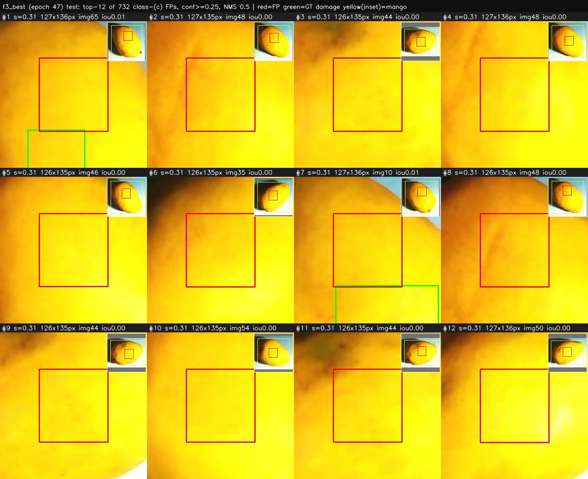
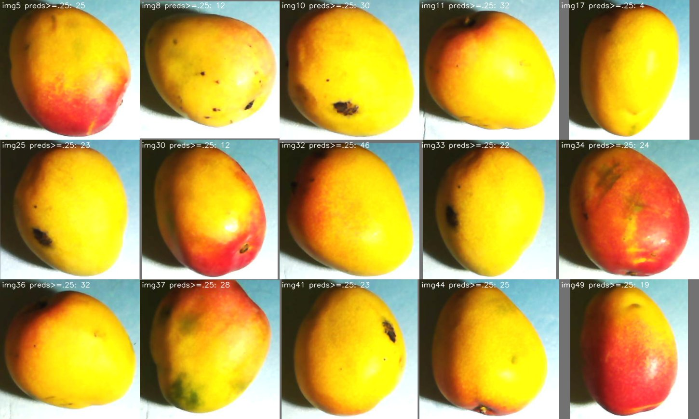
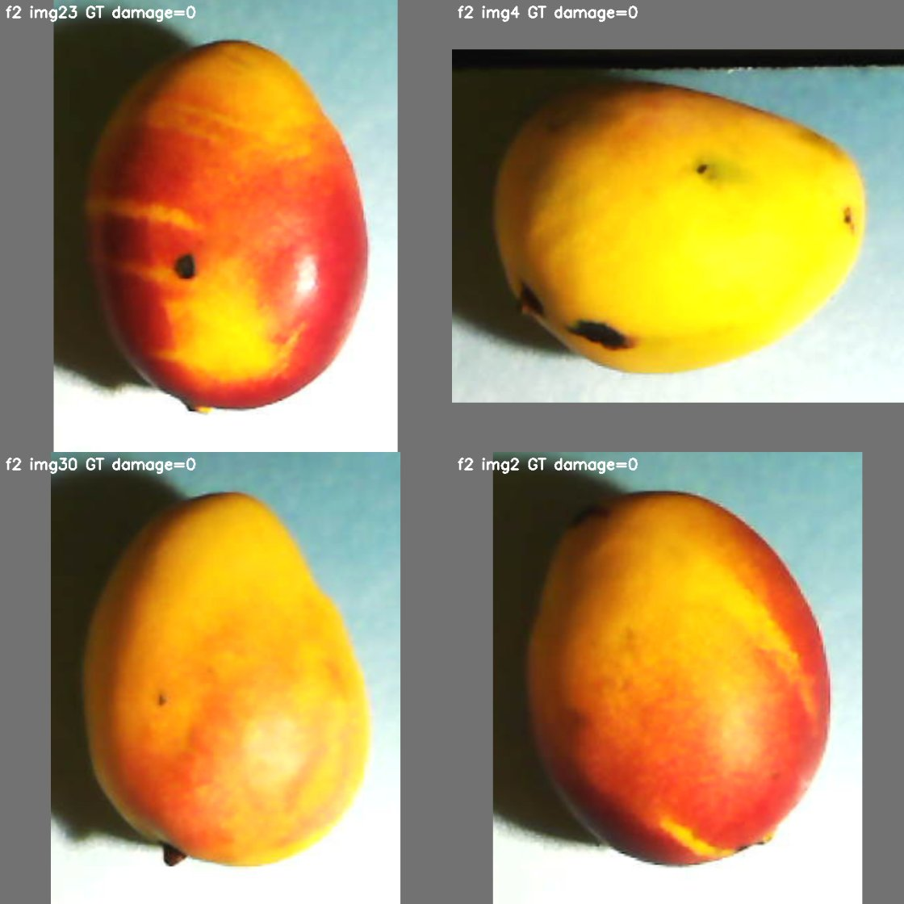
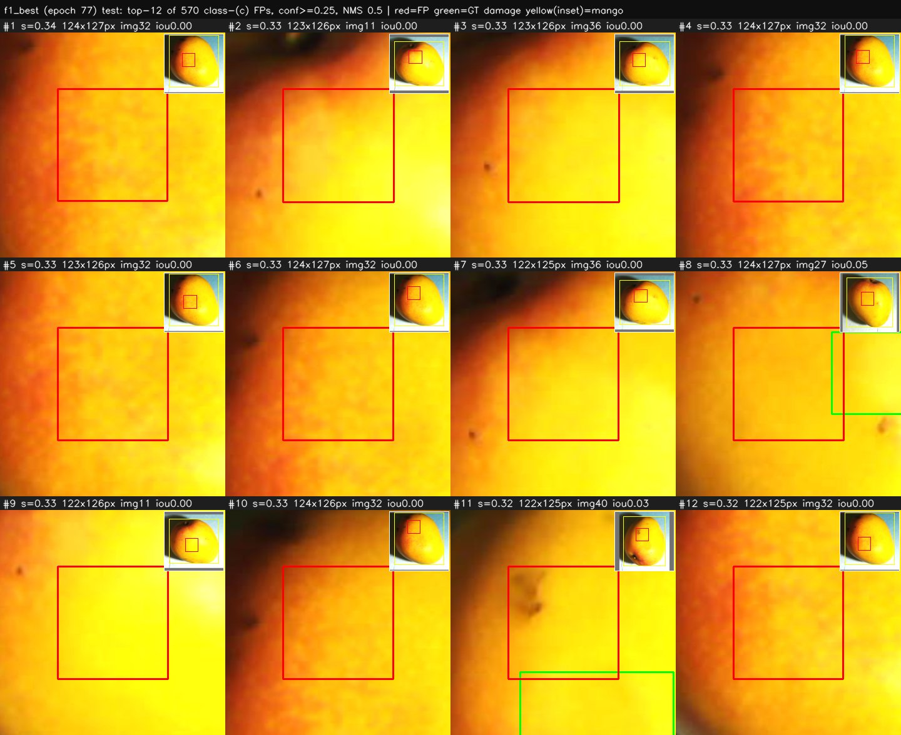
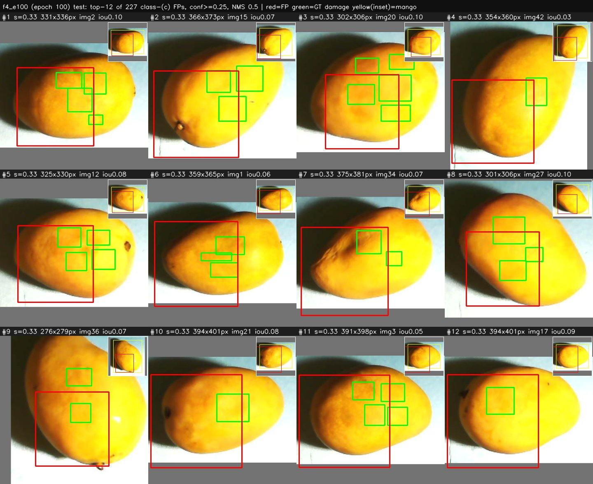
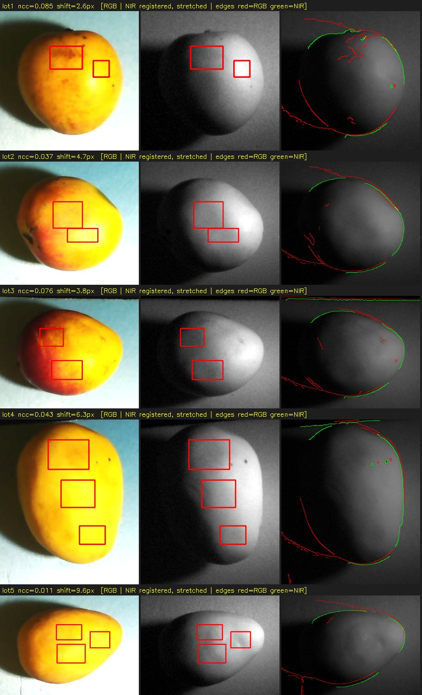

# Findings of 2026-10-18: why the damage AP50 is low, and what to change

| | |
|:--|:--|
| **Date** | 2026-10-18 (analyses run 2026-10-16 to 2026-10-18) |
| **Scope** | Diagnosis of the leave-one-lot-out (LOLO) baseline of [`twostream_roi_crop.yaml`](../../../configs/experiment/twostream_roi_crop.yaml): training stability, what the false positives are, how much the registered NIR adds, and the capture protocol. |
| **Status** | Findings 1-3 are measured on existing checkpoints and labels. Finding 4 is a design plus a capture script that **has not been run on the Pi**. The stabilization of section 5 is implemented but **not trained yet**. |
| **Compute** | Every analysis here ran on the CPU (the commands below set `CUDA_VISIBLE_DEVICES=""`); no model was trained. |
| **Evidence** | [Evidence index and reproduction commands](#8-evidence-index-and-reproduction) |
| **See also** | [Capture calibration with diffusers and the first calibrated capture](capture-calibration.md): final settings, script v2.2 and the findings on one impacted mango. |

## Related work

| PR | What | State |
|:--|:--|:--|
| [#27](https://github.com/gabrielWYP/MCP_Agent/pull/27) | Mango ROI crop before the letterbox | merged |
| [#28](https://github.com/gabrielWYP/MCP_Agent/pull/28) | Eval is bound to the checkpoint's ROI crop and never jitters | merged |
| [#29](https://github.com/gabrielWYP/MCP_Agent/pull/29) | Lot-grouped folds, resumable runner, aggregator | merged |
| [#32](https://github.com/gabrielWYP/MCP_Agent/pull/32) | Leakage audit (`docs/data/leakage-audit.md`) | open, not merged |
| [#33](https://github.com/gabrielWYP/MCP_Agent/pull/33) | GroupNorm neck and weight EMA (section 5) | open, not trained |

## Baseline being diagnosed

The LOLO run of `configs/experiment/twostream_roi_crop.yaml`: seed 42, `patience=1000` (so no early stop), checkpoint selection on `damage_ap50`, GTX 1660S with physical batch 2 x gradient accumulation 4 = effective batch 8, 100 epochs per fold. Fold k holds out lot k+1 for test; the validation lot is another lot. Crop-based numbers use the **oracle ROI** (the crop window comes from the ground-truth mango box, see `src/training/roi_crop.py`), so they are an upper bound for a pipeline that has to detect the mango first.

| fold | test lot | test images | test damage GT | selected epoch | val AP50 damage | **test AP50 damage** |
|:--|:--|--:|--:|--:|--:|--:|
| 0 | lot1 | 24 | 23 | 80 | 0.307 | **0.107** |
| 1 | lot2 | 51 | 64 | 77 | 0.100 | **0.105** |
| 2 | lot3 | 42 | 44 | 61 | 0.089 | **0.043** |
| 3 | lot4 | 69 | 112 | 47 | 0.074 | **0.028** |
| 4 | lot5 | 50 | 125 | 3 | 0.029 | **0.005** |
| mean +- sd (n = 5) | | | | | 0.120 +- 0.108 | **0.058 +- 0.046** |

The sd is the sample standard deviation across the five folds. Test AP50 was re-derived from the cached head outputs (NMS 0.5, as trained, table 2.2) and cross-checked by running the repo's own `evaluate_checkpoint.py` on three checkpoints (identical, see [evidence/literal_check](evidence/literal_check/)).

### At a glance

| # | Finding | Strength of the evidence | Consequence |
|:--|:--|:--|:--|
| 1 | Training is **unstable, not overfitting**; checkpoint selection is close to random (3 of 5 folds selected an epoch where the mango class had collapsed). | Strong: per-epoch metrics of all folds. | Run the stabilized config (GroupNorm + EMA), section 5. |
| 2 | The false positives are a **low-confidence plateau of near-constant boxes** (no score above 0.41 in folds 1-4). Poor localization and a **positional prior created by the impact protocol and the ROI crop** dominate; NMS is minor. | Strong on counts and the prior baseline; the visual audit is a single-rater judgement. | Break the prior with spatial augmentation; report AP@0.3 next to AP@0.5. |
| 3 | The **registered NIR adds nothing** in a per-pixel proxy (RGB 0.709, RGB+NIR 0.693, NIR 0.622 AUC). | Weak: the proxy ignores spatial features. | Run the NIR-ablation. |
| 4 | The capture protocol has avoidable **domain shift**; script v2.1 fixes the settings and records impact metadata. | Design only; not tested on the Pi. | Recapture with protocol v2. |

## Damage annotation protocol (confirmed by the dataset owner, 2026-10-18)

| Item | Protocol |
|:--|:--|
| Damage is **induced** | A 66 g steel ball is dropped from 50 cm onto the mango: 0.066 kg x 9.81 m/s^2 x 0.5 m = **0.32 J** per impact. |
| How the boxes are labeled | Empirically, from the **known impact location**, corroborated with the **NIR photograph**, where the owner finds the damage appreciable. |
| Label quality | The owner states that the labels carry a margin of error, accepted as a limitation of the study. |
| What is *not* damage | Natural black spots, lenticels and blemishes are **not damage by design**. |

Consequences used throughout this document:

1. A test image without damage boxes that shows black spots is a **correct negative**, not a missing label. A detector that fires on those spots makes genuine false positives (section 2.8).
2. The boxes are empirical and the damage is amorphous, so strict IoU 0.5 is a harsh yardstick. This motivates AP@0.3 next to AP@0.5 (section 2.3).
3. Because the impact location follows a protocol, the damage sits in a narrow region of the fruit. Together with the ROI crop, which always centers the mango, this is the origin of the model's **positional prior** (section 2.7).
4. The v1 capture script recorded none of the impact data (impacted or not, face, location, time since impact). Script v2.1 does (section 4.4). Bruise visibility changes with the time since impact, so this matters for the NIR question in section 3.

## 1. Finding 1: training is unstable, not overfitting

**Evidence.** Per-epoch metrics of the baseline run (`metrics_history.csv`, 100 epochs per fold). Epochs shown: 1, 5, 10, 20, then every 10. "val" columns are the validation lot at conf 0.25.

Fold 1 (selected epoch 77):

| epoch | train cls_loss | train box_loss | val AP50 damage | val TP | val FP | val FN | val AP50 mango |
| :-- | --: | --: | --: | --: | --: | --: | --: |
| 1 | 2.649 | 1.028 | 0.0000 | 0 | 6619 | 44 | 0.0000 |
| 5 | 1.558 | 0.775 | 0.0029 | 0 | 289 | 44 | 0.1063 |
| 10 | 1.442 | 0.575 | 0.0014 | 0 | 586 | 44 | 0.1206 |
| 20 | 1.464 | 0.541 | 0.0094 | 0 | 481 | 44 | 0.1977 |
| 30 | 1.368 | 0.551 | 0.0026 | 1 | 670 | 43 | 0.1991 |
| 40 | 1.276 | 0.538 | 0.0078 | 1 | 707 | 43 | 0.3956 |
| 50 | 1.256 | 0.520 | 0.0099 | 2 | 409 | 42 | 0.6961 |
| 60 | 1.176 | 0.506 | 0.0162 | 18 | 990 | 26 | 0.9652 |
| 70 | 1.121 | 0.492 | 0.0353 | 29 | 1202 | 15 | 0.9575 |
| 80 | 1.147 | 0.488 | 0.0543 | 25 | 979 | 19 | 0.9287 |
| 90 | 1.082 | 0.484 | 0.0361 | 27 | 1206 | 17 | 0.9708 |
| 100 | 1.091 | 0.473 | 0.0321 | 27 | 956 | 17 | 0.9758 |

Fold 3 (selected epoch 47):

| epoch | train cls_loss | train box_loss | val AP50 damage | val TP | val FP | val FN | val AP50 mango |
| :-- | --: | --: | --: | --: | --: | --: | --: |
| 1 | 2.431 | 1.080 | 0.0000 | 0 | 14991 | 125 | 0.0000 |
| 5 | 1.337 | 0.562 | 0.0000 | 0 | 14598 | 125 | 0.0000 |
| 10 | 1.419 | 0.534 | 0.0000 | 0 | 472 | 125 | 0.0000 |
| 20 | 1.321 | 0.535 | 0.0107 | 0 | 0 | 125 | 0.0000 |
| 30 | 1.125 | 0.479 | 0.0457 | 0 | 102 | 125 | 0.0000 |
| 40 | 1.091 | 0.500 | 0.0310 | 3 | 281 | 122 | 0.9630 |
| 50 | 1.064 | 0.480 | 0.0416 | 36 | 537 | 89 | 0.0000 |
| 60 | 1.027 | 0.475 | 0.0060 | 0 | 131 | 125 | 0.9790 |
| 70 | 1.025 | 0.482 | 0.0208 | 49 | 2180 | 76 | 0.0263 |
| 80 | 0.964 | 0.449 | 0.0161 | 28 | 1592 | 97 | 0.9948 |
| 90 | 0.920 | 0.435 | 0.0162 | 27 | 1737 | 98 | 0.9952 |
| 100 | 0.989 | 0.434 | 0.0128 | 22 | 1749 | 103 | 0.9964 |

Key points:

- **Fold 3 flips between epochs.** Val damage TP is 36, 0 and 49 at epochs 50, 60 and 70. The mango AP50 jumps between 0.000 and 0.96-1.00 (0.963, 0.000, 0.979, 0.026, 0.995 at epochs 40, 50, 60, 70, 80). Fold 1 settles after epoch 60 but its damage TP still moves 18 -> 29 -> 25 -> 27 -> 27.
- **Not overfitting.** The training classification loss is still around 1.0 at epoch 100 (0.84, 1.09, 1.03, 0.99, 1.21 for folds 0-4) and the validation metrics oscillate from one epoch to the next, which smooth overfitting would not produce.
- **This explains the earlier open item "mango AP50 = 0 in folds 2-4".** Checkpoints are selected on damage AP50 only. In folds 2, 3 and 4 the best-damage epoch landed on an epoch where the mango class had collapsed (mango AP50 0.000 at the selected epoch). Collapses are common: after epoch 30, the mango AP50 is below 0.1 in 21, 0, 25, 21 and 24 of the 70 epochs of folds 0-4.

| fold | selected epoch | val AP50 damage | val AP50 mango at that epoch | val TP damage | optimizer steps / epoch | epochs > 30 with mango AP50 < 0.1 (of 70) | train cls_loss @ ep 100 |
| :-- | --: | --: | --: | --: | --: | --: | --: |
| f0 | 80 | 0.307 | 0.981 | 38 | 20 | 21 | 0.84 |
| f1 | 77 | 0.100 | 0.952 | 29 | 18 | 0 | 1.09 |
| f2 | 61 | 0.089 | 0.000 | 69 | 16 | 25 | 1.03 |
| f3 | 47 | 0.074 | 0.000 | 63 | 15 | 21 | 0.99 |
| f4 | 3 | 0.029 | 0.000 | 14 | 21 | 24 | 1.21 |

- **A likely mechanism: BatchNorm with micro-batches.** BatchNorm exists in only **3 layers** of the master model, the `DualFPN` fusion convs of the cross-attention neck (`src/models/master/neck.py`; the count is the one reported in PR #33). With a physical batch of 2 their batch statistics are very noisy, and gradient accumulation does not change that, because BatchNorm normalizes each micro-batch on its own. Every fold has only 15-21 optimizer steps per epoch, so the live weights at the end of any epoch are a noisy sample. This mechanism is a hypothesis consistent with the data, not a proven cause.
- **Selection amplifies the noise.** Taking the maximum of a noisy per-epoch series is optimistic: the mean validation AP50 at the selected epoch is 0.120, twice the mean test AP50 of 0.058 (lot shift also contributes, so the gap is not attributable to selection alone).

**Prior evidence that averaging weights helps** (fold 0, 60 epochs, **unregistered NIR**, older pipeline, one seed; `origin/feat/kfold-stability`, copied to [evidence/stability](evidence/stability/)):

| fold 0, 60 epochs | best val AP50 damage (epoch) | mean of last 10 epochs | max epoch-to-epoch jump | mean epoch-to-epoch jump |
| :-- | --: | --: | --: | --: |
| baseline (BatchNorm, no EMA) | 0.174 (29) | 0.1115 | 0.1102 | 0.0292 |
| EMA (decay 0.99) | 0.174 (47) | 0.1355 | 0.0666 | 0.0180 |

EMA keeps the same best (0.174), raises the mean of the last 10 epochs from 0.111 to 0.136 and cuts the largest jump from 0.110 to 0.067. This is weak evidence (one seed, one fold, different pipeline).

**False positives per test image are high.** At conf 0.25, NMS 0.5:

| checkpoint | test images | damage predictions >= 0.25 | FP | FP per image |
| :-- | --: | --: | --: | --: |
| f0 (ep 80) | 24 | 326 | 322 | 13.4 |
| f1 (ep 77) | 51 | 1313 | 1281 | 25.1 |
| f2 (ep 61) | 42 | 1405 | 1370 | 32.6 |
| f3 (ep 47) | 69 | 1730 | 1676 | 24.3 |
| f4 (ep 3, degenerate) | 50 | 2521 | 2510 | 50.2 |
| f4 (ep 100) | 50 | 359 | 359 | 7.2 |

The crop LOLO folds produce 13-50 FP per image (the 50 is the degenerate epoch-3 checkpoint of fold 4; its epoch-100 checkpoint gives 7.2). The full-frame teacher on the leaky split gave 4.4 (111 FP over 25 images); that figure comes from an earlier analysis and was **not recomputed here**. The comparison is **confounded**: crop, split and batch size all differ.

## 2. Finding 2: what the false positives are

All numbers of this section come from the cached forward passes of the six checkpoints (`best_model.pt` of folds 0-4 plus `checkpoint_epoch100.pt` of fold 4), decoded with the repo's own `Trainer._decode_predictions_static` and `compute_map`. **Fold 4's `best_model` is epoch 3 and is degenerate** (median FP size 1x1 px, 2510 FPs); use its epoch-100 row for any reading of fold 4. The TP/FP/FN counts are at score 0.25 (the config's `conf_threshold`).

### 2.1 The FPs are a low-confidence plateau

| checkpoint | FP score median / p90 / max | TP score median / p90 | max damage score of any prediction | FP >= 0.5 | AUC TP vs FP score | FP size median (px) | FP within +-10% of median size |
| :-- | --: | --: | --: | --: | --: | --: | --: |
| f0 (ep 80) | 0.295 / 0.350 / 0.553 | 0.493 / 0.593 | 0.603 | 5 | 0.978 | 274x263 | 16% |
| f1 (ep 77) | 0.277 / 0.311 / 0.350 | 0.314 / 0.336 | 0.350 | 0 | 0.839 | 117x119 | 86% |
| f2 (ep 61) | 0.283 / 0.355 / 0.414 | 0.321 / 0.370 | 0.414 | 0 | 0.719 | 112x117 | 57% |
| f3 (ep 47) | 0.289 / 0.303 / 0.311 | 0.296 / 0.303 | 0.311 | 0 | 0.627 | 125x134 | 99% |
| f4 (ep 3, degenerate) | 0.263 / 0.277 / 0.294 | 0.266 / 0.276 | 0.294 | 0 | 0.592 | 1x1 | 56% |
| f4 (ep 100) | 0.301 / 0.324 / 0.334 | - | 0.334 | 0 | - | 351x356 | 28% |

- The highest damage score of **any** prediction is 0.350, 0.414, 0.311 and 0.294 (0.334 at epoch 100) in folds 1-4. Only fold 0 reaches 0.603, with 5 FPs and 2 TPs at or above 0.5.
- TP and FP scores are nearly the same distribution in the hard folds (fold 3: median 0.296 vs 0.289; AUC 0.627). Fold 0's AUC of 0.978 rests on 4 TPs.
- The 0.25 operating point sits at the **bottom of the plateau**: a slightly higher threshold removes most FPs and most TPs together.

| checkpoint | score >= 0.25 (TP/FP/FN) | score >= 0.30 | score >= 0.35 |
| :-- | --: | --: | --: |
| f0 (ep 80) | 4 / 322 / 19 | 4 / 140 / 19 | 4 / 33 / 19 |
| f1 (ep 77) | 32 / 1281 / 32 | 24 / 249 / 40 | 0 / 1 / 64 |
| f2 (ep 61) | 35 / 1370 / 9 | 21 / 447 / 23 | 9 / 161 / 35 |
| f3 (ep 47) | 54 / 1676 / 58 | 18 / 311 / 94 | 0 / 0 / 112 |
| f4 (ep 3, degenerate) | 11 / 2510 / 114 | 0 / 0 / 125 | 0 / 0 / 125 |
| f4 (ep 100) | 0 / 359 / 125 | 0 / 184 / 125 | 0 / 0 / 125 |

### 2.2 NMS is minor

Re-decoding the same head outputs with NMS IoU 0.3 / 0.4 / 0.5 / 0.6 (0.5 is what was trained):

| checkpoint | NMS IoU | AP50 | AP50-95 | TP | FP | FN |
| :-- | --: | --: | --: | --: | --: | --: |
| f0 (ep 80) | 0.3 | 0.1087 | 0.0475 | 4 | 140 | 19 |
| f0 (ep 80) | 0.4 | 0.1079 | 0.0473 | 4 | 204 | 19 |
| f0 (ep 80) | 0.5 | 0.1074 | 0.0472 | 4 | 322 | 19 |
| f0 (ep 80) | 0.6 | 0.1045 | 0.0460 | 4 | 486 | 19 |
| f1 (ep 77) | 0.3 | 0.1209 | 0.0236 | 27 | 524 | 37 |
| f1 (ep 77) | 0.4 | 0.1250 | 0.0268 | 33 | 849 | 31 |
| f1 (ep 77) | 0.5 | 0.1052 | 0.0225 | 32 | 1281 | 32 |
| f1 (ep 77) | 0.6 | 0.0944 | 0.0207 | 36 | 2743 | 28 |
| f2 (ep 61) | 0.3 | 0.0404 | 0.0083 | 22 | 380 | 22 |
| f2 (ep 61) | 0.4 | 0.0501 | 0.0109 | 34 | 809 | 10 |
| f2 (ep 61) | 0.5 | 0.0431 | 0.0102 | 35 | 1370 | 9 |
| f2 (ep 61) | 0.6 | 0.0332 | 0.0082 | 37 | 2921 | 7 |
| f3 (ep 47) | 0.3 | 0.0288 | 0.0052 | 37 | 567 | 75 |
| f3 (ep 47) | 0.4 | 0.0277 | 0.0057 | 50 | 1090 | 62 |
| f3 (ep 47) | 0.5 | 0.0284 | 0.0056 | 54 | 1676 | 58 |
| f3 (ep 47) | 0.6 | 0.0270 | 0.0057 | 56 | 2197 | 56 |
| f4 (ep 3, degenerate) | 0.3 | 0.0042 | 0.0004 | 4 | 1846 | 121 |
| f4 (ep 3, degenerate) | 0.4 | 0.0045 | 0.0005 | 8 | 2088 | 117 |
| f4 (ep 3, degenerate) | 0.5 | 0.0047 | 0.0005 | 11 | 2510 | 114 |
| f4 (ep 3, degenerate) | 0.6 | 0.0050 | 0.0005 | 14 | 3279 | 111 |
| f4 (ep 100) | 0.3 | 0.0253 | 0.0043 | 0 | 171 | 125 |
| f4 (ep 100) | 0.4 | 0.0240 | 0.0045 | 0 | 244 | 125 |
| f4 (ep 100) | 0.5 | 0.0235 | 0.0050 | 0 | 359 | 125 |
| f4 (ep 100) | 0.6 | 0.0130 | 0.0036 | 0 | 595 | 125 |

| checkpoint | AP50 @ NMS 0.5 (as trained) | best AP50 over NMS 0.3-0.6 | gain |
| :-- | --: | --: | --: |
| f0 (ep 80) | 0.1074 | 0.1087 (NMS 0.3) | +0.0012 |
| f1 (ep 77) | 0.1052 | 0.1250 (NMS 0.4) | +0.0197 |
| f2 (ep 61) | 0.0431 | 0.0501 (NMS 0.4) | +0.0070 |
| f3 (ep 47) | 0.0284 | 0.0288 (NMS 0.3) | +0.0004 |
| f4 (ep 3, degenerate) | 0.0047 | 0.0050 (NMS 0.6) | +0.0003 |
| f4 (ep 100) | 0.0235 | 0.0253 (NMS 0.3) | +0.0019 |

The best gain from changing NMS is +0.020 AP50 (fold 1 at NMS 0.4); everywhere else it is below +0.01. Duplicates (category a below) are 0-3% of the FPs.

### 2.3 Localization is a major loss

| checkpoint | AP@0.1 | AP@0.3 | AP@0.5 | AP@0.3 / AP@0.5 | GT damage boxes hit at IoU >= 0.5 | ... at IoU >= 0.3 |
| :-- | --: | --: | --: | --: | --: | --: |
| f0 (ep 80) | 0.596 | 0.451 | 0.107 | 4.2x | 4/23 | 18/23 |
| f1 (ep 77) | 0.283 | 0.237 | 0.105 | 2.3x | 32/64 | 53/64 |
| f2 (ep 61) | 0.386 | 0.172 | 0.043 | 4.0x | 35/44 | 42/44 |
| f3 (ep 47) | 0.273 | 0.151 | 0.028 | 5.3x | 54/112 | 93/112 |
| f4 (ep 3, degenerate) | 0.229 | 0.086 | 0.005 | 18.4x | 11/125 | 68/125 |
| f4 (ep 100) | 0.196 | 0.046 | 0.023 | 2.0x | 0/125 | 1/125 |

AP@0.3 is 2.3-5.3x AP@0.5 in folds 0-3 (about 4x on average). Most FPs are boxes that overlap a damage GT without reaching IoU 0.5 (category b below: 37-61%). Caveat: with 13-50 predictions per image a loose IoU is easy to satisfy, so the column "hit at IoU >= 0.3" must be read together with the prior baseline of section 2.7.

### 2.4 FP taxonomy

Every damage prediction with score >= 0.25 is classified with the evaluator's own matching convention (greedy by score, best-IoU GT, each GT matched once):

- **TP**: IoU >= 0.5 with a GT not yet matched.
- **(a) duplicate**: IoU >= 0.5 with an already matched GT.
- **(b) poor localization**: best IoU with a damage GT between 0.1 and 0.5.
- **(c) background on fruit**: IoU < 0.1 with every GT, centre inside the mango GT box.
- **(d) off fruit**: centre outside the mango GT box.

| checkpoint | TP | FP | (a) duplicate | (b) poor localization | (c) background on fruit | (d) off fruit | predictions / image | GT damage / image |
| :-- | --: | --: | --: | --: | --: | --: | --: | --: |
| f0 (ep 80) | 4 | 322 | 0 (0%) | 197 (61%) | 125 (39%) | 0 | 13.6 | 0.96 |
| f1 (ep 77) | 32 | 1281 | 34 (3%) | 677 (53%) | 570 (44%) | 0 | 25.7 | 1.25 |
| f2 (ep 61) | 35 | 1370 | 37 (3%) | 510 (37%) | 822 (60%) | 1 | 33.5 | 1.05 |
| f3 (ep 47) | 54 | 1676 | 50 (3%) | 894 (53%) | 732 (44%) | 0 | 25.1 | 1.62 |
| f4 (ep 3, degenerate) | 11 | 2510 | 3 (0%) | 802 (32%) | 1705 (68%) | 0 | 50.4 | 2.50 |
| f4 (ep 100) | 0 | 359 | 0 (0%) | 128 (36%) | 227 (63%) | 4 | 7.2 | 2.50 |

### 2.5 A null baseline: re-placing the boxes at random on the fruit

Each damage prediction keeps its size and score, but its centre is redrawn uniformly inside the GT mango box (10 draws, seed 0):

| checkpoint | real AP50 | null AP50 (mean +- sd, 10 draws) | null max | real / null mean |
| :-- | --: | --: | --: | --: |
| f0 (ep 80) | 0.1074 | 0.0043 +- 0.0018 | 0.0080 | 24.8x |
| f1 (ep 77) | 0.1052 | 0.0069 +- 0.0058 | 0.0222 | 15.3x |
| f2 (ep 61) | 0.0431 | 0.0064 +- 0.0018 | 0.0103 | 6.7x |
| f3 (ep 47) | 0.0284 | 0.0043 +- 0.0010 | 0.0056 | 6.6x |
| f4 (ep 3, degenerate) | 0.0047 | 0.0018 +- 0.0004 | 0.0023 | 2.6x |
| f4 (ep 100) | 0.0235 | 0.0080 +- 0.0008 | 0.0096 | 2.9x |

The real AP50 is above the null placement in every row (2.6x to 25x), so the detector places damage better than chance on the fruit, but in absolute terms it is low, and in fold 4 it is only 2.6-2.9x the null at 0.005-0.023.

### 2.6 FP count does not shrink with training

Mean per epoch bin of **val FP / val TP** at conf 0.25 (from the per-epoch metrics):

| fold (val) | ep 1-5 | ep 6-10 | ep 11-20 | ep 21-30 | ep 31-50 | ep 51-70 | ep 71-90 | ep 91-100 |
| :-- | --: | --: | --: | --: | --: | --: | --: | --: |
| f0 | 4416 / 7 | 473 / 0 | 2204 / 7 | 1782 / 8 | 2085 / 19 | 837 / 32 | 791 / 33 | 875 / 33 |
| f1 | 2670 / 0 | 944 / 5 | 1033 / 4 | 1115 / 8 | 1192 / 5 | 957 / 18 | 985 / 24 | 1062 / 27 |
| f2 | 3895 / 3 | 4352 / 0 | 1563 / 10 | 3394 / 20 | 1649 / 9 | 1129 / 30 | 1117 / 40 | 1283 / 41 |
| f3 | 12413 / 4 | 2857 / 0 | 3135 / 0 | 259 / 4 | 636 / 11 | 1261 / 18 | 1673 / 21 | 1748 / 22 |
| f4 | 1414 / 3 | 999 / 0 | 575 / 2 | 1327 / 0 | 1326 / 1 | 859 / 0 | 1651 / 0 | 1808 / 1 |

TP rises in folds 0-3 while, from epoch 51 on, the FP count stays between about 790 and 1810 per epoch; in fold 3 it climbs from 259 (epochs 21-30) to about 1750. In fold 4 TP stays near zero for the whole run.

### 2.7 The positional prior: where it comes from

**What the model does.** In fold 3, 99% of the FPs have a size within +-10% of the median 125x134 px, and their scores are 0.25-0.31 (median 0.289, maximum 0.311). The 12 top-scored class-(c) FPs (figure below) are all the same box (126x135 px, score 0.306-0.310) at centres on a 16 px lattice in x = 311-359, y = 212-340 of the 640 px crop (the crop centre is (320, 320)), on plain skin. "The same place" means *around the centre of the crop*, not one pixel: over all fold-3 FPs the median centre is (343, 293) with sd (49, 76) px, and only 14% lie within 40 px of the median centre ([evidence/fp_positions.json](evidence/fp_positions.json)). In fold 2 the top FP of four different images sits at exactly (304, 304) with 215-224 x 188-196 px at score 0.40-0.41 ([evidence/fp_top_tiles_meta.json](evidence/fp_top_tiles_meta.json)).



**What the labels do.** Damage boxes expressed relative to the mango box (all 368 boxes of the 236 images; method in [tools/position_prior.py](tools/position_prior.py)):

- Centre x: mean **0.53**, sd **0.12**; centre y (from the top): mean **0.46**, sd **0.15**. A uniform layout would give sd 0.29.
- **85%** of the centres fall inside the central 50% of the mango box (a uniform layout: 25%).
- No centre lies outside the mango box.

| lot | images | damage boxes | centres in the central 50% of the mango box | median damage width / mango width | median damage height / mango height |
| :-- | --: | --: | --: | --: | --: |
| lot1 | 24 | 23 | 83% | 0.30 | 0.28 |
| lot2 | 51 | 64 | 97% | 0.26 | 0.20 |
| lot3 | 42 | 44 | 89% | 0.24 | 0.21 |
| lot4 | 69 | 112 | 84% | 0.24 | 0.19 |
| lot5 | 50 | 125 | 79% | 0.22 | 0.20 |
| all | 236 | 368 | 85% |  |  |

Counts of damage-box centres on a 5x5 grid of the mango box (rows from the top):

| y \ x | 0.0-0.2 | 0.2-0.4 | 0.4-0.6 | 0.6-0.8 | 0.8-1.0 |
| :-- | --: | --: | --: | --: | --: |
| 0.0-0.2 | 0 | 1 | 6 | 3 | 0 |
| 0.2-0.4 | 0 | 32 | 68 | 27 | 2 |
| 0.4-0.6 | 0 | 16 | 99 | 48 | 1 |
| 0.6-0.8 | 0 | 1 | 35 | 24 | 0 |
| 0.8-1.0 | 0 | 0 | 3 | 2 | 0 |

**The prior as a baseline.** For each fold, one fixed "prior box" is predicted in every test image, at the median relative position and size of the **train-lot** damage boxes of that fold, all with the same score, so AP = precision x recall:

| fold | prior box (cx, cy, w, h) rel. to mango | prior AP50 | prior AP@0.3 | prior AP@0.1 | model checkpoint | model AP50 | model AP@0.3 | model AP@0.1 |
| :-- | --: | --: | --: | --: | --: | --: | --: | --: |
| f0 | (0.51, 0.47, 0.23, 0.20) | 0.0072 | 0.1467 | 0.524 | (ep 80) | 0.1074 | 0.451 | 0.596 |
| f1 | (0.51, 0.47, 0.23, 0.20) | 0.0049 | 0.2071 | 0.375 | (ep 77) | 0.1052 | 0.237 | 0.283 |
| f2 | (0.51, 0.46, 0.24, 0.20) | 0.0022 | 0.0135 | 0.216 | (ep 61) | 0.0431 | 0.172 | 0.386 |
| f3 | (0.50, 0.43, 0.25, 0.22) | 0.0021 | 0.0626 | 0.274 | (ep 47) | 0.0284 | 0.151 | 0.273 |
| f4 | (0.51, 0.45, 0.24, 0.20) | 0.0040 | 0.0774 | 0.339 | (ep 3, degenerate) | 0.0047 | 0.086 | 0.229 |
|  |  |  |  |  | (ep 100) | 0.0235 | 0.046 | 0.196 |

- At IoU 0.5 the prior is essentially zero in every fold (0.002-0.007), so the model's AP50 is above it in folds 0-3 and in fold 4 at epoch 100.
- At IoU 0.3, the comparison that matters here, the model **clearly beats the prior in folds 0, 2 and 3** (0.451 vs 0.147, 0.172 vs 0.014, 0.151 vs 0.063), **barely in fold 1** (0.237 vs 0.207) and is **indistinguishable in fold 4** (0.086 at epoch 3, 0.046 at epoch 100, against 0.077).
- At IoU 0.1 the prior is as good as or better than the model in folds 1, 3 and 4.
- Caveat: a one-box-per-image baseline against a multi-box detector is an **approximate** comparison (AP of a single operating point vs the area under a full PR curve), and the prior uses the GT mango box like the oracle ROI crop does.

**Interpretation.** The impact protocol puts the damage in the central region of the visible face, slightly above its midline (mean y 0.46 from the top), and the ROI crop always centers the mango. Both make a constant central box a competitive default for the network (the prior box alone reaches AP@0.3 of 0.147 in fold 0 and 0.207 in fold 1), and the fold-3 constant box is what that default looks like. Part of what the model has learned is the protocol rather than the appearance of the damage; where it beats the prior (folds 0, 2, 3) it has learned more, but the margin is small in absolute terms. The remedy is to break the prior in training (spatial augmentation) and in future captures (vary and record the impact location, section 4.4).

### 2.8 Label consistency: black spots are correct negatives

- Under the annotation protocol, natural black spots, lenticels and blemishes are **not damage**. The zero-GT test images that show clear black spots (counted by eye: fold 0 3 of 4, fold 1 about 5-6 of 15, fold 2 about 5-6 of 14, fold 3 about 1-2 of 17) are **correct negatives**, and the predictions on them are genuine FPs. This replaces an earlier reading in which they were treated as unlabeled damage.
- The detector fires on those images as much as on the rest, so at image level it does not tell impacted from non-impacted fruit:

| checkpoint | test images with no damage GT | of | mean predictions >= 0.25 on those images | mean on all test images |
| :-- | --: | --: | --: | --: |
| f0 (ep 80) | 4 | 24 | 9.8 | 13.6 |
| f1 (ep 77) | 15 | 51 | 23.8 | 25.7 |
| f2 (ep 61) | 14 | 42 | 33.0 | 33.5 |
| f3 (ep 47) | 17 | 69 | 23.5 | 25.1 |





- **Visual audit of the top-12 class-(c) FPs of each fold** (5 folds, 60 tiles, sheets `fp_top_fold0..4`; one rater, no inter-rater check): 3 look like real damage, 6 lenticel or speckle, 6 specular highlight or illumination, 11 stem, edge or shadow, 34 unclear or plain skin. Under the protocol the 3 that "look like real damage" are more likely natural blemishes, so they are also genuine FPs: none of the 60 tiles is taken as evidence of a missing label.
- The remaining **label-consistency issue** is the duplicate groups of the leakage audit ([PR #32](https://github.com/gabrielWYP/MCP_Agent/pull/32)): in 12 of its 16 groups of near-identical photographs of the same face, the damage-box counts differ. With empirical, location-based labeling these differences most likely come from box placement and visibility judgements. They bound how exactly a box can be matched, which is one more reason to report AP@0.3.





### 2.9 What this means

1. The model emits a near-constant low-score box pattern; the metric is dominated by where those boxes fall relative to a central, protocol-induced damage distribution.
2. NMS and the confidence threshold are not the lever. Training stability (Finding 1) and breaking the prior are.
3. Report AP@0.3 next to AP@0.5, always with the prior-box baseline (section 6).

## 3. Finding 3: how much the registered NIR adds

**Method** ([tools/nir_value_audit.py](tools/nir_value_audit.py), 236 images, oracle mango box and the lot-grouped folds). For every image the NIR is warped to RGB with the shipped ArUco homography. Then:

- *Alignment*: normalized cross-correlation (NCC) of Sobel gradient magnitudes between the RGB luminance and the NIR, raw vs registered, in the mango box +30%; residual shift by phase correlation of the same gradient images.
- *Quality*: NIR p50/p99 and the share of clipped pixels (>= 250 and <= 2) inside an elliptical fruit mask.
- *Redundancy*: R^2 of a linear fit of the NIR from (R, G, B, 1) inside the fruit, and corr(NIR, R).
- *Separability*: per-pixel AUC of one channel for damage pixels (the central 60% of each damage box) vs healthy fruit pixels (outside every damage box enlarged to 160% of its size); the reported AUC is `max(a, 1-a)`, so it is sign-agnostic and never below 0.5. Only images with at least 30 pixels of each kind count.
- *Pooled classifier*: logistic regression on up to 400 damage and 1200 healthy pixels per image (features divided by the image's fruit median), trained leave-one-lot-out with the same grouping as the folds, AUC on the held-out lot.

**Per-lot medians** (recomputed from `nir_audit.json`; [evidence/nir_audit_summary.json](evidence/nir_audit_summary.json)):

| lot | images | gradient NCC raw -> registered | residual shift (px) | NIR p50 / p99 in fruit (0-255) | clipped >= 250 / <= 2 (%) | R^2 of NIR from RGB | corr(NIR, R) | images with pixel AUC |
| :-- | --: | --: | --: | --: | --: | --: | --: | --: |
| lot1 | 24 | -0.004 -> 0.072 | 2.9 | 23.5 / 63.5 | 0.00 / 0.01 | 0.46 | 0.51 | 20 |
| lot2 | 51 | -0.006 -> 0.039 | 5.1 | 26.0 / 70.0 | 0.00 / 0.20 | 0.63 | 0.59 | 36 |
| lot3 | 42 | -0.008 -> 0.077 | 4.5 | 25.0 / 65.5 | 0.00 / 0.13 | 0.58 | 0.61 | 28 |
| lot4 | 69 | -0.023 -> 0.037 | 4.0 | 24.0 / 68.0 | 0.00 / 1.05 | 0.59 | 0.55 | 52 |
| lot5 | 50 | -0.013 -> 0.013 | 10.5 | 23.0 / 61.0 | 0.00 / 0.37 | 0.61 | 0.54 | 50 |

Per-pixel damage-vs-healthy AUC, median over images:

| lot | R | G | B | NIR |
| :-- | --: | --: | --: | --: |
| lot1 | 0.722 | 0.665 | 0.634 | 0.712 |
| lot2 | 0.732 | 0.653 | 0.657 | 0.627 |
| lot3 | 0.686 | 0.653 | 0.649 | 0.605 |
| lot4 | 0.683 | 0.655 | 0.616 | 0.600 |
| lot5 | 0.727 | 0.665 | 0.625 | 0.653 |

**Pooled leave-one-lot-out classifier**, AUC on the held-out lot:

| features | test lot 1 | lot 2 | lot 3 | lot 4 | lot 5 | mean |
| :-- | --: | --: | --: | --: | --: | --: |
| RGB | 0.693 | 0.771 | 0.655 | 0.717 | 0.711 | 0.709 |
| RGB+NIR | 0.661 | 0.778 | 0.601 | 0.708 | 0.715 | 0.693 |
| NIR | 0.688 | 0.615 | 0.599 | 0.576 | 0.633 | 0.622 |

**Visual check.**



- Alignment is within about 3-6 px in lots 1-4 (median residual shift 2.9-5.1 px, p10-p90 2.1-7.7 px) and about 10 px in lot 5 (median 10.5 px, p10-p90 8.5-12.2 px). The absolute gradient NCC after registration is small (0.01-0.08): the two modalities do not share much gradient structure, so NCC is a coarse indicator, but it rises from about 0 in every lot.
- In the examples shown, the damage boxes are not conspicuous in the NIR: it is dominated by an illumination gradient across the fruit and by specular highlights (in the lot 1 row the brightest NIR blob falls inside a damage box).
- **Capture fact.** The NIR is captured at EV -3 on purpose, to avoid clipping the highlight of the 850 nm LED. That explains the underexposure (p50 about 24/255); no fruit pixel reaches 250 in any lot.

**Reading and caveats.**

- The pixel proxy **ignores spatial features** (texture, shape, context), which are exactly what a CNN uses. It therefore bounds only the per-pixel intensity information.
- The dataset owner reports that the damage is appreciable in the NIR photograph and uses it to corroborate the labels. The two are not necessarily in conflict. One possible reconciliation, not tested here, is that a person sees a local contrast over a smooth background, while the proxy compares isolated pixel intensities under a strong illumination gradient; NIR alone does reach 0.622 pooled AUC, above chance but below RGB (0.709). Bruise visibility also changes with the time since impact, which the existing captures did not record.
- The registration fix (test damage AP50 0.177 -> 0.398, from an earlier analysis) shows that **misaligned NIR hurts**, not that aligned NIR helps.
- **The definitive test is an ablation**: the same two-stream model with the NIR input replaced by a constant, on the same LOLO folds, paired by fold.

## 4. Finding 4: capture protocol and script v2.1

> **Update:** the protocol was later calibrated on the Pi and script v2.2 was run there; the calibration, the final settings and the findings on a first impacted capture are in [capture-calibration.md](capture-calibration.md).

### 4.1 Issues found in the v1 Pi script

| # | Issue | Effect |
|:--|:--|:--|
| 1 | Auto exposure and auto white balance on **both** cameras | Exposure and colour change between shots and between lots: domain shift between the lots that LOLO is designed to expose. |
| 2 | NIR at EV -3 | Underexposed NIR (p50 about 24/255) in an 8-bit JPEG: few gray levels are left for the damage contrast. |
| 3 | The NoIR camera also sees **visible ambient light** | The NIR frame mixes the 850 nm LED with room light, which varies between sessions. |
| 4 | The RGB image has no EXIF | The exposure and white balance actually used cannot be recovered afterwards. |
| 5 | No mango ID or photographed face recorded | No grouping by mango (leakage control) and no way to know which face carries the impact. |
| 6 | `--mode 3280:2464` with a 1280x720 output | The NIR is read from the full 3280x2464 sensor (8.1 MP) and written at 1280x720 (0.92 MP), about 8.8x fewer pixels; the RGB is also only 1280x720. Damage boxes are only about 26 px on the short side in the full frame (`src/training/roi_crop.py`). |

### 4.2 Recommendations, ranked

| Rank | Recommendation | Rationale |
|:--|:--|:--|
| 1 | **Cross-polarized lighting for the visible light** (polarizer on the LEDs, crossed analyser on the RGB camera). Most film polarizers stop working above roughly 750-800 nm, so for 850 nm rely on diffusion instead. | Removes the specular highlights of the visible image; the NIR highlight is handled by item 2. |
| 2 | A **diffuser** (parchment paper or a white light box) for **both** the white and the NIR LEDs, kept a few cm away from the LEDs. | Flattens the illumination gradient and the NIR highlight. |
| 3 | **Fixed manual exposure, gain and white balance** (script v2.1 flags). | Removes the shot-to-shot and lot-to-lot drift. |
| 4 | Raise the **NIR exposure** once the highlight is gone, and save **RAW DNG at 10 bit**. | Uses the dynamic range that EV -3 wastes. |
| 5 | An **850 nm long-pass filter** on the NoIR camera plus an **enclosure**. | Blocks ambient visible light. |
| 6 | A **gray-card flat-field** and an **ArUco board** per session (section 4.5). | Corrects illumination and re-estimates the homography. |
| 7 | **Mango ID, photographed face and impact data** in a metadata sidecar (script v2.1). | Enables grouping by mango and checks of the protocol. |
| 8 | More **RGB resolution**, or the camera closer. | Damage boxes are small in the full frame. |
| 9 | Optional: a **940 nm** test. | The literature often uses about 900-1000 nm for bruises, but the IMX219 sensitivity drops there, so it needs a trial before any commitment. |

### 4.3 Script v2.1 ([capture/captura_dual.py](capture/captura_dual.py))

The script is the user's Raspberry Pi script and stays in Spanish. Changes in this copy relative to the original: none other than the OCI upload URL (below).

- **Image file names are unchanged** (`mango_rgb_<ts>.jpg`, `mango_nir_<ts>.jpg`), because pair discovery (`src/data_pipeline/pair_discovery.py`) uses the regex `(?:.*/)?(\w+)_(rgb|nir)_(\d+)\.(jpg|jpeg|png|tiff|tif)$` with the timestamp at the end.
- **Layout**: images to `news/rgb/` and `news/nir/`, the NIR RAW DNG to `news/nir_raw/`, the metadata JSON to `news/meta/`, and calibration shots to `calib/`, **outside `news/`**.
- **Verified with the regex**: `news/rgb/mango_rgb_<ts>.jpg` and `news/nir/mango_nir_<ts>.jpg` pair as data; `mango_nir_<ts>.dng`, `mango_meta_<ts>.json` and every `calib-*` file do **not** match.
- **Fixed settings**: `--nir-shutter` (us), `--nir-gain`, `--rgb-exposure`, `--rgb-wb` (K), `--rgb-gain`, `--nir-denoise` (default `cdn_off`), `--nir-raw`; `--awbgains 1,1` for the NIR. Without them the script behaves as before (automatic, NIR with `--ev -3`).
- **Calibration mode**: `--calib gris|aruco`, uploaded to `calib/`.
- **Credentials**: `OCI_PAR_URL` is read **only from the environment** and the script stops with a clear error when it is unset. The URL, bucket and namespace are not in the repository. The check runs when the module is imported, so even `--no-upload` test runs need the variable set (any placeholder).
- **Tested**: `py_compile`, and the argument rules with a stubbed `gpiozero` (4 valid cases accepted, 6 invalid ones rejected with clear errors, an ISO date from the previous day accepted; the energy for 66 g at 50 cm comes out as 0.324 J). **Not tested on the Pi.**

### 4.4 Impact metadata (new in v2.1)

Purpose: **vary and record the impact location** to break the protocol-induced positional prior, and **record the time since impact**, because bruise visibility changes with time.

| Flag | Rule |
|:--|:--|
| `--impacto si\|no` | Mandatory, except with `--calib`. |
| `--cara-impacto` | With `--impacto si`: mandatory, one or more faces 1-4. |
| `--zona-impacto` | With `--impacto si`: mandatory, one of centro / superior / inferior / izquierda / derecha / otro. |
| `--hora-impacto` or `--minutos-desde-impacto` | With `--impacto si`: **exactly one** is mandatory. `--hora-impacto` is `HH:MM` (today) or `YYYY-MM-DDTHH:MM`. |
| `--n-impactos` | Optional; default one per impacted face. |
| `--masa-bola-g` | Optional; default 66. |
| `--altura-cm` | Optional; default 50. |
| `--impacto no` | No impact data may be given. |

The metadata JSON gets an `impacto` block: `impactado`, `caras_impactadas`, `cara_fotografiada_impactada` (true when the photographed face is one of the impacted faces, i.e. damage is expected in that photo), `zona`, `hora_impacto`, `minutos_desde_impacto`, `n_impactos`, `masa_bola_g`, `altura_cm` and `energia_j` (about 0.324 J for 66 g at 50 cm).

### 4.5 Calibration procedure (per session)

1. **Fix the setup.** Mount the lights and cameras and choose the fixed values once per light setup, as described in the script's docstring: NIR shutter with a low gain until the brightest part of the fruit is near 230/255 without saturating; RGB exposure and colour temperature with the mango well exposed (`v4l2-ctl -d /dev/video1 --list-ctrls` lists the valid ranges). Use the **same values for the whole session**, ideally for all sessions.
2. **Gray card.** Put a matte uniform gray card where the mango goes and run `python3 captura_dual.py --calib gris ...` with the same fixed parameters. It gives the per-pixel illumination (vignetting plus lamp gradient) of both cameras for a flat-field correction (divide each image by the normalized gray-card image).
3. **ArUco board.** Put the board in the plane of the mango and run `python3 captura_dual.py --calib aruco ...`. Re-estimate the homography with `notebooks/homografia_script.py` and compare it with the shipped `notebooks/matriz_homografia_aruco.npy`. Keep the fruit at the board's distance: the two cameras sit side by side, so objects off that plane are displaced by parallax.
4. **Check before the session.** No NIR pixel at 255 in the fruit, the fruit well above the noise floor, and the alignment overlay within a few pixels.
5. **Keep the files.** The `calib-*` files go to `calib/` and never enter the dataset; the session ID in the metadata ties them to the shots.

The lot 5 residual shift of about 10 px (section 3) is the kind of drift this procedure is meant to catch; its cause is not established here.

## 5. Implemented: stabilization ([PR #33](https://github.com/gabrielWYP/MCP_Agent/pull/33), not trained yet)

| Key | Default | Meaning |
|:--|:--|:--|
| `neck_norm` | `batch` | `batch` or `group`: the norm layer of the 3 fusion convs of the cross-attention `DualFPN`. |
| `neck_gn_groups` | 32 | Cap on the GroupNorm group count; the largest divisor of the channel count up to the cap is used (256 channels give 32 groups). |
| `ema` | `false` | Keep an exponential moving average of the weights, updated once per **optimizer** step; validation, selection, patience and saved checkpoints use the EMA weights. |
| `ema_decay` | 0.99 | Asymptotic decay. The lot folds have only 15-21 optimizer steps per epoch, so 0.99 averages the last ~100 steps (5-6 epochs); the WIP branch's 0.9998 would span more steps than the whole run. |
| `ema_tau` | 50 | Warm-up time constant in optimizer steps: the decay at update n is `ema_decay * (1 - exp(-n / ema_tau))`. |

`configs/experiment/twostream_roi_crop_stable.yaml` (in the PR) combines the ROI crop, GroupNorm and EMA. With the defaults the behaviour is unchanged.

**Independent verification** (reported in the PR): with the defaults, a seeded tiny run is **bitwise identical** to `origin/main`; the EMA is updated once per optimizer step; selection and checkpoints use the EMA; **no CRITICAL, HIGH or MEDIUM defects**. Four LOW follow-ups: the KD teacher lacks a pre-load norm check, a raw GroupNorm state dict loads with any group count, the EMA copies BatchNorm buffers instead of averaging them, and fp16 steps skipped by the scaler still count as EMA updates. The native review approved. The stabilized 5-fold run takes about 13 h on the GTX 1660S.

## 6. Open decisions and next steps, ranked

| Rank | Step | Why |
|:--|:--|:--|
| 1 | **The stabilized LOLO run** (PR #33 config), paired by fold against the baseline of this document. | Finding 1: without a stable run no other comparison is reliable. |
| 2 | **Stronger spatial augmentation** of the crop (translate, scale, flip, rotate) to break the protocol-induced prior. | Section 2.7: the model must beat the prior-box baseline by a wide margin in every fold. |
| 3 | **Annotation policy and re-labeling.** The protocol above settles that natural black spots are not damage; what remains is a written box-placement rule and a re-check of the 12 of 16 duplicate groups from the leakage audit ([PR #32](https://github.com/gabrielWYP/MCP_Agent/pull/32)) whose damage counts differ. | Section 2.8. |
| 4 | **Report AP@0.3 next to AP@0.5**, always with the prior-box baseline. Consider an impact-point metric as a supplementary localization measure, for example "the predicted box contains the labeled centre". | The labels are empirical and location-based (sections 2.3 and 2.7). |
| 5 | **The NIR ablation** (NIR replaced by a constant, same folds, paired by fold). | Finding 3. |
| 6 | **The full-frame LOLO baseline** (no ROI crop, same folds and batch). | Separates the confounders of the FP-per-image comparison in Finding 1. |
| 7 | **New captures with protocol v2.1:** vary the impact location on the face and record it, plus impacted yes/no, impacted face, time since impact, ball mass and height. | Sections 2.7 and 4. |

## 7. Summary for the thesis (Spanish)

**Resumen para la tesis (español).**

El daño del conjunto de datos es inducido: se deja caer una bola de acero de 66 g desde 50 cm sobre el mango (aproximadamente 0.32 J por impacto), y el propietario del conjunto etiqueta el daño de forma empírica a partir de la ubicación conocida del impacto, con apoyo de la fotografía NIR, aceptando un margen de error en las etiquetas como limitación del estudio. Por diseño, las manchas negras naturales, las lenticelas y otras imperfecciones no son daño. Sobre esta base, el modelo de referencia (dos flujos con recorte ROI, validación cruzada dejando un lote fuera, cinco lotes, una semilla) alcanza un AP50 de daño en prueba de 0.058 ± 0.046 (media ± desviación estándar entre lotes), con valores por pliegue (lote de prueba 1 a 5) de 0.107, 0.105, 0.043, 0.028 y 0.005; con solo cinco lotes y una semilla, estas cifras tienen poca potencia estadística.

El primer hallazgo es que el entrenamiento es inestable y no sufre sobreajuste: la pérdida de entrenamiento sigue en torno a 1.0 en la época 100 y las métricas de validación oscilan entre épocas (por ejemplo, en el pliegue 3 los verdaderos positivos de daño en validación pasan de 36 a 0 y a 49 en las épocas 50, 60 y 70, y el AP50 de la clase mango alterna entre 0 y 0.96-1.0). Por ello la selección del mejor punto de control es casi aleatoria, y en tres de los cinco pliegues se eligió una época en la que la clase mango había colapsado. Una causa plausible, aunque no demostrada, es la normalización por lotes con micro-lotes de dos imágenes; se implementó una alternativa (GroupNorm y promedio exponencial de pesos) que todavía no se ha entrenado.

El segundo hallazgo es que los falsos positivos forman una meseta de baja confianza (ninguna puntuación de daño supera 0.41 en los pliegues 1 a 4) de cajas casi constantes, y que la pérdida principal está en la localización (el AP con IoU 0.3 es 2.3 a 5.3 veces el AP con IoU 0.5), no en la supresión de no máximos (mejora máxima de +0.02 de AP50). El protocolo de impacto concentra el daño en la zona central de la cara visible (el 85 % de los centros de las cajas cae en el 50 % central de la caja del mango, frente al 25 % esperado bajo una distribución uniforme) y el recorte ROI siempre centra el mango, lo que crea un sesgo posicional que el modelo aprende. Una caja fija ubicada en la posición mediana del conjunto de entrenamiento permite cuantificarlo: con IoU 0.3, el modelo supera claramente esa referencia en los pliegues 0, 2 y 3, la supera por poco en el pliegue 1 (0.237 frente a 0.207) y no se distingue de ella en el pliegue 4; esta comparación es aproximada (una caja por imagen frente a un detector de múltiples cajas). Las imágenes sin daño etiquetado que muestran manchas negras son negativos correctos, de modo que las detecciones sobre ellas son falsos positivos genuinos.

El tercer hallazgo es que, en un indicador a nivel de píxel, el NIR registrado no aporta información adicional al RGB (AUC de 0.709 con RGB, 0.693 con RGB más NIR y 0.622 solo con NIR). Esto debe interpretarse con cautela: el indicador ignora las características espaciales, el propietario indica que el daño es apreciable en la fotografía NIR, y la corrección del registro (AP50 de 0.177 a 0.398, según un análisis previo) solo demuestra que un NIR desalineado perjudica, no que uno alineado ayude; la prueba definitiva es una ablación con el NIR reemplazado por una constante. Finalmente, se identificaron fuentes evitables de desplazamiento de dominio en la captura (exposición y balance de blancos automáticos, NIR a EV -3, luz ambiente visible en la cámara NoIR) y se propone un protocolo con exposición fija, iluminación difusa, calibración por sesión y registro de metadatos del impacto (cara, zona, tiempo transcurrido, masa y altura), cuyo script aún no se ha probado en la Raspberry Pi.

## 8. Evidence index and reproduction

### Figures ([figures/](figures/), JPEG q85, at most 1600 px wide)

| File | What it shows |
|:--|:--|
| [nir_alignment.jpg](figures/nir_alignment.jpg) | One image per lot: RGB, registered NIR (stretched) and RGB/NIR edge overlay with the residual shift. Made with an ad-hoc contact-sheet script (not shipped) from the same registration as `nir_value_audit.py`. |
| [fp_top_fold1.jpg](figures/fp_top_fold1.jpg) | Top-12 class-(c) FPs of fold 1 (`fp_viz.py`). |
| [fp_top_fold3.jpg](figures/fp_top_fold3.jpg) | Top-12 class-(c) FPs of fold 3: the same box repeated (`fp_viz.py`). |
| [fp_top_fold4_epoch100.jpg](figures/fp_top_fold4_epoch100.jpg) | Top-12 class-(c) FPs of fold 4 at epoch 100: oversize boxes (`fp_viz.py`). |
| [fold2_label_check.jpg](figures/fold2_label_check.jpg) | Four fold-2 test images with no damage GT (`fp_label_check.py`). |
| [zero_gt_images_fold1.jpg](figures/zero_gt_images_fold1.jpg) | The 15 fold-1 test images with no damage GT and their prediction counts (`fp_zero_gt_sheets.py`). |

The other sheets (`fp_top_fold0`, `fp_top_fold2`, `fp_top_fold4`, `zero_gt_images_fold{0,2,3}`) are regenerated by the same tools; the repository's `.gitignore` excludes `*.png`, so they are not committed.

### Evidence ([evidence/](evidence/))

| File | What it holds | Produced by |
|:--|:--|:--|
| [finding1_tables.json](evidence/finding1_tables.json) | Epoch tables of folds 1 and 3, selected epochs, stability pair statistics. | `finding1_tables.py` |
| [stability/](evidence/stability/) | Fold-0 per-epoch metrics, baseline vs EMA (60 epochs, unregistered NIR), copied from `origin/feat/kfold-stability`. | copied |
| [nms_sensitivity.json](evidence/nms_sensitivity.json) | AP50, AP50-95, TP/FP/FN at 0.25 for NMS 0.3-0.6. | `fp_analyze.py nms` |
| [taxonomy_summary.json](evidence/taxonomy_summary.json) | FP taxonomy, score statistics and per-image counts. | `fp_analyze.py tax` |
| [extra_diagnostics.json](evidence/extra_diagnostics.json) | Threshold sweep, AP at IoU 0.1/0.3/0.5, GT hits, FP size plateau. | `fp_extra.py` |
| [null_baseline.json](evidence/null_baseline.json) | Random re-placement baseline and TP-vs-FP score AUC. | `fp_null.py` |
| [trend_fp_over_epochs.json](evidence/trend_fp_over_epochs.json) | Val FP/TP/AP50 per epoch for the five folds. | `trend.py` |
| [fp_top_tiles_meta.json](evidence/fp_top_tiles_meta.json) | The 12 tiles of every contact sheet (image, score, box). | `fp_viz.py` |
| [fp_positions.json](evidence/fp_positions.json) | Dispersion of the FP centres per checkpoint. | `fp_positions.py` |
| [literal_check/](evidence/literal_check/) | The repo's own `evaluate_checkpoint.py` on three checkpoints, to cross-check the re-implemented decode. | `literal_check.sh` |
| [position_prior.json](evidence/position_prior.json) | Damage-box position statistics and the prior-box baseline. | `position_prior.py` |
| [nir_audit.json](evidence/nir_audit.json) | Per-image NIR audit rows and the pooled LOLO AUCs. | `nir_value_audit.py` |
| [nir_audit_summary.json](evidence/nir_audit_summary.json) | Per-lot medians and pooled AUCs (trimmed). | `summarize_nir_audit.py` |

`fp_records.json` (2.1 MB, every damage prediction with its category) is not committed; `fp_analyze.py tax` regenerates it.

### Tools ([tools/](tools/)) and capture script

All tools are analysis tooling, not part of the training pipeline. They take `--repo-root` (code checkout, default: this repository), `--data-root` (checkout that holds the untracked `data/` and `checkpoints/`, default: `--repo-root`) and `--out-dir` (default `<repo-root>/reports/findings-2026-10-18-work`). The data and checkpoints are not in git (the dataset is `data/mango_dataset_v3.zip`); copy them to a checkout first.

| Tool | Purpose |
|:--|:--|
| [fp_forward.py](tools/fp_forward.py) | Stage 1: one CPU forward pass per checkpoint over the fold's test split; caches the head outputs, GT and crop RGB. |
| [fp_analyze.py](tools/fp_analyze.py) | Stage 2: NMS sensitivity (`nms`) and FP taxonomy (`tax`) from the cache (mode `all`, `nms` or `tax`). |
| [fp_viz.py](tools/fp_viz.py) | Stage 3: contact sheets of the top-12 class-(c) FPs. |
| [fp_extra.py](tools/fp_extra.py), [fp_null.py](tools/fp_null.py), [fp_positions.py](tools/fp_positions.py) | Threshold sweep and AP by IoU; null baseline; FP position dispersion. |
| [fp_label_check.py](tools/fp_label_check.py), [fp_zero_gt_sheets.py](tools/fp_zero_gt_sheets.py) | Contact sheets of zero-GT images. |
| [trend.py](tools/trend.py), [print_tax.py](tools/print_tax.py), [finding1_tables.py](tools/finding1_tables.py) | Per-epoch tables; printing of the taxonomy tables; Finding 1 tables. |
| [position_prior.py](tools/position_prior.py) | Position statistics of the labels and the prior-box baseline (numpy only). |
| [nir_value_audit.py](tools/nir_value_audit.py), [summarize_nir_audit.py](tools/summarize_nir_audit.py) | NIR audit and its trimmed summary. |
| [literal_check.sh](tools/literal_check.sh) | Cross-check against the repo's own evaluator. |
| [capture/captura_dual.py](capture/captura_dual.py) | Capture script v2.1 for the Pi. |

### Reproduction

```bash
export CUDA_VISIBLE_DEVICES=""                      # CPU only
REPO=$(git rev-parse --show-toplevel)               # code checkout
DATA=/path/to/checkout/with/data-and-checkpoints    # may equal $REPO
OUT=/tmp/findings-work                              # scratch directory
T=$REPO/docs/findings/2026-10-18/tools
ARGS="--repo-root $REPO --data-root $DATA --out-dir $OUT"

python $T/fp_forward.py $ARGS                       # CPU forward passes (about 5-6 min)
python $T/fp_analyze.py $ARGS all                   # nms_sensitivity.json, taxonomy_summary.json, fp_records.json
python $T/fp_extra.py $ARGS                         # extra_diagnostics.json
python $T/fp_null.py $ARGS                          # null_baseline.json
python $T/fp_positions.py --out-dir $OUT            # fp_positions.json
python $T/fp_viz.py --out-dir $OUT                  # fp_top_fold*.png, fp_top_tiles_meta.json
python $T/fp_label_check.py --out-dir $OUT          # fold2_label_check.png
python $T/fp_zero_gt_sheets.py --out-dir $OUT       # zero_gt_images_fold*.png
python $T/trend.py --data-root $DATA --out-dir $OUT # trend_fp_over_epochs.json
python $T/print_tax.py --out-dir $OUT               # tables on stdout
python $T/finding1_tables.py --data-root $DATA --out-dir $OUT
python $T/position_prior.py $ARGS                   # position_prior.json
python $T/nir_value_audit.py $ARGS                  # nir_audit.json
python $T/summarize_nir_audit.py --out-dir $OUT     # nir_audit_summary.json
bash $T/literal_check.sh --repo-root $REPO --data-root $DATA --out-dir $OUT   # optional, the repo's own evaluator
```

The cached analyses were reproduced bit-for-bit from the committed evidence (`taxonomy_summary.json`, `extra_diagnostics.json`, `null_baseline.json`, `trend_fp_over_epochs.json`, `fp_top_tiles_meta.json`); `nir_audit.json` reproduces with differences of at most 2e-6 in the alignment fields and identical pooled AUCs.
