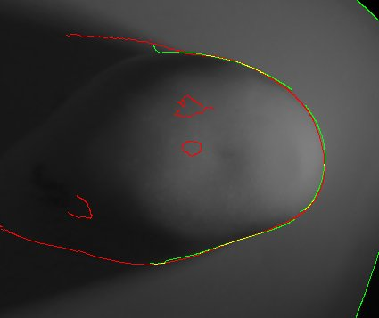
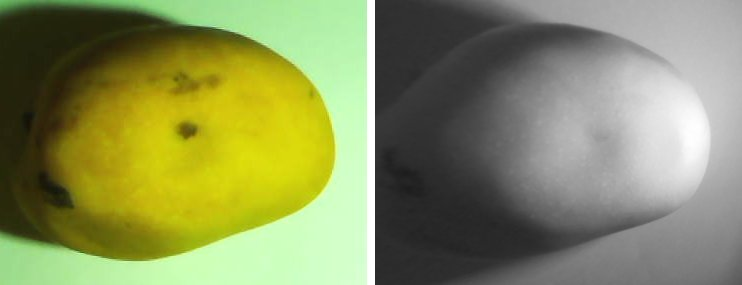
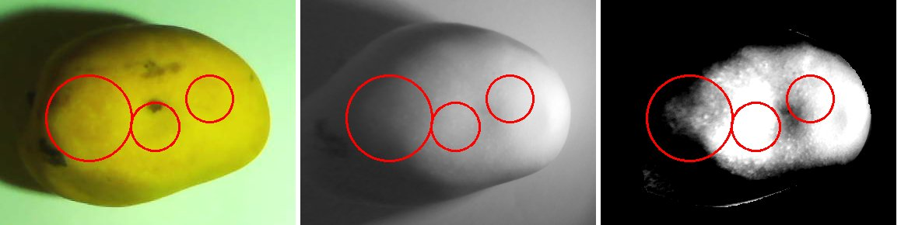

# Capture calibration with diffusers, and the first calibrated dual capture (2026-10-18)

| | |
|:--|:--|
| **Date** | 2026-10-18 (one session on the Raspberry Pi, run by the dataset owner) |
| **Context** | Follow-up to [Finding 4 of the findings report](README.md#4-finding-4-capture-protocol-and-script-v21): the capture protocol was calibrated on the real rig, and one impacted mango was captured with the final settings and analysed. |
| **Script** | [`capture/captura_dual.py`](capture/captura_dual.py), **v2.2** (v2.1 plus a brightness report after each capture). The script stays in Spanish. |
| **Analysis tool** | [`tools/process_new_capture.py`](tools/process_new_capture.py) (registration, alignment overlay, ROI crop of one capture). |
| **Status** | Calibration and the single-capture findings are **measured on one session and one mango (3 impacts)**: they are observations, not statistics. Script v2.2 was verified on a PC with a stubbed `gpiozero` and synthetic images (11 argument cases and 3 brightness cases) and then **run successfully on the Pi by the dataset owner**; it was not re-tested on the Pi by the analysis side. The captured images are not versioned. |
| **Compute** | Everything here ran on the CPU; no model was trained. |

## 1. Setup

- **Capture box:** black interior. It gives hard shadows (see the lessons in section 2.2).
- **Lights:** the white LED and the 850 nm NIR LED, each behind a **parchment-paper diffuser**.
- **Tray:** a **white sheet** on the tray. It is the neutral reference for the white balance and the background of the fruit.
- **Cameras:** a USB RGB camera (Arducam IMX219, controlled through V4L2) and a Raspberry Pi NoIR v2 for the NIR (`rpicam-still`). Both output 1280x720.
- **Fixed settings, no auto:** manual NIR shutter and gain with `--awbgains 1,1`, and manual RGB exposure with a fixed colour temperature. The flags come from script v2.1 ([README section 4.3](README.md#43-script-v21-capturecaptura_dualpy)).

## 2. Calibration iterations

Five iterations on the same rig. The first three used a mango as the scene, the fourth a white sheet (to judge the white balance), the fifth an impacted mango.

**Settings and verdict**

| # | Scene | NIR settings | RGB settings | Verdict |
|--:|:--|:--|:--|:--|
| 1 | mango | defaults: auto exposure at EV -3 | auto | RGB colour visually fine, but a hard shadow and the right half of the tray blown out. NIR visually almost black with a purple cast: **far too dark**. |
| 2 | mango | shutter 60000 us, gain 4 | exposure 150, WB 5000 K | NIR **blown out**. RGB white balance **wrong** (strong cyan cast on the tray). |
| 3 | mango | shutter 60000 us, gain 1 | exposure 150, WB 6500 K | NIR **still too bright**. |
| 4 | white sheet | shutter 60000 us, gain 1 | exposure 150, WB 6500 K | White-balance check: R is about B, so 6500 K is right on the blue-amber axis. The excess green is the LED's own green tint. |
| 5 | mango (impacted) | **shutter 20000 us, gain 1** | **exposure 150, WB 6500 K** | **FINAL.** |

**Brightness reports.** The script reports the central 50% of each image: p1 / p50 / p99 of the channel-mean gray level, the percentage of pixels with any channel >= 250, and the channel means R, G, B. A dash means that value was not recorded.

| # | RGB p1 / p50 / p99 | RGB % sat | RGB means R, G, B | NIR p1 / p50 / p99 | NIR % sat | NIR means R, G, B |
|--:|:--|--:|:--|:--|--:|:--|
| 1 | not measured (judged by eye) | - | - | not measured (judged by eye) | - | - |
| 2 | - / - / 185 (mango region) | 0.7 (mango region) | 59, 242, 241 (tray) | - / 254 / 254 | 84.0 | - |
| 3 | 27 / 178 / 230 | 37.6 | 165.6, 200.7, 121.9 | 43 / 238 / 254 | 60.7 | 217.4, 194.6, 223.1 |
| 4 (sheet) | 127 / 190 / 230 | 34.3 | 170.8, 230.7, 160.9 | 43 / 240 / 255 | 68.8 | 228.3, 205.2, 233.6 |
| 5 (final) | 27 / 174 / 230 | 35.7 | 164.8, 200.2, 120.8 | 17 / 159 / 241 | 3.9 | 149.9, 113.1, 166.2 |

### 2.1 How to read the numbers

- **The RGB "saturated" percentage is not about the mango.** The report measures the image centre, which includes a lot of the bright tray or sheet. In the RGB it is driven by the sheet's **green** channel (the sheet reads R 172, G 230, B 160 in the final capture), so 35% in the RGB report does not mean a blown-out fruit.
- **Judge the exposure on the mango.** Measured on the mango only (final capture): NIR inside the fruit p50 197, p99 251, 2.0% saturated. The mango box is 305x237 px, 7.8% of the 1280x720 frame. This is slightly above the v2.2 target (p99 200 to 240 with under 1% saturated, section 4); the final values were nevertheless kept for the whole session.

### 2.2 Lessons

- **A fixed manual NIR exposure replaces EV -3.** EV -3 had been used to avoid clipping the LED's specular highlight. With the diffusers, a fixed manual NIR exposure about **6 to 8 times longer** is usable.
- **Judge the white balance on a neutral white sheet, never on the fruit.** The mango is yellow and not neutral; its colours were first misread. On the sheet (iteration 4) R is about B, so 6500 K is correct on the blue-amber axis; the remaining green excess is the LED tint, not a balance error.
- **The NoIR purple cast is expected.** Under 850 nm the R and B channels sit above G (final capture: R 149.9, G 113.1, B 166.2). Keep `--awbgains 1,1`; do not try to "fix" it.
- **The pipeline reads the NIR with `cv2.IMREAD_GRAYSCALE`.** That is the BT.601, green-weighted conversion, and G is the weakest channel under 850 nm (final capture: G 113.1 against R 149.9 and B 166.2), so it under-uses the IR signal. The pending recommendation is a **channel-mean conversion for new captures**. This is **not implemented yet** (next steps, section 7).
- **A black interior gives hard shadows.** Line the walls with white, or put a white card on the shadow side.

## 3. Final configuration and session routine

The same values for the whole session:

```bash
python3 captura_dual.py --mango-id N --cara C --impacto si --cara-impacto C --zona-impacto ZONA --hora-impacto HH:MM \
    --nir-shutter 20000 --nir-gain 1 --nir-raw --rgb-exposure 150 --rgb-wb 6500
```

`OCI_PAR_URL` must be set in the environment (the script stops with a clear message otherwise; with `--no-upload`, any placeholder value is enough). The real URL is never in the repository.

Session routine:

1. **Start of every session:** run `--calib gris` (white sheet) and `--calib aruco` with the same parameters as the session. Both are uploaded to `calib/`, outside `news/`.
2. **Vary `--zona-impacto` between mangos**, to break the positional prior of the labels ([README section 2.7](README.md#27-the-positional-prior-where-it-comes-from)).
3. **Recalibrate after any physical change:** lights, diffuser or camera height.
4. **Calibration test shots always use `--no-upload`.** Local files go to `./fotos_tesis/`, relative to the working directory.

## 4. Mandatory parameters (script v2.2)

| Rule | Flags |
|:--|:--|
| Mandatory, except with `--calib` | `--mango-id`, `--cara`, `--impacto si\|no` |
| Also mandatory with `--impacto si` | `--cara-impacto` (one or more faces), `--zona-impacto`, and **exactly one** of `--hora-impacto` (`HH:MM` with two digits, or `YYYY-MM-DDTHH:MM`) or `--minutos-desde-impacto` |
| Optional, with defaults | `--n-impactos` (one per impacted face), `--masa-bola-g` 66, `--altura-cm` 50, `--ev` -3 (auto mode only), `--sesion` (today) |

The impact metadata block is described in [README section 4.4](README.md#44-impact-metadata-new-in-v21).

**New in v2.2:** after each capture the script prints a brightness report of the central 50% of the image (the same fields as the table in section 2) and stores it in the metadata JSON as `brillo_centro`. The calibration target is **p99 between 200 and 240 with under 1% saturated, judged on the mango, not on the tray** (section 2.1).

## 5. Findings on the final capture

One impacted mango, final configuration, analysed with [`tools/process_new_capture.py`](tools/process_new_capture.py).

### 5.1 Registration

- The stored homography (`notebooks/matriz_homografia_aruco.npy`, a tray-plane ArUco calibration) leaves a residual of about **12 px** on this setup.
- An **ECC (homography) refinement on the gradient magnitude around the fruit** raised the edge NCC from **0.038 to 0.355**. The phase-correlation readout after the refinement was unreliable (the tool still prints it; ignore it), so the overlay below is the evidence.
- In the overlay the fruit contour aligns on the right (yellow). The extra RGB-only edge on the left is the **cast shadow**, which exists only in the RGB. The small red-only contours inside the fruit appear to be dark skin spots visible in the RGB.



*Edge overlay after the ECC refinement, over the registered NIR (red = RGB edges, green = NIR edges, yellow = both).*



*ROI crop exactly as the training pipeline does it (mango box plus 10% margin): RGB on the left, registered NIR on the right, 367x285 px each at native resolution.*

### 5.2 Impacts

The user induced **3 impacts** (0.32 J, the energy of the default 66 g ball dropped from 50 cm) and marked their approximate positions **by hand on both images**. The user annotates damage **on the NIR only**, and the drawings were approximate.

Illumination-corrected darkness of each marked zone against a surrounding ring, each measured in its own frame:

| Impact | RGB | NIR |
|:--|--:|--:|
| 2 | 5.1% | 7.9% |
| 3 | 2.1% | 1.6% |
| 1 | not measurable | not measurable |

Impact 1 sits next to the fruit edge, where the shading makes both values negative (RGB -14.3%, NIR -15.5%), so it carries no information.



*Left to right: RGB crop, registered NIR crop, illumination-corrected NIR. The red circles are the dataset owner's approximate hand-drawn impact zones from the RGB annotation, the same circles in all three panels, numbered left to right as impacts 1, 2 and 3.*

- In the illumination-corrected NIR, distinct dark blobs appear near impacts 2 and 3.
- **Reading:** the damage is visible in the NIR, slightly more than in the RGB for impact 2 (7.9% against 5.1%); for impact 3 the RGB value is the larger one (2.1% against 1.6%). Overall the contrast is **subtle for fresh 0.32 J impacts**. With three hand-drawn zones on one mango this is an observation, not a measurement of the NIR advantage.
- **Caveat:** under **directional side light**, a dent also shows as shading, which is geometry and not tissue reflectance. Diffuse light is what isolates the reflectance contrast, which is the reason for the diffusers.

### 5.3 Parallax

- The user's NIR circles, mapped into the RGB frame, land about **37 to 44 px** from the user's RGB circles. That mixes the real two-camera parallax with the imprecision of hand-drawn circles, so treat it as an **upper bound**.
- A tray-plane homography cannot align the **fruit top**, which sits several cm above the tray, when the two cameras view from different positions.
- **Consequence for the current labeling protocol:** labels drawn on the NIR and projected with the same homography stay consistent with the registered NIR stream. The RGB stream may see the damage **offset** from the label.
- **Fix:** calibrate the homography with the ArUco board **raised to the fruit-top height (about 5 to 7 cm)**, or reduce the camera baseline.

### 5.4 Fruit size in the frame

The mango still covers only about **6 to 8% of the frame** (7.8% here). The ROI crop is 367x285 px at native resolution. Moving the cameras closer would add real detail; recalibrate the homography after doing so.

## 6. Data hygiene

Two early test captures were run **without `--no-upload`** (mango-id 2, cara 1, 2026-10-18), so they are in `news/` and would enter the dataset: `news/rgb/mango_rgb_<ts>.jpg` and `news/nir/mango_nir_<ts>.jpg` pair as data under the pair-discovery regex ([README section 4.3](README.md#43-script-v21-capturecaptura_dualpy)).

- **Identify them** by their `news/meta/mango_meta_<ts>.json`: `mango_id` 2, date 2026-10-18.
- **Exclude or delete them before the next download** of the capture data. Deletion is the dataset owner's decision; nothing was deleted here.
- **Prevention:** calibration test shots always use `--no-upload` (section 3).

## 7. Next steps

1. **Fruit-height ArUco calibration:** capture the board raised to about 5 to 7 cm and recompute the homography (section 5.3).
2. **Time series of one impacted mango** at +0, +1 h and +24 h with the final configuration, to test whether the NIR bruise contrast grows with time.
3. **A white-lined box or a white fill card**, against the hard shadows.
4. **Pipeline changes (pending code):** channel-mean NIR conversion instead of `IMREAD_GRAYSCALE`, and a gray-card colour correction.
5. **Exclude the two test captures** from `news/` (section 6).
6. **Optional:** a `--registrar-impacto` mode that records the impact time automatically at the moment of impact. It was offered to the dataset owner and is not built.

## 8. Summary for the thesis (Spanish)

Se calibró la captura dual RGB/NIR en la Raspberry Pi con una caja negra, difusores de papel pergamino en ambas luces y una hoja blanca sobre la bandeja. Tras cinco iteraciones, la configuración final fija el NIR en obturador de 20000 us y ganancia 1, y el RGB en exposición 150 y balance de blancos de 6500 K; con difusores es utilizable una exposición NIR manual fija unas 6 a 8 veces más larga que la que se usaba antes con EV -3 (adoptado para evitar el recorte del reflejo especular del LED). El balance de blancos debe juzgarse sobre una hoja blanca neutra y no sobre el mango, que es amarillo; el tinte morado de la cámara NoIR bajo 850 nm es esperado. El script `captura_dual.py` v2.2 exige los parámetros obligatorios de cada captura, agrega un reporte de brillo tras cada toma y se ejecutó con éxito en la Raspberry Pi.

En la captura final de un mango con tres impactos de 0,32 J, el registro NIR-RGB con la homografía de la bandeja deja un residuo de unos 12 px; un refinamiento ECC sobre el fruto elevó la correlación de bordes de 0,038 a 0,355. El daño es visible en el NIR, algo más que en el RGB para el impacto 2 (7,9 % frente a 5,1 %), aunque el contraste es sutil en impactos frescos y la muestra es de un solo mango. El paralaje entre cámaras (cota superior de unos 37 a 44 px) sugiere recalibrar la homografía con el tablero ArUco a la altura del fruto, acercar las cámaras (el mango ocupa solo el 6 a 8 % del cuadro) y registrar series temporales del mismo mango. Dos capturas de prueba subidas por error a `news/` deben excluirse antes de la próxima descarga.

## 9. Reproduction

The images are not versioned, so the figures cannot be regenerated from the repository alone. With the capture pair of the session (a CPU-only run; add `--repo-root <checkout>` if the code and `notebooks/matriz_homografia_aruco.npy` live in another checkout):

```bash
export CUDA_VISIBLE_DEVICES=""                       # CPU only
REPO=$(git rev-parse --show-toplevel)
python $REPO/docs/findings/2026-10-18/tools/process_new_capture.py \
    /path/to/news/rgb/mango_rgb_<ts>.jpg \
    /path/to/news/nir/mango_nir_<ts>.jpg \
    /tmp/new-capture-out                             # writes figures 01 to 08 and prints the numbers
```

On the session's pair the tool prints the mango box (305x237 px, 7.8% of the frame), the alignment NCC (0.038 with the stored homography, 0.355 after the refinement) and the crop size (367x285 px). `capture_alignment_edges.jpg` is its `04_alignment_edges.png` and `capture_final_crop.jpg` its `08_final_crop_rgb_nir.png`.

Not produced by the versioned tool: the impact figure, the illumination-corrected darkness table of section 5.2 and the mango-only brightness figures of section 2.1 come from a separate manual analysis of the same pair (the impact circles are the user's hand drawings), and that code is not versioned. The parallax numbers of section 5.3 come from the same analysis.
