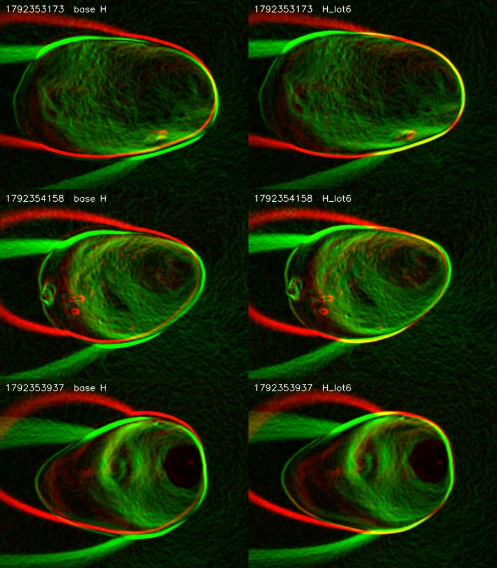

# Lot 6 intake: the 2026-10-18 capture day

| | |
|:--|:--|
| **Date** | 2026-10-20 (captures of 2026-10-18, taken with a rebuilt rig) |
| **Scope** | What is in the capture bucket, which pairs of the 2026-10-18 day join dataset v3 as **lot 6**, why half of the day is unusable (RGB overexposure), and a lot-level correction of the NIR to RGB registration for the new rig. |
| **Status** | Selection, overexposure evidence and registration are **measured**. Labeling, the split append and the per-lot homography support in training are **not done** (section 6). The capture-script fix (section 7) is a recommendation, **not implemented or tested on the Pi**. |
| **Compute** | CPU only (OpenCV and NumPy); no model was trained and no GPU was used. |
| **Evidence** | [Evidence index and reproduction commands](#8-evidence-index-and-reproduction) |

## At a glance

| # | Result | Strength of the evidence | Consequence |
|:--|:--|:--|:--|
| 1 | The bucket holds nothing newer than 2026-10-18 17:04 (Lima); dataset v3 already holds 237 of its timestamps. | The listing was taken by the intake session and cannot be reproduced from the repository (section 1). | The 2026-10-18 day is the only new data. |
| 2 | **16 of the 36 captures with images are kept** (mangos 1-4, four faces each); 20 are excluded. | Decision by the dataset owner, applied to the QC table by a tool. | Lot 6 adds 16 pairs (12 train, 1 val, 3 test with seed 42). |
| 3 | From 16:12 the **RGB is overexposed**: white reference (179, 237, 171) to (249, 253, 248), fruit box 11 % to 76 % saturated. The likely cause is the RGB camera gain, which the script neither sets nor logs. | Strong on the measurements; the cause is **likely, not proven**. | Mangos 5-8 are excluded; the capture script needs a fixed, logged gain and a numeric stop rule. |
| 4 | The NIR is offset by **(-4, -9) px** on the new rig relative to the shipped homography; a lot-6 homography removes it. | Edge NCC rises from -0.002 to 0.184, all 16 captures improve, the opposite direction shows no peak, the self-check passes. Residual up to 4 px in x. | Lot 6 needs its own homography. |
| 5 | Training, evaluation and visualization load **one** homography. | Read from the code (section 6, step 6). | Without per-lot support, lot-6 NIR would be registered with the old matrix; do not train or evaluate with lot 6 before that change. |

## 1. Bucket inventory

| Item | Count |
|:--|--:|
| Captures under the `news/` prefix of the OCI capture bucket | 315 |
| RGB images | 300 |
| NIR images | 313 |
| NIR RAW DNG | 33 |
| Metadata JSON | 34 |
| Timestamps already in `data/mango_dataset_v3.zip` | 237 |

- **Last upload:** 2026-10-18 17:04 Lima time (22:04 UTC). Nothing newer exists in any prefix as of 2026-10-20.
- **Source of the bucket figures.** They come from a listing taken by the intake session on 2026-10-20. The bucket name, namespace and URL are not stored in the repository (the capture script reads the URL from the environment, see section 4.3 of the [2026-10-18 findings](../2026-10-18/README.md)), so this listing is not reproducible from the repository.
- **Cross-checks that are reproducible.** The local copy of the day (`data/cache/incoming/2026-10-18`) holds 36 RGB, 36 NIR, 33 DNG and 34 JSON files, so every DNG and every JSON of the bucket is from this day. The v3 zip holds 237 timestamps that each have an RGB and a NIR image and 236 label files: 236 labelled pairs plus one orphan pair (1782752988, captured 2026-06-29 12:09 Lima) without a label. None of the 16 lot-6 timestamps is in the zip.

## 2. Lot-6 selection

The QC table of the day (`qc/qc.csv`) has 38 rows: 36 captures with an RGB and a NIR image, and 2 test captures that only have a metadata JSON. [lot6_selection.csv](evidence/lot6_selection.csv) records the decision for the 36 rows with images; the 2 test captures have no image to keep and are described below.

| Decision | Captures |
|:--|--:|
| Keep | 16 |
| Exclude (with images) | 20 |
| Test captures without images (not rows of the CSV) | 2 |

The QC `status` column marked mangos 5-8 as `KEEP_FLAGGED`; the decision to exclude them is manual (section 3).

### 2.1 Kept: 16 captures (mangos 1-4, faces 1-4)

Every photographed face is an impacted face. The impact zone is `centro` in 12 captures and off-centre in only 4 (`izquierda` twice, `derecha` twice), so lot 6 adds little to the effort of breaking the positional prior (see [2026-10-18, section 2.7](../2026-10-18/README.md)).

| Timestamp | Local time | Mango | Face | Zone | Min since impact | QC flags | Note |
| :-- | :-- | --: | --: | :-- | --: | :-- | :-- |
| 1792348876 | 13:41:16 | 1 | 1 | centro | 0.3 | none | |
| 1792349334 | 13:48:54 | 1 | 2 | centro | 7.9 | none | |
| 1792351957 | 14:32:37 | 1 | 3 | centro | 51.6 | MISALIGN | late: more than 10 min after impact |
| 1792353173 | 14:52:53 | 1 | 4 | centro | 1.9 | none | |
| 1792353731 | 15:02:11 | 2 | 1 | centro | 11.2 | NIR_OVER | NIR saturated in 1.9 % of the fruit region; late (more than 10 min); same mango and face as the 2 test captures |
| 1792353836 | 15:03:56 | 2 | 2 | izquierda | 1.9 | NIR_OVER | NIR saturated in 2.7 % of the fruit region |
| 1792353937 | 15:05:37 | 2 | 3 | centro | 0.6 | NIR_OVER | NIR saturated in 4.1 % of the fruit region |
| 1792354158 | 15:09:18 | 2 | 4 | centro | 1.3 | none | |
| 1792355197 | 15:26:37 | 3 | 1 | derecha | 1.6 | none | |
| 1792355284 | 15:28:04 | 3 | 2 | centro | 1.1 | MISALIGN | |
| 1792356266 | 15:44:26 | 3 | 3 | centro | 1.4 | MISALIGN | |
| 1792356345 | 15:45:45 | 3 | 4 | centro | 0.8 | none | |
| 1792357237 | 16:00:37 | 4 | 1 | izquierda | 14.6 | none | late: more than 10 min after impact |
| 1792357582 | 16:06:22 | 4 | 2 | derecha | 5.4 | MISALIGN | |
| 1792357752 | 16:09:12 | 4 | 3 | centro | 2.2 | none | |
| 1792357845 | 16:10:45 | 4 | 4 | centro | 1.8 | none | |

How each QC flag is handled:

- **MISALIGN** (4 captures) is **not a reason to exclude**. The QC measured a shift per capture, but the whole lot shares one offset; it is corrected by the lot-6 homography (section 4).
- **NIR_OVER** (mango 2, faces 1-3): 1.9 to 4.1 % of the fruit region is saturated in the NIR. The saturated patches can hide contrast, so check them when labeling.
- **Late captures** (more than 10 min after impact: 51.6, 11.2 and 14.6 min): bruise visibility changes with time since impact, so these three are the ones where a faint or missing damage in the NIR is least surprising. Their `minutes_since_impact` is in the CSV.
- **1792353731 and the test captures.** The two test captures (1792343585 at 12:13:05 and 1792344644 at 12:30:44) have a metadata JSON only (no RGB or NIR JPEG in the bucket; the second also has a DNG) and are excluded, so nothing from them enters any split. They record impacts on the same mango and face (mango 2, face 1, zone centro, logged at 12:13 and 12:10) as this capture, whose own impact is logged at 14:51. Whether the test impacts were real is not documented; if they were, this face may carry more than the single impact its metadata lists.

### 2.2 Excluded: 20 captures with images, plus 2 test captures

| Group | Captures | Reason |
|:--|--:|:--|
| Pre-metadata captures: 1792336581, 1792336785, 1792336910, 1792337046 (10:16 to 10:24) | 4 | No JSON sidecar and no DNG, so the settings are unverifiable; automatic exposure (NIR mean 8.5 of 255, RGB 58 % saturated in the fruit box on average). |
| Mangos 5-8, from 1792357957 (16:12:37) to 1792361045 (17:04:05) | 16 | RGB blown out (section 3). 1792357957 and 1792358104 are also duplicates of mango 5, face 1 (QC flag `DUP_FACE`), and 15 of the 16 have `MASK_UNRELIABLE`. |
| Test captures: 1792343585, 1792344644 | 2 (no images) | Incomplete: metadata JSON only. |

## 3. RGB overexposure from 16:12

Source: [lot6_exposure_audit.json](evidence/lot6_exposure_audit.json), made by [lot6_exposure_audit.py](tools/lot6_exposure_audit.py) from the incoming files and the QC table. Group means, with the range in brackets.

| Measure | Mangos 1-4 (16 captures, 13:41 to 16:10) | Mangos 5-8 (16 captures, 16:12 to 17:04) |
|:--|--:|--:|
| White reference sheet, mean R, G, B | 179, 237, 171 | 249, 253, 248 |
| Saturated share of the fruit box (QC `rgb_sat_pct_bbox`) | 11.4 % (6.3 to 14.4) | 76.4 % (64.8 to 82.2) |
| RGB JPEG size | 71.6 KB (69.4 to 73.6) | 92.4 KB (77.5 to 95.8) |
| Unlit top-left 120x120 corner of the RGB, green mean | 12.5 (10.8 to 14.6) | 76.3 (37.9 to 84.8) |
| Corner noise of the RGB (standard deviation of the Laplacian, green) | 0.64 (0.57 to 0.69) | 3.37 (1.20 to 5.18) |
| NIR frame mean | 67.4 (64.8 to 70.7) | 65.1 (63.4 to 66.2) |
| NIR top-left 120x120 corner mean | 17.0 (13.9 to 23.4) | 14.0 (13.3 to 16.5) |

All images are 1280x720. Around the onset:

| Local time | Mango | White sheet R, G, B | Fruit box saturated | RGB JPEG | NIR corner | RGB corner (green) | RGB corner noise |
|:--|--:|:--|--:|--:|--:|--:|--:|
| 16:09:12 | 4 | 178, 237, 170 | 11.4 % | 72.1 KB | 13.9 | 11.0 | 0.63 |
| 16:10:45 | 4 | 180, 238, 173 | 8.9 % | 72.0 KB | 13.9 | 10.8 | 0.68 |
| 16:12:37 | 5 | 252, 255, 248 | 64.8 % | 77.5 KB | 14.0 | 37.9 | 1.20 |
| 16:15:04 | 5 | 247, 252, 245 | 77.2 % | 94.8 KB | 13.9 | 84.8 | 2.79 |
| 16:17:19 | 5 | 250, 253, 249 | 77.1 % | 93.8 KB | 13.9 | 79.0 | 2.52 |

**Reading.**

- **Onset.** The last normal capture is 16:10:45 and the first affected one is 16:12:37 (a transition: the sheet is already saturated but the corner and noise are only partly up); from 16:15:04 every capture is fully affected. The change happened within about two minutes and did not reverse.
- **The camera settings did not change.** All 32 captures that have images and a JSON read back the same controls: manual exposure mode, `exposure_time_absolute` 150, automatic white balance off, 6500 K. `rgb.pedido.gain` is `null` in all 34 JSON files: the 2026-10-18 session did not pass `--rgb-gain`, and the script reads back only the controls it applied, so the gain was never logged.
- **The light did not change.** The NIR frame is unchanged across the onset (mean 67.4 to 65.1; corner 13.9 before and after). The NoIR camera also sees visible light ([2026-10-18, section 4.1](../2026-10-18/README.md)), so a brighter box would have shown there. This is indirect evidence: it does not rule out a change that only affects the RGB camera's own light.
- **The noise scaled with the signal.** In the 15 fully affected captures the unlit corner of the RGB goes from 12.5 to 78.9 (6.3 times) and its noise from 0.64 to 3.51 (5.5 times). More light on the same sensor would raise shot noise by about the square root of the signal, 2.5 times. Noise growing nearly in proportion to the signal is what a higher analogue gain produces.
- **The script's own report did not stop it.** The metadata of the 32 captures carries a brightness report whose `estado` is `BAJAR exposicion` in **all 32**, good ones included, so the flag carried no information. Its numeric `saturado_pct` separates the two groups cleanly: 31.3 to 37.0 % for mangos 1-4 against 89.2 to 95.5 % for mangos 5-8 (and the RGB `p50` is 161 to 186 against 255). The captures report `script_version` 2.2; the copy of the script in the repository is v2.1 and has no brightness report, so v2.2 is not in the repository.

**Likely cause (not proven).** The most likely cause is a change of the RGB camera's gain, or of an equivalent internal gain stage, that the script does not control. It fits every measurement above and needs no change of light or of the requested settings. It cannot be confirmed from the logs because the gain is neither set nor read back. A camera reset that restored a different default, or a control the script never touches, cannot be told apart from a gain change with the available data. The direct test is to read every control of the camera with `v4l2-ctl --list-ctrls` at the start of the next session, after any restart of the camera, and to log the result (section 7).

## 4. Lot-6 registration

### 4.1 Why a new matrix

The project registers the NIR to the RGB with **one** homography, `notebooks/matriz_homografia_aruco.npy`, which maps RGB to NIR (`src/training/nir_registration.py`; the NIR is resampled with its inverse). Damage labels are drawn on the NIR and projected to the RGB with the same inverse. On the rebuilt rig the NIR lands about 10 px off with this matrix. For scale, a 26 px damage box ([2026-10-18, section 4.1](../2026-10-18/README.md)) displaced by (4, 9) px has an IoU of 0.38 with its true position, below the 0.5 threshold. The earlier lot 5 also showed a residual of about 10 px (median 10.5 px, [2026-10-18, section 3](../2026-10-18/README.md)); whether it is the same offset was not tested here.

### 4.2 Method

[lot6_registration.py](tools/lot6_registration.py) runs on the 16 kept pairs:

1. Warp each NIR onto the RGB grid with `register_nir_to_rgb` and the base homography loaded by `load_homography`: the real project code path.
2. Compute the gradient magnitude (Gaussian blur 7x7, then Sobel) of the RGB gray image and of the warped NIR, inside the fruit region: the QC fruit bounding box plus 30 px.
3. Search the integer shift (dx, dy) in [-18, 18] of the warped NIR. The RGB pixel (x, y) is compared with the warped-NIR pixel (x - dx, y - dy) by normalized cross-correlation (NCC) of the edge maps. The NCC surfaces of the 16 captures are averaged; the lot shift is the argmax.
4. Compose the lot-6 matrix in the **same RGB to NIR convention**: `H_lot6 = H_base @ T`, where `T` translates by (-dx, -dy). Derivation: the corrected warped NIR is `W'(p) = W(p - d)` with `W(p) = NIR(H p)`, so `W'(p) = NIR(H T(-d) p)`.
5. **Self-check.** Re-register the 16 NIR images with `H_lot6` through `register_nir_to_rgb`, repeat the search, and require the lot best shift within 1 px of (0, 0) and a mean NCC at (0, 0) of at least 0.15. The tool exits non-zero, and writes no evidence file, otherwise. This verifies the sign empirically instead of on paper.

### 4.3 Results

| | Value |
|:--|:--|
| Lot shift (dx, dy) | **(-4, -9) px**, 9.8 px in length |
| Mean edge NCC at (0, 0) with the base H | -0.002 |
| Mean edge NCC at (-4, -9) with the base H, and at (0, 0) with H_lot6 | **0.184** |
| Per-capture best shifts | dx from -6 to 0, dy from -10 to -8 |
| Captures whose NCC rises | 16 of 16 |
| Opposite direction (the inverse matrix handed to `register_nir_to_rgb`) | no coherent peak: best mean NCC 0.021 at (7, -16) |
| Self-check | **PASSED**: lot shift after correction (0, 0), mean NCC at (0, 0) 0.184 |

The base registration leaves the NIR content 4 px to the right and 9 px below the RGB content. The five best lot shifts are (-4, -9) at 0.1842, (-3, -9) at 0.1836, (-5, -9) at 0.1809, (-2, -9) at 0.1795 and (-4, -8) at 0.1794: the vertical shift is better constrained than the horizontal one, where the peak is flat over about 2 px.

| Timestamp | Mango | Face | Best (dx, dy) | NCC at (0, 0), base H | NCC at (-4, -9), base H | NCC at (0, 0), H_lot6 | Residual (dx, dy) |
| :-- | --: | --: | :-- | --: | --: | --: | :-- |
| 1792348876 | 1 | 1 | (-5, -10) | 0.024 | 0.207 | 0.207 | (-1, -1) |
| 1792349334 | 1 | 2 | (-6, -10) | -0.005 | 0.225 | 0.225 | (-2, -1) |
| 1792351957 | 1 | 3 | (-6, -8) | -0.037 | 0.174 | 0.174 | (-2, 1) |
| 1792353173 | 1 | 4 | (-3, -9) | 0.040 | 0.256 | 0.256 | (1, 0) |
| 1792353731 | 2 | 1 | (-5, -9) | 0.022 | 0.167 | 0.167 | (-1, 0) |
| 1792353836 | 2 | 2 | (-6, -10) | 0.015 | 0.163 | 0.163 | (-2, -1) |
| 1792353937 | 2 | 3 | (0, -9) | 0.012 | 0.191 | 0.191 | (4, 0) |
| 1792354158 | 2 | 4 | (-6, -8) | -0.013 | 0.197 | 0.197 | (-2, 1) |
| 1792355197 | 3 | 1 | (-5, -8) | -0.006 | 0.162 | 0.162 | (-1, 1) |
| 1792355284 | 3 | 2 | (-6, -8) | -0.034 | 0.104 | 0.104 | (-2, 1) |
| 1792356266 | 3 | 3 | (-2, -8) | -0.037 | 0.120 | 0.120 | (2, 1) |
| 1792356345 | 3 | 4 | (-3, -8) | -0.015 | 0.114 | 0.114 | (1, 1) |
| 1792357237 | 4 | 1 | (-5, -8) | 0.015 | 0.254 | 0.254 | (-1, 1) |
| 1792357582 | 4 | 2 | (-4, -8) | -0.020 | 0.197 | 0.197 | (0, 1) |
| 1792357752 | 4 | 3 | (-5, -9) | 0.007 | 0.182 | 0.182 | (-1, 0) |
| 1792357845 | 4 | 4 | (-2, -9) | 0.003 | 0.234 | 0.234 | (2, 0) |

"Residual" is the best shift that remains after re-registering with H_lot6.



The overlay is an independent visual check: with the base matrix the fruit outline is doubled (red and green), with H_lot6 it coincides (yellow) except for a few pixels, mostly in x. Structures that exist in only one modality (the sheet rim in the RGB, the NIR-only blobs) stay red or green by nature.

### 4.4 The matrix and its convention

`matriz_homografia_lot6_20261018.npy` is a float64 3x3 matrix in the **same convention** as the base: it maps RGB pixels to NIR pixels, and `register_nir_to_rgb` resamples the NIR with its inverse. It loads with `load_homography` unchanged. It is the exact product `H_base @ T(+4, +9)`, so `H[2, 2]` is 0.99903 instead of 1; a homography is defined up to scale, and `scripts/convert_nir_labels.py` divides by the third coordinate.

| | Base `matriz_homografia_aruco.npy` | `matriz_homografia_lot6_20261018.npy` |
|:--|:--|:--|
| Row 1 | 0.98081, -0.04984, -120.110 | 0.98081, -0.04984, -116.636 |
| Row 2 | -0.00631, 0.92339, 110.421 | -0.00631, 0.92339, 118.706 |
| Row 3 | 2.467e-05, -1.183e-04, 1.0 | 2.467e-05, -1.183e-04, 0.99903 |
| sha256 | `36361795b200a190256fb2d8058b7456746ace4e34302cca7bbbf8b403f7a91a` | `803dc5ce3a29465f9de8d568689aa9ae02fc8173a58527d861c91dd6b1803609` |

Full-precision matrices, both hashes and the per-capture numbers are in [lot6_registration.json](evidence/lot6_registration.json).

### 4.5 Limitations

- **One translation per lot.** The correction is a single integer translation. It cannot fix a scale, rotation or perspective change of the rig, and it absorbs only the *average* parallax of the fruit surface. The two cameras sit side by side and the ArUco homography is exact only for its calibration plane, so fruit at other depths is displaced differently. This is the likely source of the per-capture residual, not a measured one.
- **Residual after correction.** In x the residual is -2 to +4 px (15 of 16 captures within 2 px, one at +4: 1792353937, which is also an NIR_OVER capture); in y it is -1 to +1 px. The mean residual is -0.3 px in x and +0.3 px in y, so no systematic offset is left. For a 26 px box a single-axis residual of 2 px keeps an IoU of about 0.86 and one of 4 px about 0.73.
- **Resolution and peak.** Shifts are whole pixels, and the x peak is flat over about 2 px, so the lot estimate in x is uncertain by about that much.
- **A low absolute NCC.** 0.184 is small in absolute terms because RGB and NIR share little gradient structure ([2026-10-18, section 3](../2026-10-18/README.md)); it is not comparable with the 0.01 to 0.08 of lots 1-5, which used another ROI, another NCC variant and a very different NIR exposure. What carries the evidence is the rise from -0.002, the 16 of 16 improvement, the visual overlay and the absence of a peak in the opposite direction.
- **The self-check is not independent of the estimate.** It uses the same images and metric. It verifies the sign and the composition of the matrix, not its accuracy; the overlay is the independent check.

## 5. What is staged where

The intake session stages the data; this document only describes it. All paths are relative to the primary checkout. `data/cache/` and `data/label_studio*/` are git-ignored, so the staged images stay local.

| Location | Content | Use |
|:--|:--|:--|
| `data/label_studio_batch_20261018_nir/` | The 16 NIR JPEGs (`mango_nir_<timestamp>.jpg`) | Uploaded to Label Studio by hand, like the 2026-09-27 batch (`data/label_studio_batch_20260927_nir/`). |
| `data/cache/mango/rgb/` and `data/cache/mango/nir/` | The 16 RGB and 16 NIR files, under the same names | Where `YOLODataset` and the label tools read pairs. |
| `notebooks/matriz_homografia_lot6_20261018.npy` | Byte copy of [evidence/matriz_homografia_lot6_20261018.npy](evidence/matriz_homografia_lot6_20261018.npy) | The lot-6 homography, tracked in git next to the base matrix (committed with this intake, so it reaches the primary checkout on the next pull). Verify with `sha256sum` against the hash in section 4.4. |

## 6. Next steps, in order

Steps 1 to 5 prepare the data; **do not train or evaluate with lot 6 before step 6**, because until then lot-6 NIR is registered with the old matrix while its labels are projected with the new one.

1. **Label the 16 NIR images in Label Studio (damage only)** and export only those tasks.
2. **Append them to the split manifest:**
   ```bash
   python scripts/prepare_yolo_splits.py --append-export <export> --append-labels-dir <staging> \
       --rgb-dir data/cache/mango/rgb --nir-dir data/cache/mango/nir \
       --manifest data/annotations/yolo/splits.json
   ```
   Existing stems keep their split. Seed 42 assigns the 16 new stems 12 train, 1 val and 3 test (re-derived here with the script's own `assign_splits`).
3. **Add the mango boxes (class 0):**
   ```bash
   python scripts/annotate_mango_florence.py --rgb-dir data/cache/mango/rgb --labels-dir <staging>
   ```
   Never point it at the full labels directory: it replaces the class-0 box of every label file it finds, so it would rewrite the mango boxes of the 236 existing labels. Check visually that it boxes the mango and not the white sheet.
4. **Project the damage labels to the RGB with the lot-6 matrix:**
   ```bash
   python scripts/convert_nir_labels.py --export <export> \
       --homography notebooks/matriz_homografia_lot6_20261018.npy \
       --splits <staging> --output-dir <staging>
   ```
5. **Copy the staged labels** into `data/annotations/yolo/labels/<split>/`.
6. **Add per-lot homography support to training, evaluation and visualization.** Today every loader uses one homography, so the lot-6 NIR would be warped with the old matrix. Change points:
   - `src/training/nir_registration.py`: a stem-to-homography lookup (or a per-lot map).
   - `YOLODataset` in `src/training/dataset.py`: the homography is applied around lines 408-412 from the single `nir_homography_path`.
   - `TrainingConfig.nir_homography_path` (`src/training/config.py:193`).
   - The call sites that pass or load it: `src/training/train.py`, `src/training/kd_train.py`, `scripts/evaluate_checkpoint.py`, `scripts/visualize_damage_predictions.py`, `scripts/visualize_attention.py` and `scripts/stem_init_audit.py`.
   - The provenance record in `src/training/loop.py:942-944` (`homography_path` and `homography_sha256`), which must record every matrix in use.
7. **Rebuild the folds:**
   ```bash
   python scripts/make_grouped_folds.py
   python scripts/make_grouped_folds.py --check
   ```
   Lot 6 is detected automatically (2026-10-18 is 21 days after lot 5, far beyond `--lot-gap-days`), giving 6 folds; this was re-derived here with the script's own `group_into_lots`. The default assignment file is still named `configs/folds/lot_5fold.json`. As a test fold, lot 6 holds 16 images, so its AP50 will be very noisy; report it, but weigh it accordingly.

An optional, cheap follow-up: run the same search on lot 5, whose residual was about 10 px, to see whether it is the same offset and whether the lot-6 matrix would also correct it.

## 7. Capture-script fix for future sessions

The 2026-10-18 failure cost 16 of 32 usable captures and was visible in the script's own log. A fixed rig is not enough if the settings that matter are not all fixed and logged.

1. **Always pass a fixed `--rgb-gain` and log it.** Make `--rgb-exposure`, `--rgb-wb` and `--rgb-gain` required together in manual mode, so that no RGB control is left at whatever the camera holds.
2. **Read back and log more than the controls that were applied.** `leer_controles_rgb` reads only `rgb_aplicados`, so an unset gain is never read. Read back a fixed list (at least `gain`, `brightness`, `contrast`, `saturation`, `backlight_compensation`, exposure and white balance) after each capture, and store the full `v4l2-ctl --list-ctrls` output once per session.
3. **Stop, or warn loudly, on saturation, using the number.** The categorical `estado` fired on 32 of 32 captures. Use the numeric `saturado_pct` (and the RGB `p50`): on 2026-10-18 it was 31 to 37 % for good captures and 89 to 96 % for blown-out ones. Any threshold between them separates the day; pick it from the good captures of the day (for example 60 %, **not tested**), stop the session on the first capture above it, and require a confirmation to continue.
4. **A drift guard on the white reference.** The white sheet is in every frame. Compare its mean colour with the first capture of the session and warn when it moves by more than a tolerance (the 2026-10-18 sheet moved from (179, 237, 171) to (249, 253, 248)).
5. **Commit the script that runs on the rig.** The captures report `script_version` 2.2; the repository holds v2.1. Put the deployed version, with these changes, under `docs/findings/` or `capture/` so the next review can read what actually ran.

These changes are a proposal. They have not been implemented, and none has been run on the Pi.

## 8. Evidence index and reproduction

### Figures ([figures/](figures/))

| File | What it shows |
|:--|:--|
| [lot6_registration_overlay.jpg](figures/lot6_registration_overlay.jpg) | Edge overlay, base H against H_lot6, for the best, a median and the worst-residual capture (`lot6_registration.py`). |

### Evidence ([evidence/](evidence/))

| File | What it holds | Produced by |
|:--|:--|:--|
| [lot6_selection.csv](evidence/lot6_selection.csv) | The 36 captures with images: decision, reason, QC flags, impacted faces, zone, minutes since impact. | `lot6_registration.py` |
| [lot6_registration.json](evidence/lot6_registration.json) | Both homographies (matrices, paths, sha256), the lot shift, the mean NCC before and after, the per-capture table, the opposite-direction check and the self-check. | `lot6_registration.py` |
| [matriz_homografia_lot6_20261018.npy](evidence/matriz_homografia_lot6_20261018.npy) | The lot-6 homography (float64 3x3, RGB to NIR). | `lot6_registration.py` |
| [lot6_exposure_audit.json](evidence/lot6_exposure_audit.json) | Per-capture exposure measures, group summaries and the camera controls read back in the metadata. | `lot6_exposure_audit.py` |

### Tools ([tools/](tools/))

Analysis tooling, not part of the training pipeline. They take `--repo-root` (code checkout, default: this repository), `--data-root` (checkout that holds the untracked `data/`; default: `$MANGO_DATA_ROOT`, else the primary checkout of this repository, so a linked worktree reads the main checkout's data) and `--out-dir` (default `docs/findings/2026-10-20/evidence`). The registration tool reads the base homography from `<repo-root>/notebooks/matriz_homografia_aruco.npy` (tracked) unless `--base-homography` says otherwise.

| Tool | Purpose |
|:--|:--|
| [lot6_registration.py](tools/lot6_registration.py) | Lot-6 selection, lot shift search, `H_lot6` composition, self-check, evidence files and overlay figure. Exits 1 when the self-check fails and 2 when an input is missing. |
| [lot6_exposure_audit.py](tools/lot6_exposure_audit.py) | The measurements of section 3. |
| [_paths.py](tools/_paths.py) | Shared root resolution. |

### Reproduction

```bash
REPO=$(git rev-parse --show-toplevel)            # code checkout
PY=/path/to/venv/bin/python                      # NumPy and OpenCV (no GPU needed)
T=$REPO/docs/findings/2026-10-20/tools
cd "$REPO"
$PY -I $T/lot6_registration.py                   # prints the lot shift, the table and SELF-CHECK PASSED
$PY -I $T/lot6_exposure_audit.py                 # prints the group table and the onset rows
# elsewhere: add --data-root /path/to/checkout/with/data (or set MANGO_DATA_ROOT)
```
