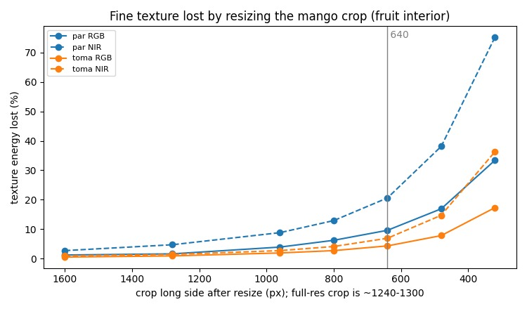
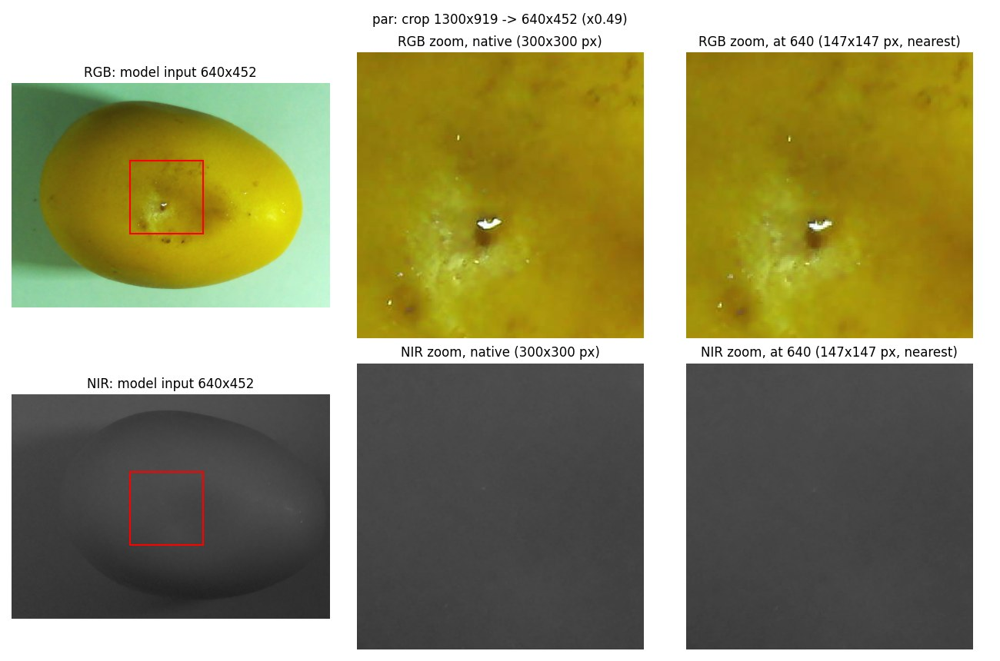

# captura_v3 full-res: what the mango crop loses at the 640 input (2026-10-23)

**Question.** captura_v3 now takes RGB at 3264x2448 and NIR at 3280x2464 (registered with `notebooks/matriz_homografia_aruco_3264x2448.npy`, PR #42). After the mango ROI crop, how much image quality is lost when the crop is resized to the 640 px model input?

**Short answer.** Little. The crop is about 1240-1300 px on the long side, so 640 is a x0.49-0.52 downscale (about a quarter of the pixels are kept). Inside the fruit, the RGB input keeps **90-96% of the fine-texture energy**, and most of what is lost is at the level of pixel noise and JPEG grain. The full-res crops do not carry 1300 px of real detail: optics plus MJPEG resolve the equivalent of **about 800-900 px**. So 640 sits a little below what the camera actually resolves, not far below. Damage features (puncture, brown spots, lenticels) are intact at 640 in the zooms.

Reproduce (CPU only, about 20 s):

```bash
python -I docs/findings/2026-10-23-captura-v3-crop/tools/crop_quality.py \
    data/cache/incoming/2026-10-22_captura_v3 \
    notebooks/matriz_homografia_aruco_3264x2448.npy /tmp/crop_quality
```

Output: [evidence/metrics.json](evidence/metrics.json), [figures/](figures/).

## Data

Two test pairs from the Pi (`ssh mangopi`, `~/pruebas_toma/`), captured on 2026-10-22 with the rig used for the new homography. They are not in git; copy them into `data/cache/incoming/2026-10-22_captura_v3/` (gitignored):

```bash
scp -r mangopi:pruebas_toma/{par-1792730854,toma-1792727724,aruco-1792730443,modos-1792731863} \
    data/cache/incoming/2026-10-22_captura_v3/
```

| Pair | Content | Mango bbox (full-res) | Crop (+10% margin) | Model input | Scale |
| :-- | :-- | :-- | :-- | :-- | :-- |
| `par-1792730854` | yellow mango, puncture + bruise | 1083x766 | 1300x919 | 640x452 | x0.49 |
| `toma-1792727724` | greener mango, diffuse bruise | 1030x800 | 1236x960 | 640x497 | x0.52 |

## Method

The tool mirrors the training pipeline: NIR warped into the RGB frame with `inv(H)` and `INTER_LINEAR` (`src/training/nir_registration.py`), crop = mango bbox + 10% per side with no jitter (`roi_crop_margin: 0.10`), long side resized to 640 with `cv2.INTER_LINEAR` (`letterbox` in `src/training/dataset.py`). The captures have no labels, so the bbox comes from a color mask (the fruit is more yellow than the paper and its shadow, b* > 154).

Loss is a round trip: resize the full-res crop to long side L, upsample back with bicubic, compare against the full-res crop. All metrics are computed on the fruit interior (mask eroded by 60 px, so the RGB/NIR parallax stays on the fruit). RGB is measured on luma.

- **Texture lost:** variance of the round-trip residual divided by the variance of the texture band (image minus a sigma-8 Gaussian blur). SSIM and PSNR are also reported, but they barely move here (SSIM >= 0.993 at 640) because the smooth fruit skin dominates them.
- **Pixel-noise share:** variance of (image - 3x3 median) divided by the same texture band. It is a rough measure of how much of that band is noise.
- **Effective long side:** the frequency where the radial power spectrum of a 512 px patch drops to 3x its noise floor, expressed as the long side that would put that frequency at Nyquist.

## Results

Texture energy lost (`INTER_LINEAR`, as in training):

| | 960 | 800 | **640** | 480 | Pixel-noise share | Effective long side |
| :-- | --: | --: | --: | --: | --: | --: |
| par RGB | 3.9% | 6.2% | **9.6%** | 16.9% | 7.6% | 913 px |
| toma RGB | 1.9% | 2.7% | **4.3%** | 7.8% | 4.8% | 795 px |
| par NIR | 8.8% | 12.9% | **20.6%** | 38.1% | 26.8% | 816 px |
| toma NIR | 2.7% | 4.1% | **6.9%** | 14.7% | 10.5% | 800 px |

At 640: PSNR 47.6 / 48.9 dB (RGB) and 55.2 / 53.9 dB (NIR); SSIM 0.993-0.997.





The zoom shows the same 300x300 px patch at native resolution and at the 640 input (upsampled with nearest neighbor for display). The [toma zoom](figures/toma_zoom.jpg) shows the same.

## Reading

1. **RGB: 640 keeps 90-96% of the fine texture.** The loss at 640 (4-10%) is about the size of the pixel-noise share (5-8%). Not all of it is noise, but most of it is at that scale.
2. **640 is close to the camera's effective resolution.** The full-res crop carries detail up to about 800-900 px on the long side, not 1240-1300. Going to an 800 input would recover 1.6-3.4 percentage points of RGB texture for 1.56x the pixels. Going above about 900 recovers almost nothing.
3. **`INTER_AREA` is not needed.** At x0.5, `INTER_LINEAR` already averages 2x2 pixels. The two give the same loss within 0.3 points on RGB, and `INTER_AREA` is slightly worse on NIR (+1.1 to +1.3 points). Keep the pipeline as is.
4. **Versus the 1280x720 mode on the same rig.** A SIFT match between `modos-1792731863/rgb_720.jpg` and `rgb_full.jpg` gives a scale of 2.50 full-res px per 720p px. The 720p mode keeps 98% of the width and crops the frame vertically (only 12 RANSAC inliers, so treat the number as approximate). In 720p mode, the same mango crop would be about 520x370 px and would be **upsampled** x1.23 to 640. In full-res mode, the 640 input is a downscale of real detail. At the same input size, the new captures give at least 1.2x more real linear detail.

## Side observations (not caused by the resize)

- **The NIR of `par` is dark and flat.** Same shutter (6000 us) and gain (1.0) as `toma`, but the fruit's median is 65 vs 92 and the p99 is 84 vs 171. Its texture band has a standard deviation of 0.97 gray levels, and 27% of it is pixel noise. The 20.6% "lost" at 640 for this image is mostly noise. Exposure limits this NIR much more than the resize does.
- **Parallax can clip the NIR fruit at the crop edge.** The crop comes from the RGB bbox. In `toma`, the registered NIR fruit is shifted right by about the 10% margin (about 100 px; PR #42 reports 80-100 px at the fruit contour) and touches the crop edge in the 640 NIR input. With `roi_crop_jitter: 0.5` a side's margin can drop to 5%, which would cut the NIR fruit. This is a visual observation on one image, not measured.

## Limits

Two images, no labels: the ROI comes from a color mask, and there is no detection metric. The texture-loss and effective-resolution numbers are signal measurements, not a measure of AP. Whether the 1.6-3.4 points recovered at 800 matter for damage AP can only be answered by training at both sizes.
