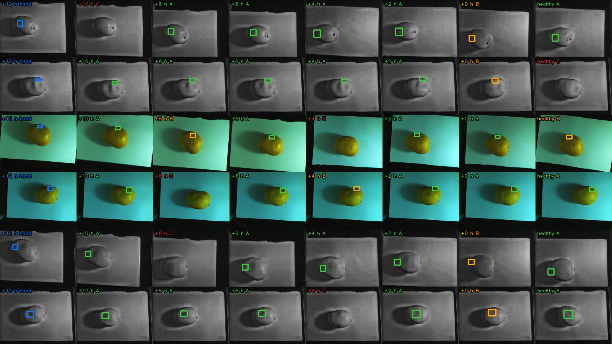

# Carrying the +12 h damage boxes back to the earlier photos (2026-10-26)

**Question.** The 200 hand-drawn +12 h boxes (180 on NIR, 20 on RGB) are the only boxes that exist. Can they be projected onto the earlier photos of the same fruit face (+10, +8, +6, +4, +2, +0 h and healthy) to pre-fill the next annotation rounds, and how far can each projection be trusted?

**Short answer.** Partly. 57% of the 1399 projections got a box (561 Tier A, 237 Tier B; 601 Tier C get none), more in lot 2 (73% on NIR) than in lot 1 (40%), and less the further back in time (67% at +10 h, 47% at healthy). Against the hand boxes of the blind +10 h round, **Tier A has median IoU 0.49 (49% reach 0.5, 21% reach 0.7) and Tier B 0.20 (29% / 0%)**. Copying the +12 h box unchanged gives 0.17 on the same Tier A faces, so registration buys about 3x, but a perfectly centred +12 h box would still score only 0.74 against a hand box, so IoU >= 0.7 stays rare. Use A as a pre-fill to correct; treat B as "roughly where to look".

**Surprising.** NIR photos hardly register on NIR: SIFT is valid on 0-3% of the pairs and the dense search is barely above chance. The smooth NIR skin has almost no texture. What works is registering the **RGB** photos of the same capture and carrying the motion into the NIR frame (the "bridge" below). 90% of the boxes are on NIR, so almost every Tier A/B box on NIR comes from the bridge.

Reproduce (about 21 min on 11 CPU cores; no GPU):

```bash
# once: enhanced NIR for the earlier moments (the +12 and +10 h ones already existed)
.venv/bin/python scripts/build_nir_display.py --data-root data/cache/captura_v3 --moments 8,6,4,2,0,sano

.venv/bin/python scripts/project_boxes.py \
    --data-root data/cache/captura_v3 \
    --export data/labels_lote_1_2_12h_10h.json \
    --out-dir data/label_studio_captura_v3 \
    --report-dir docs/findings/2026-10-26-box-projection \
    --homography data/cache/captura_v3/homografias/20261024/lote1_oficial/matriz_homografia_lote1_20261024_centros.npy \
    --homography-jornada lote1-20261024 \
    --mask-sheet docs/findings/2026-10-26-box-projection/mask_check.jpg --workers 11

# blind validation against the hand +10 h boxes (same export; it holds both rounds)
.venv/bin/python scripts/project_boxes.py --validate data/labels_lote_1_2_12h_10h.json \
    --out-dir data/label_studio_captura_v3 --report-dir docs/findings/2026-10-26-box-projection

# the null distributions behind the dense thresholds
.venv/bin/python scripts/project_boxes.py --data-root data/cache/captura_v3 \
    --export data/labels_lote_1_2_12h_10h.json --calibrate 300 --workers 11
```

Outputs: [projection_report.csv](projection_report.csv) (one row per face and moment: tier, methods, inliers, RMSE, dense score, agreement, transform parameters), [cycle_check.csv](cycle_check.csv), [summary.json](summary.json), [validation_10h.json](validation_10h.json), [contact_sheet.jpg](contact_sheet.jpg), [mask_check.jpg](mask_check.jpg). The Label Studio files go to `data/label_studio_captura_v3/` (git-ignored): `predictions_{8,6,4,2,0}h.json`, `predictions_sano.json` and `projection_10h_for_validation.json`.

## What was projected

- **Export:** `data/labels_lote_1_2_12h_10h.json`, sha256 `518b25a8...7e` (400 tasks: 200 at +12 h, 200 at +10 h, one annotation each; one task had two annotations and the latest non-cancelled one is used). Tasks are filtered by `data.ronda_h`. The +12 h tasks are the source boxes: 180 NIR (94 lot 1, 86 lot 2) and 20 RGB (6, 14). Every face has a box; the tool still reports faces without one and skips them. The +10 h tasks were not read by the projection run.
- **Pairs:** 7 earlier moments x 200 faces = 1400, minus one missing slot (lot 2 mango 34 face 3 +2 h) = **1399**. One duplicate was dropped by the task builder's rule (lot 2 mango 33 face 1 +2 h: 1792954369 is off time, 1792952047 kept). RGB uses the 57 white-balance-corrected photos when they exist.

## Method

For each face and earlier moment, the +12 h photo is registered to the earlier one **in the modality the box was drawn on**, with two independent methods, and the box corners are carried across (axis-aligned bounds, clipped to the frame).

1. **Fruit mask.** The sheet is not static (it is re-placed between rounds, its edges shift by tens of px), so a plain empty-tray difference leaves edge strips. RGB: yellow skin has little blue next to the cyan sheet (`B/(G+R)`, Otsu), no empty tray needed. NIR: ratio to the latest empty tray of the lot, a cubic polynomial fitted out for the illumination change, pixels dark in either image ignored, convex hull of the largest darker region plus its lit side. NIR masks include the fruit's shadow. See [mask_check.jpg](mask_check.jpg).
2. **SIFT.** Half resolution, CLAHE, contrast threshold 0.008, features only inside the mask, Lowe ratio 0.75, RANSAC similarity (`estimateAffinePartial2D`, 6 px at half resolution). Valid at >= 15 inliers; 300 unrelated pairs per modality never exceeded 6.
3. **Dense search** (shares no code with SIFT). Masked zero-mean cross-correlation of the band-passed fruit interior (Gaussian band 0.012-0.04 of the fruit diameter, mask eroded 18% of the diameter so the silhouette does not count) over rotation +-36 deg, scale 0.94-1.06 and every shift, then a fine local refinement and a parabolic peak. Valid at **>= 0.78 RGB / 0.81 NIR**, just above the maximum over 300 unrelated pairs per modality (RGB 0.772, p99 0.719; NIR 0.803, p99 0.755). The 0.45 used in earlier measurements does not hold for this implementation (unrelated pairs reach 0.77). Eroding 0.10 -> 0.18 raised the RGB AUC (169 pairs with >= 25 SIFT inliers vs 169 unrelated) from 0.979 to 0.998; on NIR the best setting gives AUC 0.87 and finds 46% of the RGB-registered pairs at 1% false positives.
4. **RGB bridge (NIR boxes only).** The RGB registration of the same two captures is carried into the NIR frame as two more estimates (`bridge_sift`, `bridge_dense`) by conjugating the RGB similarity with the lot-1 RGB-to-NIR homography. A map error `d` moves the box by about `d` times the fruit rotation, not by `d`. Lot 2 has no homography: the lot-1 one is used with a shift of (-84, -7) px estimated from fruit-mask centroids (the NIR mask includes the shadow, which biases both lots equally, so only the difference between lots is used). The shift is not a measured calibration; it is checked below.
5. **Tiers.** A = two valid methods whose projected boxes agree (IoU >= 0.8 or every corner within 10% of the box side); with more than two valid methods, any agreeing pair is enough and the box is the mean of the agreeing ones. B = exactly one valid method. C = no projection: no valid method (510), valid methods that contradict each other (91), or the box leaves the frame. `model_version` is `proj-12h-A` / `proj-12h-B`, `score` 0.9 / 0.5.

The tests build a synthetic fruit warped by a known similarity (recovered to within 3 px for SIFT and 8 px for dense at the box corners), unrelated fruits (Tier C), a static textured sheet around a moving fruit (the fruit's motion is recovered, not identity), and the Label Studio shapes (`python -m pytest tests/annotation tests/data_pipeline -q`).

## Results

### Coverage per moment and lot (tier counts, 1399 projections)

| Moment | Lot | n | A | B | C | A+B |
|:--|:--|--:|--:|--:|--:|--:|
| +10 h | lot 1 | 100 | 32 | 16 | 52 | 48% |
| +10 h | lot 2 | 100 | 81 | 5 | 14 | 86% |
| +8 h | lot 1 | 100 | 24 | 19 | 57 | 43% |
| +8 h | lot 2 | 100 | 77 | 7 | 16 | 84% |
| +6 h | lot 1 | 100 | 24 | 16 | 60 | 40% |
| +6 h | lot 2 | 100 | 56 | 15 | 29 | 71% |
| +4 h | lot 1 | 100 | 19 | 22 | 59 | 41% |
| +4 h | lot 2 | 100 | 50 | 17 | 33 | 67% |
| +2 h | lot 1 | 100 | 23 | 21 | 56 | 44% |
| +2 h | lot 2 | 99 | 56 | 16 | 27 | 73% |
| +0 h | lot 1 | 100 | 17 | 21 | 62 | 38% |
| +0 h | lot 2 | 100 | 52 | 18 | 30 | 70% |
| healthy | lot 1 | 100 | 14 | 15 | 71 | 29% |
| healthy | lot 2 | 100 | 36 | 29 | 35 | 65% |

Both lots together: +10 h 113 A / 21 B / 66 C (67%), +8 h 64%, +6 h 56%, +4 h 54%, +2 h 58%, +0 h 54%, healthy 47%. By box modality: NIR 40% (lot 1) and 73% (lot 2); RGB 45% and 76%. Of the 798 projected boxes, 658 rest on the RGB bridge alone (459 A, 199 B), 37 are bridge + native, 93 are native RGB boxes, and 10 NIR-native dense only.

### NIR registers worse than RGB (share of valid registrations)

| Box on | Moment | n | SIFT | dense | RGB SIFT (bridge) | RGB dense (bridge) |
|:--|:--|--:|--:|--:|--:|--:|
| NIR | +10 h | 180 | 3% | 17% | 64% | 68% |
| NIR | +8 h | 180 | 3% | 16% | 58% | 62% |
| NIR | +6 h | 180 | 1% | 9% | 55% | 50% |
| NIR | +4 h | 180 | 0% | 8% | 51% | 50% |
| NIR | +2 h | 180 | 0% | 7% | 53% | 49% |
| NIR | +0 h | 180 | 0% | 3% | 51% | 43% |
| NIR | healthy | 180 | 1% | 2% | 43% | 34% |
| RGB | +10 h | 20 | 80% | 85% | | |
| RGB | +8 h | 20 | 75% | 85% | | |
| RGB | +6 h | 20 | 70% | 60% | | |
| RGB | +4 h | 20 | 85% | 75% | | |
| RGB | +2 h | 19 | 68% | 68% | | |
| RGB | +0 h | 20 | 75% | 70% | | |
| RGB | healthy | 20 | 55% | 45% | | |

The RGB columns for NIR faces (180 faces) are the larger sample of RGB registration: 64% at +10 h falling to 34-43% at healthy, as expected (the bruise and the fruit's pose change; "healthy" is the oldest photo). Lot 1 registers worse than lot 2 in every row of the coverage table.

### Internal consistency

- **Cycle error.** Going +12 h -> +10 h -> t and comparing with +12 h -> t, over the box corners, where all three registrations of a method are valid: median 8.9-9.9 px (full resolution, box side about 230 px), p90 21-34 px; 80-90% of the cycles are under 10% of the box side (SIFT n=74 and dense n=83 native; bridged SIFT n=444, bridged dense n=394; see [cycle_check.csv](cycle_check.csv)).
- **SIFT vs dense.** Where both are valid, their projected boxes agree (IoU >= 0.8 or corner displacement < 10% of the side) in 75% of the native NIR/RGB pairs (n=95; 67% under 10% of the side) and in 89% of the bridged pairs (n=552; 81% under 10%). That is lower than the 95% seen in the earlier measurement; the median displacement between the two methods is 4-7% of the side.

### Blind validation against the hand +10 h boxes

The projections for +10 h went only to `projection_10h_for_validation.json`. The 200 hand +10 h boxes (185 NIR, 15 RGB) are compared by IoU with the projected box on the same modality; the 33 faces boxed on a different modality at +10 h than at +12 h (25 of them projected) cannot be scored and are skipped. No parameter was changed after seeing these numbers.

| Projected boxes vs hand +10 h | n | median IoU | IoU >= 0.5 | IoU >= 0.7 |
|:--|--:|--:|--:|--:|
| Tier A | 92 | 0.49 | 49% | 21% |
| Tier B | 17 | 0.20 | 29% | 0% |
| **A + B** | 109 | 0.46 | 46% | 17% |
| *Copy of the +12 h box, same A faces* | 92 | 0.17 | 9% | 1% |
| *Copy of the +12 h box, same B faces* | 17 | 0.05 | 0% | 0% |
| *Copy, all faces with both boxes (incl. 58 Tier C)* | 167 | 0.08 | 5% | 1% |
| *Size ceiling: +12 h box centred exactly on the hand box* | 167 | 0.74 | 90% | 59% |
| Lot 1, A / B / A+B | 27 / 12 / 39 | 0.58 / 0.31 / 0.53 | 67% / 42% / 59% | 30% / 0% / 21% |
| Lot 2, A / B / A+B | 65 / 5 / 70 | 0.43 / 0.04 / 0.41 | 42% / 0% / 39% | 17% / 0% / 16% |
| NIR box, A / B / A+B | 91 / 17 / 108 | 0.49 / 0.20 / 0.47 | 49% / 29% / 46% | 21% / 0% / 18% |
| RGB box, A+B | 1 | 0.05 | | |
| A by source: RGB bridge / bridge + native | 81 / 10 | 0.48 / 0.58 | 48% / 60% | 20% / 30% |

- **Centre error.** Median 67 px for A (0.27 box sides), 133 px for B (0.70 sides). The median offset hand minus projection is (-6, +9) px in lot 1 and (-6, +9) px in lot 2: no systematic shift, so the lot-2 shift estimate did not bias the result; the errors are spread.
- **Hand box size.** The hand +10 h box has a median area of 1.04x the +12 h box (46% are smaller), so the bruise is not visibly smaller at +10 h and the projected box (same size as at +12 h) is the right size on average. At earlier moments, where the damage is smaller or absent, the projection is only an upper bound.
- **Tier C.** 66 of the 200 +10 h faces get no projection (58 of them have a hand box on the same modality; copying the +12 h box would score a median IoU of 0.00 there).
- **RGB boxes** barely enter the validation (15 hand +10 h RGB boxes, only 1 projected A/B pair on the same modality), so the numbers are NIR numbers.

### Contact sheet

[contact_sheet.jpg](contact_sheet.jpg): six faces (four NIR, two RGB; both lots) at +12 h (blue, hand), then each earlier moment with the projected box coloured by tier (green A, orange B); red "C" means no projection.



## Limits

- **Upper bound, not the bruise.** The bruise grows, so the +12 h extent is an upper bound of the damage at earlier moments, and at +0 h and healthy there may be no visible damage: the pre-fill says where the damage will appear, and the annotator decides whether it is visible. Only +10 h has hand boxes to compare with; at other moments the precision is unknown.
- **IoU is capped by the annotation itself.** Even a perfect position gives a median IoU 0.74 against a hand box drawn independently at another moment. Compare the tiers with that ceiling, not with 1.0.
- **Similarity model.** The fruit rolls; a similarity (shift, rotation, scale) cannot follow it, and smooth faces fail. The score of a registration says the two photos match, not that the box lands on the same skin patch.
- **The bridge rests on one homography.** NIR boxes (90%) depend on the lot-1 RGB-to-NIR homography and, for lot 2, on an estimated shift. The validation shows no bias, but it is one moment and one lot pair.
- **Dense is weak on NIR and on RGB near its null.** Thresholds are set just above the maximum of 300 unrelated pairs, so roughly 1 in 300 unrelated pairs could still pass. Tier B on NIR is nearly all a single bridged method.
- **Cross-modality rounds.** 33 of 200 faces were boxed on NIR at one round and on RGB at the other, so a projection on the original modality cannot be scored (and cannot be used by someone who prefers the other image). Carrying a NIR box onto the RGB control through the same bridge would cover them; it is not implemented.
- **The export changed during the work** (first copy with 199 boxes, then 200, then the 400-task version). Registrations do not depend on the boxes; the final run and the validation use the file with the sha256 above.

## Suggested use

Import the `predictions_<h>h.json` of the next round and filter by `model_version`: start with `proj-12h-A` (half of the faces at +8 h, a quarter at healthy), redraw the rest. Re-run `--validate` when the next hand round exists (any moment can be validated the same way: `--projections data/label_studio_captura_v3/predictions_8h.json` against a hand export that has +8 h tasks; the moment is read from the projection file).
