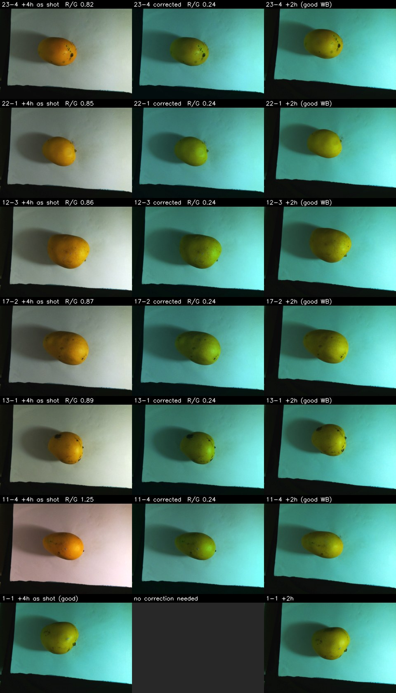

# Lot 1 +4 h: 57 RGB photos shot with automatic white balance (2026-10-26)

**Problem.** During lot 1's +4 h round the Arducam USB camera reset three times (EMI, 18:07, 18:20, 18:38) and came back in automatic white balance while still reporting manual 5300 K (`jornadas/lote1-20261024/observaciones_lote1.json`). 57 RGB photos are affected: mango 11 face 4 and mangos 12-25, all faces. The sheet looks neutral instead of cyan and the mango looks orange. NIR is not affected. The metadata cannot find these photos: `rgb.controles` says `white_balance_automatic=0`, 5300 K for all 800 lot-1 RGB photos.

**Short answer.** A per-photo diagonal von Kries correction in linear light, with the sheet at the image border as the neutral reference, brings the sheet back to the colour of the good +4 h photos (R/G 0.240, B/G 0.881 in all 57) and cuts the mango colour error against the same face at +2 h from a median CIE76 ΔE of **20.7 to 6.2**. The correction is partial: the corrected mangos keep a visible olive tint next to their +2 h photo (figure below). The unaffected +4 h photos drift from +2 h by about +1.4 L* and +1.6 b* on their own (median ΔE 2.4), so against the colour a good +4 h photo would have, the residual is about **7.5 ΔE76**, not 6.2. The 57 corrected photos are fine for localization and annotation; flag them, or exclude them, in colour-sensitive RGB analyses. The originals are untouched; corrected copies go to a separate folder.

Reproduce (CPU only, about 35 s; the data root is gitignored):

```bash
.venv/bin/python -I scripts/correct_white_balance.py --data-root data/cache/captura_v3 \
    --jornada lote1-20261024 --ronda 4 --faces 11:4,12-25 --expected-count 57
.venv/bin/python -m pytest tests/data_pipeline tests/capture -q
```

Outputs: `data/cache/captura_v3/news/rgb_wb/mango_rgb_<ts>.jpg` (57 files, same names, 3264x2448, JPEG q95 4:4:4, 48 MB) and `manifest.json` next to them (per file: gains, border chroma before/after, clipped fraction, source and output sha256, mango ΔE). Here: [evidence/summary.json](evidence/summary.json), [figures/before_after.jpg](figures/before_after.jpg), [figures/mango_masks.jpg](figures/mango_masks.jpg). Nothing under `news/rgb`, `news/nir` or `news/meta` is ever written: `--out-subdir`, `--figure-dir` and `--summary-json` are all resolved (following `..` and symlinks) and refused if they land at or below those folders (`--out-subdir` must also stay inside the data root).

## Evidence: which photos are affected

The selection is explicit (`--faces`, `--expected-count`) and then validated from pixels. The tool measures the linear-light border chroma of all 800 RGB photos of the jornada, with the same border frame as the capture QC (`capture.calidad.region_borde`, 10%), and splits R/G at its largest gap in log-space:

| | Photos | Border R/G (linear) |
| :-- | --: | :-- |
| Selected 57 | 57 | 0.824 - 1.249 |
| Everything else in lot 1 (all rounds, `sano`) | 743 | 0.201 - 0.293 |

The gap is x2.8, so the threshold is 0.491 (geometric midpoint). The outlier set equals the selected set exactly; if it did not, the run aborts and prints the diff. No other round has an off-colour photo. The only non-selected photo more than 25% off its round is 11-3 at +4 h, which was retaken at 19:00 after the manual balance was restored, under the night light (B/G 0.63 against 0.87).

The operator's notes quote ratios of gamma-encoded values (sheet R/G about 0.45-0.5 good, 0.92 bad). In linear light the same photos are 0.24 and 0.86; the numbers here are linear.

## Method

1. **Reference** = per-channel median of the linear border means of the 43 non-selected +4 h photos (mangos 1-10 all faces, mango 11 faces 1-3). Same sheet and same afternoon light as the affected photos. Later rounds are not usable: the sheet was replaced before +6 h and the room light changed (B/G 0.64 instead of 0.88). The reference photos are checked not to be outliers.
2. **Gains** per selected photo = reference / own border means, per channel, measured on a 1/4-scale decode.
3. **Apply** at full resolution: sRGB to linear, multiply by the gains, clip at 1.0, back to sRGB (a 256-entry LUT per channel), save as JPEG q95 with 4:4:4 chroma. With 4:2:0 the re-encode bled chroma across the sheet/tray edge inside the border frame and moved the border R/G by about 8% on a synthetic test.

Why linear light and per-channel gains: a camera white-balance gain multiplies the linear sensor value of each channel, so undoing it is a diagonal transform in linear space. The same factors applied to gamma-encoded values would not be the inverse. The gains are absolute (they restore the sheet level in every channel), so they also undo the brightness change of the auto frames.

**Non-circular check.** After the correction the border matches the reference by construction, so it proves nothing. The check uses the mango instead: median CIELAB colour of the fruit in the photo against the same mango and face at +2 h (good white balance, same sheet, two hours earlier). CIE76 ΔE (Euclidean distance in Lab, D65). The mango mask is pixels with b* more than 12 above the sheet's (median b* of the bright border pixels), largest connected component, holes filled, eroded 1% of the short side, on a 1/4-scale decode; checked by eye in [figures/mango_masks.jpg](figures/mango_masks.jpg). The same measurement on the 43 unaffected photos gives the floor expected from real ripening and light drift.

## Results

| | Before (57) | After (57) | Good +4 h photos (43) |
| :-- | :-- | :-- | :-- |
| Border R/G, linear (min-max) | 0.864 (0.824-1.249) | 0.2403 (0.2398-0.2411) | reference 0.2404 |
| Border B/G, linear (min-max) | 0.834 (0.758-0.954) | 0.881 (0.878-0.882) | reference 0.880 |
| Mango ΔE76 vs +2 h, median (min-max) | 20.7 (15.7-32.3) | **6.2** (4.4-11.2) | 2.4 |
| Mango median (ΔL, Δa*, Δb*) vs +2 h | (0.2, +20.0, +1.5) | (-1.8, -4.9, -3.2) | (+1.4, -0.1, +1.6) |

All 57 photos improved; 2 stay above 10 (11-4 at 10.9, 14-2 at 11.2). Gains (median, range): R 0.35 (0.21-0.38), G 1.27 (1.05-1.32), B 1.34 (1.03-1.52). Clipped by the gain: median 4e-6 of a photo (about 32 of 8 million pixels; 16 photos have exactly 0), at most 0.29% (about 23,000 pixels), 5 photos above 0.1%. Mango pixels already saturated in the source (any channel at 250 or more): median 0%, at most 2.3% (11-4).

Before the correction the mango is about 20 units too red (a*) and has the right lightness and b*. After it, a* overshoots by about 5.



The corrected mango reads as olive next to its +2 h version in every row. Each row: as shot at +4 h, corrected, same mango and face at +2 h. Rows are picked at evenly spaced ranks of the sheet R/G (0.82 to 1.25). The last row is a good +4 h photo.

## Limits

- **Residual colour error.** The corrected mangos keep an olive tint against +2 h: median (ΔL, Δa*, Δb*) = (-1.8, -4.9, -3.2), ΔE 6.2. That understates it, because the 43 unaffected +4 h photos are themselves about +1.4 L* lighter and +1.6 b* yellower than at +2 h (real ripening and light drift, median ΔE 2.4). Subtracting that drift leaves (-3.2, -4.7, -4.8), a drift-adjusted residual of about 7.5 ΔE76. Most of the remaining error is the correction, not ripening. A diagonal model is probably too simple (the camera's automatic mode may change more than three channel gains, not tested). A fit on mango pixels against the +2 h photos would shrink the error, but it would bake the earlier colour into the data and hide real ripening, so it was not done.
- **Estimated from the sheet only.** The sheet is cyan with very little red (linear R about 0.05 in the good photos), and the gain is applied to the fruit, which is red-rich. The tint of the auto frames was also uneven across the frame in some photos (pinkish on one side), and one global gain per photo cannot remove that.
- **Clipped highlights are not recoverable.** Pixels saturated in the source stay clipped; here that is a small share (above).
- **ΔE vs +2 h is a sanity check, not ground truth.** The mango really changes in two hours, and the +2 h photo has its own noise (mask, pose, small shifts of the sheet). Read the ΔE next to the 2.4 floor.
- **Reference.** One reference photo (11-3, retaken at night light) is in the 43; the median is robust to it (excluding it moves the reference R/G from 0.2404 to 0.2405 and B/G from 0.8798 to 0.8803).
- **Second-generation JPEG.** The outputs are re-encoded (q95, 4:4:4). Source metadata blocks are not copied (the one source checked had none).
- **Scope.** Only lot 1, +4 h. NIR is untouched. Use the 57 corrected RGB photos for localization and annotation (boxes, masks); flag them, or exclude them, in colour-sensitive RGB analyses (colour features, ripeness, RGB-vs-NIR colour ablations). The corrected photos are not wired into any export or training config yet: `news/rgb` still holds the originals.
