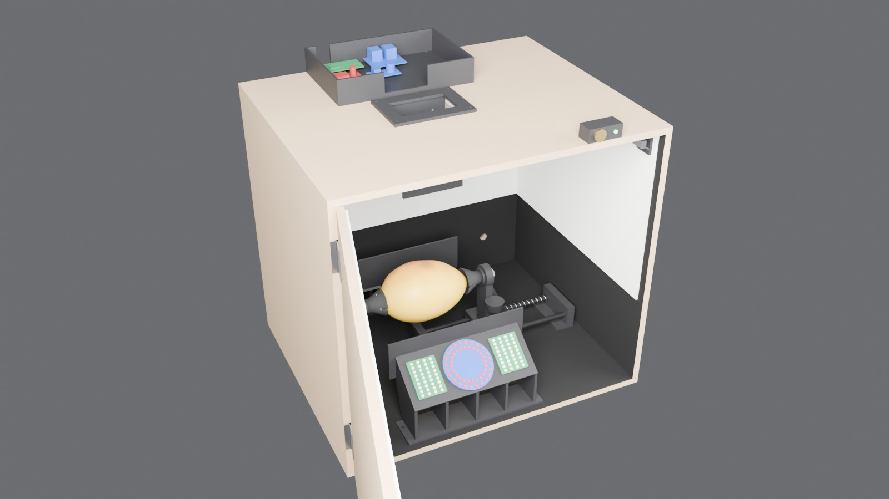
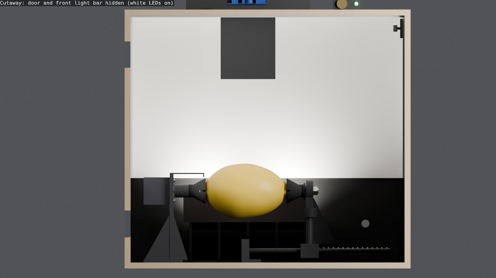
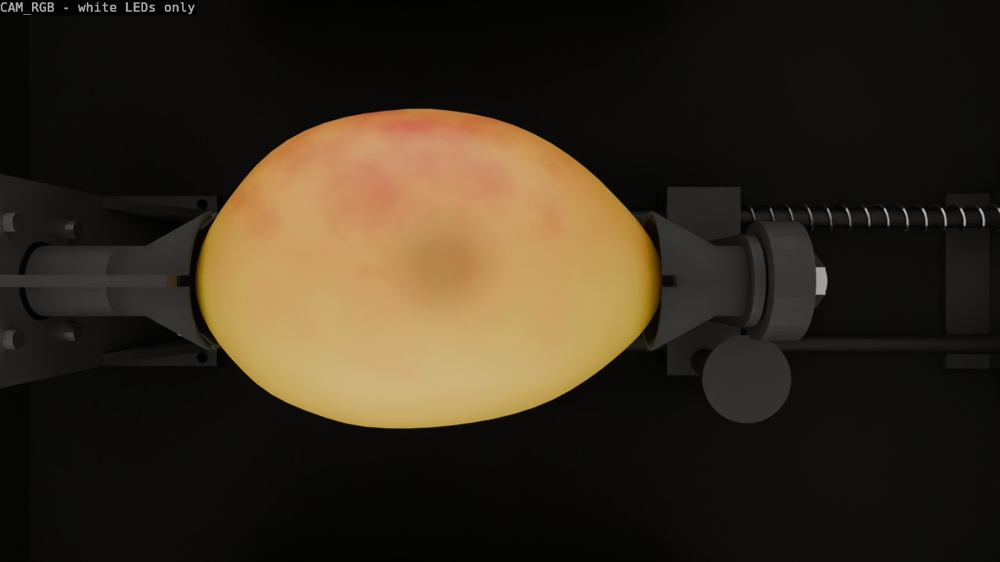
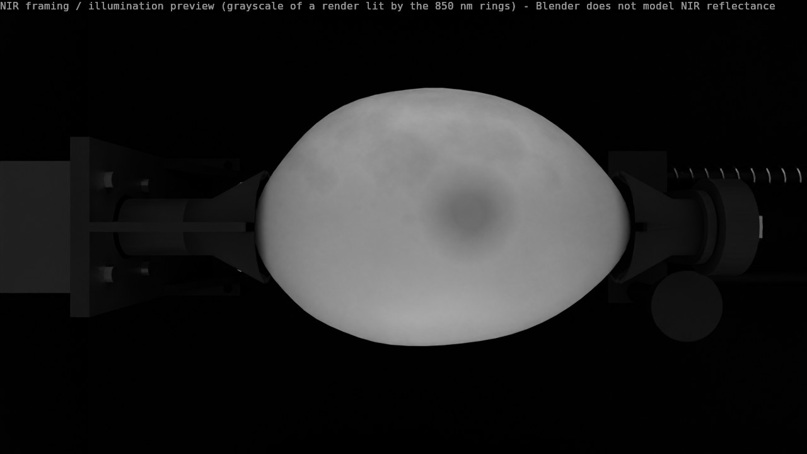
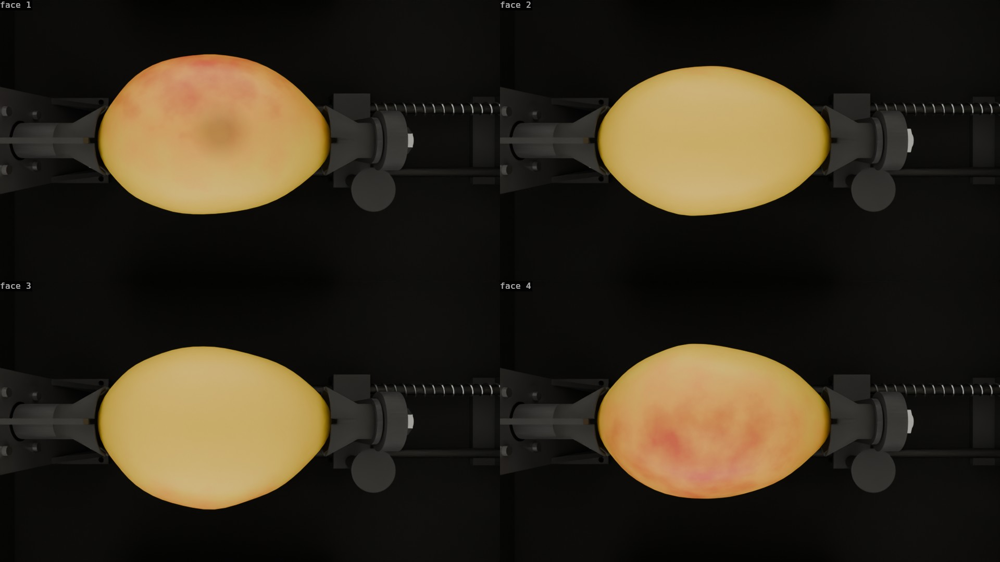
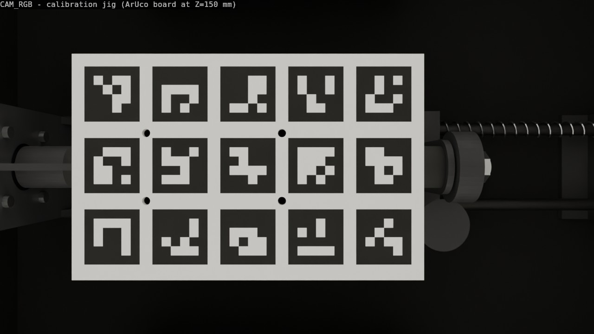

# Automated RGB + NIR capture rig for latent mango bruises

The current rig is a cardboard box with two cameras taped on top and the fruit rotated by hand. This
folder holds the replacement: a closed MDF enclosure in which a motorised spindle holds one mango by
its ends, turns it in 90 degree steps and lets two side-by-side cameras photograph four faces under
symmetric, purely indirect light (white LEDs for RGB, 850 nm LEDs for NIR). The operator loads the
fruit, closes the door and presses one button.

Everything here is generated by one parametric Blender script,
[`build_capture_rig.py`](build_capture_rig.py): geometry, design checks, STL files, MDF cut list,
renders and the capture-cycle animation. Dimensions are named constants at the top of that script;
change one and rebuild.

## 1. Problem and design response

| Problem with the cardboard rig | Design response in this rig |
|---|---|
| Fruit rotated by hand: slow, inconsistent angle, handling can add bruises | Horizontal spindle holds the fruit by its ends between two soft TPU cups; NEMA17 at 1/16 microstep = 3200 steps/rev, so exactly 800 steps per 90 degree face. Four index notches (1-4) on the head cup and a fixed pointer at 12 o'clock let the operator align the fruit's fiducial mark with notch 1 at load. Rotation axis = the fruit's long axis (stem to apex). |
| Fruit fills only about 8 % of the frame | Lens plane 195 mm above the calibration plane (Z = 150): horizontal field of view 236 mm instead of a wide shot from a high box. The nominal 124 mm fruit is 46 % of the frame width and about 20 % of the frame area in `03_view_rgb.jpg` (measured on the render). |
| Specular highlights and an illumination gradient | Indirect light only: the LEDs face up and outward onto 3 mm white PVC-foam liners on the upper walls and ceiling. A black baffle fin on the inner side of each light bar and the camera-tower skirts block every straight line from an LED to the fruit and to the lenses (verified by a segment test over all 240 emitters). Two identical bars at +Y and -Y make the geometry symmetric. |
| Both modalities need the same light geometry | One 850 nm ring and two white panels per bar, all on the same tilted face, centred at the same X. Only the active emitters differ. |
| NoIR sees ambient light | Light-tight 9 mm MDF box, matte black inside, white only where it is a deliberate reflector, door microswitch interlock (no capture with the door open). Seal the 90 x 60 mm camera opening around the cable bundle with black foam tape. |
| RGB/NIR parallax | Cameras side by side with the minimum baseline the boards allow (33 mm), baseline along the spindle axis (X), plus a per-session homography taken from the calibration jig at the fruit-top plane. Residual estimate in section 3. |
| Light intensity depended on the power bank | 12 V 3 A wall adapter feeds the LEDs and the stepper directly; an LM2596 buck gives 5 V for the Pi Zero 2W and the relay coils. |

## 2. Geometry at a glance

Origin: centre of the internal floor. X runs along the spindle axis (left to right seen from the
front), Y from the front (-) to the back (+), Z up. All dimensions in mm.

* Enclosure: internal 420 x 340 x 380, 9 mm MDF. Floor and top panel 438 x 358. Door 420 x 380,
  inset at the front, hinged on the left vertical edge (separate object `DOOR`, pivot on the hinge
  axis, animated). Top panel opening 90 x 60 centred at X = -30, Y = 0. Two D12 cable holes in the
  back wall at X = -150 / +150, Z = 60.
* Finish: floor and the lower 130 mm of every wall matte black; upper walls and ceiling lined with
  3 mm white PVC foam (separate `LINER_*` objects).
* Spindle axis: Y = 0, Z = 110. Head cup mouth plane X = -95, tail cup mouth X = +29 for the nominal
  fruit, travel -15 ... +80 (fruit length 80-175 mm).
* Headstock: NEMA17 (face at X = -150), printed L-bracket with the pointer, printed shaft hub, TPU cup.
* Tailstock: two D8 rods at Y = +-25, Z = 18 (X = -40 ... 200), two printed rod holders, printed
  carriage with 2x LM8UU and a 608 bearing, spring on the +Y rod, printed pull knob.
* Cameras: `CAM_NIR` at X = -46.5, `CAM_RGB` at X = -13.5 (baseline 33 mm), Y = 0, lens plane Z = 345
  (adjustable +-10 mm on the tower slots: Z = 335-355, working distance 185-205 mm), both looking
  straight down. IMX219 optics: sensor width 3.68 mm, focal length 3.04 mm,
  `sensor_fit = HORIZONTAL`, 1280 x 720. The Arducam IMX219 USB lens is **assumed** equal to the Pi
  Camera v2 lens. Horizontal / vertical field of view 62.4 / 37.6 degrees; at Z = 150 the frame is
  236.1 x 132.8 mm (5.42 px/mm). NIR frame X = -164.5 ... 71.5, RGB frame X = -131.5 ... 104.5.
* Light bars: two printed stands (200 mm long, centred at X = -30), LED face at Z = 75 tilted 35 degrees
  (normal 35 degrees from vertical, towards the wall on its own side), one 850 nm 48-LED ring (D70) and
  two white 36-LED panels (52 x 40) per bar.
* Electronics deck 190 x 130 x 35 on the top panel behind the camera tower; start button and status
  LED on a small printed panel at the top-front edge; DC barrel jack in a printed housing on the back
  wall; door microswitch inside, top right of the door frame.

## 3. Residual RGB/NIR parallax

Two cameras separated by a baseline `b` see a point at distance `Z` shifted by `f_px * b / Z`. A
homography calibrated at the plane Z0 removes the shift exactly at that plane; a surface point `dZ`
above or below it keeps

    disparity_px = f_px * b * dZ / Z^2

with `f_px = 1280 / (2 * 1.84 / 3.04) = 1057`, `b = 33 mm`, `Z = 195 mm`:

| dZ from the calibration plane | residual disparity (1280 px frame) |
|---|---|
| +-5 mm | 4.6 px |
| +-10 mm | 9.2 px |
| +-20 mm | **18.4 px** (0.92 px/mm) |

Context for the old rig: it showed about 12 px, matching a measurement on 2026-10-18. The same
formula gives 11.7 px for a baseline of about 50 mm at about 300 mm height with dZ = +-20 mm; that
geometry is inferred from the 12 px figure, not measured, so check it against the old rig.
The absolute residual of the new rig is larger because the cameras are closer (Z^2 in the denominator)
but the fruit is also larger in the image (about 8 % of the frame before, about 20 % now): relative to the 124 mm fruit length both rigs give about
2.7 % (new 18.4 px of 672 px, old 11.7 px of 437 px). The design therefore keeps the *relative*
misregistration constant while enlarging the fruit about 2.5x in area. To reduce it further: calibrate
at the plane that best represents the surface of interest, raise the cameras (costs resolution), or
add a per-face registration refinement on the fruit itself. Removing it entirely needs coaxial
cameras behind a 45 deg hot-mirror beam splitter (NIR reflected to the NoIR, visible transmitted to
the RGB); that option was considered and not adopted for this build.

## 4. Capture cycle

1. Operator: open the door, pull the knob, seat the fruit between the cups with its fiducial mark on
   notch 1, release the knob, close the door, press START.
2. Firmware checks the door switch (BCM 6 low = closed) and enables the driver (BCM 25 low).
3. For each face 1 ... 4: white LEDs on (BCM 27), status LED blinks, RGB frame, white off; 850 nm
   LEDs on (BCM 22), status LED blinks, NoIR frame, NIR off; spindle turns 800 steps (90 degrees).
4. After the fourth face the fruit is back at its start angle; driver disabled, status LED idle, door
   may be opened. Opening the door at any time aborts the cycle.

`renders/capture_cycle.mp4` shows this cycle (10 s, sectioned view with the back wall removed). The
same keyframes live in `capture_rig.blend` (frames 1-240, 24 fps), so you can scrub them:

| Frames | Event |
|---|---|
| 1-24 | door closes |
| 25 / 73 / 121 / 169 + 2 ... 14 | face 1 / 2 / 3 / 4: white LEDs on |
| window start + 8 ... 11 | status LED blink for the RGB shot |
| window start + 18 ... 30 | 850 nm LEDs on |
| window start + 24 ... 27 | status LED blink for the NIR shot |
| window start + 33 ... 45 | spindle turns 90 degrees |
| 217-240 | door opens |

Light power, LED emission strength, door angle and spindle angle are all keyframed. The animation
is rendered with EEVEE, which has no global illumination: a hidden `BOUNCE_FILL` light under the
ceiling, keyed with the LED pulses, stands in for the bounce, and the world is lit at 25 % so the
idle rig stays visible. The stills use Cycles and need neither.

## 5. Renders

Cycles with OIDN denoising on the GPU. Blender does not model NIR reflectance: `04_view_nir.jpg` is a
framing and illumination preview (the red channel of a render lit by the 850 nm rings), not a
prediction of what the NoIR sees.

| | |
|---|---|
|  |  |
| `03_view_rgb.jpg` - `CAM_RGB`, white LEDs only | `04_view_nir.jpg` - `CAM_NIR`, 850 nm LEDs only |

`05_faces_rgb.jpg`: `CAM_RGB` at faces 1-4. The bruise patch sits on face 1.

`06_calibration_jig.jpg`: the jig with its ArUco plate in place of the fruit, as `CAM_RGB` sees it.

## 6. MDF and foam-board cut list

Generated from the model into [`mdf_cut_list.csv`](mdf_cut_list.csv).

| Part | Qty | Length x width x thickness (mm) | Notes |
|---|---|---|---|
| M1 back wall | 1 | 420 x 380 x 9 | 2x D12 holes at X = -150 / +150, Z = 60; paint the inner face matte black |
| M2 door | 1 | 420 x 380 x 9 | nominal size; cut 1 mm smaller per side for clearance; hinged on the left |
| M3 floor | 1 | 438 x 358 x 9 | paint the upper face matte black |
| M4 top panel | 1 | 438 x 358 x 9 | opening 90 x 60 centred at X = -30, Y = 0; paint the lower face matte black |
| M5 side walls | 2 | 380 x 358 x 9 | stand on the floor, carry the top panel |
| P6 ceiling lining | 1 | 420 x 340 x 3 PVC foam | same 90 x 60 opening |
| P7 door lining | 1 | 414 x 247 x 3 PVC foam | upper door, lower edge at Z = 130 |
| P8 back lining | 1 | 414 x 247 x 3 PVC foam | upper back wall |
| P9 side linings | 2 | 334 x 247 x 3 PVC foam | upper side walls |

## 7. Printed parts

All parts fit the 200 x 200 x 200 mm bed; the STL files in [`stl/`](stl/) are in millimetres, already
in a suggested print pose (centred, resting on Z = 0). Black PETG for structure, TPU 95A for the cups.

| STL | Qty | Material | Infill | Size (mm) | Notes |
|---|---|---|---|---|---|
| `motor_bracket` | 1 | black PETG | 40 % | 93 x 70 x 138 | L-bracket with gussets and the 12 o'clock pointer |
| `shaft_hub` | 1 | black PETG | 60 % | 20 x 20 x 30 | 5 mm bore, M3 grub screw; bore down on the bed |
| `cup_head` | 1 | TPU 95A | 20 % | 39.8 x 39.8 x 26 | notches 1-4, mouth up, no supports |
| `cup_tail` | 1 | TPU 95A | 20 % | 39.8 x 39.8 x 26 | free-spinning cup, mouth up |
| `tail_hub` | 1 | black PETG | 60 % | 26 x 26 x 16 | hex pocket for the M8 bolt head |
| `rod_holder_l`, `rod_holder_r` | 1 + 1 | black PETG | 50 % | 30 x 72 x 36 | rods retained with CA glue or an M3 grub screw |
| `carriage` | 1 | black PETG | 60 % | 54.5 x 72 x 120 | 2x LM8UU pockets, 608 housing, pull-knob post |
| `pull_knob` | 1 | black PETG | 25 % | 28 x 28 x 25 | print head down, glue the stud |
| `light_bar_front`, `light_bar_back` | 1 + 1 | black PETG | 25 % | 200 x 66.8 x 118 | supports under the LED face |
| `camera_tower` | 1 | black PETG | 40 % | 110 x 80 x 111 | flange on the bed; two slots give +-10 mm lens height (Z 335-355) |
| `camera_carrier` | 1 | black PETG | 40 % | 76 x 49 x 29 | supports under the plate |
| `electronics_deck` | 1 | black PETG | 20 % | 190 x 130 x 35 | fits the bed unsplit |
| `button_panel` | 1 | black PETG | 30 % | 46 x 22 x 18 | 16 mm button, 5 mm LED |
| `jack_housing` | 1 | black PETG | 30 % | 30 x 22 x 24 | panel-mount DC barrel jack |
| `switch_bracket` | 1 | black PETG | 40 % | 30 x 26 x 8 | door microswitch |
| `door_handle` | 1 | black PETG | 25 % | 14 x 100 x 22.5 | |
| `jig_body` | 1 | black PETG | 40 % | 140 x 35.8 x 54.9 | calibration jig |
| `jig_plate` | 1 | white PETG | 100 % | 140 x 90 x 3 | glue the printed ArUco sheet on top |

## 8. Bill of materials

Prices are rough estimates in Peruvian soles (PEN), +-30 %, not quotes.

**Already owned:** Raspberry Pi Zero 2W, Pi Camera NoIR v2, Arducam IMX219 USB camera, 2x 2-channel
5 V relay modules (one is used), 2x 850 nm 48-LED CCTV rings, 1x 12 V 36-LED white panel.

**To buy:**

| Item | Est. PEN |
|---|---|
| NEMA17 stepper 42 x 40 mm | 55 |
| DRV8825 or A4988 module, perfboard, 100 uF capacitor | 15 |
| 608 bearing | 5 |
| 2x LM8UU linear bushing | 12 |
| 2x D8 mm ground rod, about 250 mm | 25 |
| Compression spring (OD 11 mm, free length >= 150 mm) | 6 |
| M8 x 35 bolt, nut, washer | 4 |
| Screw assortment (M2, M2.5, M3, M4, wood screws) | 25 |
| 12 V 3 A adapter, 5.5 x 2.1 mm, plus panel-mount barrel jack | 35 |
| LM2596 buck module | 9 |
| 3x white 12 V 36-LED panel (4 in total with the one owned) | 45 |
| 16 mm momentary push button | 9 |
| 5 mm LED, 330 ohm resistor | 2 |
| Lever micro-switch | 4 |
| Terminal block | 5 |
| 2x small butt hinge | 8 |
| MDF 9 mm, about 1 m^2 | 45 |
| PVC foam board 3 mm, about 0.7 m^2 | 30 |
| Matte black paint | 25 |
| TPU 95A, 250 g | 70 |
| Black PETG, 1 kg (skip if in stock) | 85 |
| Black foam tape / felt | 10 |
| Wire, ferrules, zip ties, heat-shrink | 20 |
| ArUco sheet printed on matte paper | 3 |
| **Total (estimate)** | **about 550** |

## 9. GPIO wiring (BCM)

| BCM | Signal | Notes |
|---|---|---|
| 27 | RGB relay IN (white LEDs) | existing |
| 22 | NIR relay IN (850 nm rings) | existing |
| 23 | STEP | to the driver |
| 24 | DIR | to the driver |
| 25 | EN | active low |
| 17 | START button | internal pull-up, button to GND |
| 18 | status LED | 330 ohm in series |
| 6 | door switch | internal pull-up, closed door = low |

Hard-wire the driver for 1/16 microstepping (A4988: MS1-3 high; DRV8825: M2 high only, check the
module datasheet). Set the current limit before connecting the motor and keep EN high between moves
so the motor does not heat the box or vibrate during an exposure.

Power (text diagram):

    230 V AC -> 12 V 3 A adapter -> barrel jack (back wall) -> terminal block (+12 V / GND)
        |- stepper driver VMOT (+ 100 uF close to the driver) -> NEMA17
        |- relay K1 (BCM 27): 12 V -> 4x white panels in parallel
        |- relay K2 (BCM 22): 12 V -> 2x 850 nm rings in parallel
        '- LM2596 (set to 5.1 V) -> Pi Zero 2W 5 V + relay module VCC/JD-VCC

Only one modality is lit at a time. Rough current estimates (verify with a meter): white panels
about 1 A, both rings about 0.7 A, stepper 0.4-0.8 A, Pi about 0.2 A at 12 V equivalent.

## 10. Assembly order

1. Cut the MDF and foam board, drill the back-wall holes, paint the inside of every MDF part matte
   black, glue the white linings above Z = 130 and on the ceiling.
2. Print the parts (cups in TPU). Test-fit the small parts first: hub bore, cup sockets, bearing
   recess, LM8UU pockets, motor holes.
3. Floor: fix the motor bracket (motor, pointer, hub, head cup), then the rod holders with the rods,
   the carriage (LM8UU, 608, tail hub, bolt, nut, tail cup, spring, knob), then both light bars.
4. Stand the side walls on the floor, fit the back wall, then the top panel with the camera tower.
5. Mount the carrier with both boards on the tower slots, set the lens plane to Z = 345 (bolts in the
   middle of the slots) and focus.
6. Electronics deck on the top panel, button panel at the top-front edge, jack housing on the back wall.
7. Door with hinges, handle and the microswitch bracket; check the switch closes at the door seal.
8. Wire it up following section 9 and seal the top opening around the cables with black foam.

## 11. Per-session calibration with the jig

The jig (`jig_body` + `jig_plate`) clamps between the cups like a mango; its plate top is at Z = 150,
the typical fruit-top height. The plate carries [`calibration/aruco_board_140x90mm.jpg`](calibration/aruco_board_140x90mm.jpg):
a 5 x 3 `DICT_4X4_50` grid (ids 0-14, 22 mm markers, 5 mm gaps) on 140 x 90 mm at 300 dpi; marker
geometry is in the JSON next to it. Print at 100 % scale.

1. Pull the knob, seat the jig, release, close the door.
2. Capture one RGB and one NIR frame with the board lit (white LEDs for RGB, the 850 nm rings for
   NIR). Check the board contrast under 850 nm before trusting it: carbon toner (laser print) absorbs
   NIR, dye-based inkjet black may not.
3. Detect the markers in both images and compute the NIR-to-RGB homography for the plate plane.
4. Store it with the session id and remove the jig.

Regenerate the board with `.venv/bin/python -I hardware/capture_rig/calibration/make_aruco_board.py`.

## 12. Practical notes

* Refocus both lenses at about 195 mm working distance. The Pi Camera v2 lens is glued at infinity
  and needs a focus tool.
* The camera height is adjustable only +-10 mm (working distance 185-205 mm). Lower, direct LED
  light reaches the lenses (and below 165 mm a 110 mm fruit leaves the frame); higher, the tower
  cheeks enter the frame. Check (k) tests both ends of the slots. After any height change, refocus
  and recompute the homography with the jig.
* Print the cups in TPU 95A; PETG cups will mark the skin.
* Paint the inside of the MDF matte black; the white parts are only the liners.
* The door model is nominal; cut the real door about 1 mm smaller on each side.
* `rebuild`: `blender -b --factory-startup --python hardware/capture_rig/build_capture_rig.py -- --export-dir hardware/capture_rig`
  (add `--no-render` to skip stills and animation, `--check-only` for the checks only).

## 13. Design checks

`--check-only` builds the scene and runs these checks (all pass; `ALL CHECKS PASSED`, exit 0).
They were written first and failed on an empty scene, then the build was grown until they passed.
`tests/hardware/test_capture_rig_build.py` runs them under pytest and also asserts they fail on an
empty scene.

| Check | What it tests | Result |
|---|---|---|
| (a) | both camera frustums contain a 175 x 110 mm footprint centred at X = -30 on Z = 150 | NIR margin 47 / 14 mm in X, RGB 14 / 47 mm, 11.4 mm in Y |
| (b) | tailstock travel gives 80-175 mm fruit length; carriage stays on the rods; spring never solid | pass |
| (c) | a 55 mm radius fruit turning about the axis clears floor, rods, light bars, fins | pass (>= 46 mm to the fins, 55 mm to the floor) |
| (d) | every printed part fits 200^3 | largest 200 x 66.8 x 118 (light bar) |
| (e) | every printed mesh has 0 non-manifold edges | pass (20 parts) |
| (f) | no direct line from any LED emitter centre (240) to the fruit top, the upper fruit surface or either lens | pass; fails with a 100 mm fin, passes with 104 mm and up |
| (g) | fins, bars, tower and carrier are outside both camera frames at their heights | pass |
| (h) | everything inside the 438 x 358 x 398 envelope except deck, button, jack, handle, hinges and the open door | pass |
| (k) | (a), (f), (g) and the jig check still pass with the lens at both ends of the slot travel (Z = 335 and 355) | pass; with the earlier +-30 mm slots it failed at both ends |
| extra | camera optics and positions, LED counts (48 per ring, 36 per panel), deck layout, jig plate top at Z = 150 and inside both frames | pass |

### Deviations from the geometry brief (what was fixed and why)

1. **Light-bar position.** The LED-face centre is at |Y| = 135 (stand footprint |Y| = 122-168), not
   150. A 76 mm face (the D70 ring) tilted 35 degrees spans 62 mm in plan; centred at 150 its outer
   edge would reach Y = 181, inside the 170 mm wall.
2. **Fin and foot shape.** At floor level the camera frame reaches |Y| = 117.5, so anything closer
   is visible. The fin therefore runs from Z = 62 to 118 (not down to the floor), the ribs slope
   outward below it and the foot starts at |Y| = 122. Check (g) fails otherwise.
3. **Lens shield.** A 118 mm fin cannot block the line from the outer LEDs to the lenses: that line
   crosses the fin plane at Z about 160. The camera-tower cheeks (Y = +-25 ... 29) hang down to
   Z = 282 and block it, and they double as a lens hood. The workable window for their lower edge is
   about Z = 272-292: lower enters the frame, higher lets LED light reach the lenses.
4. **Fruit ends.** The ellipsoid tips are extended by 4 mm (stem scar and apex beak) so the fruit
   actually seats in the cup cavities; the mouth planes stay at X = -95 and +29.
5. **Camera tower slots.** Both slots are in the rear cheek (one per M4 bolt). The brief asked for
   +-30 mm; check (k) showed the design only holds within +-10 mm, so the slots were shortened to
   +-10 mm.
6. **Jig.** Four posts and four M3 holes, placed in the white gaps between ArUco markers so no hole
   cuts a marker.
7. **Spin direction.** Each step is -90 degrees about +X so notch labels 1, 2, 3, 4 reach the top in order.
8. **Cutaway still.** `02_cutaway_front.jpg` hides the front light bar as well as the door, otherwise
   the bar hides the spindle.

## 14. Limitations

* The side-by-side parallax residual remains (section 3); the jig homography is exact only on its plane.
* The Blender renders are not an NIR simulation. Skin reflectance, bruise contrast and the NoIR
  response are not modelled.
* Prices are estimates. Current and thermal figures are estimates.
* The STLs are a first pass. Hole and pocket sizes (hub bore, cup sockets, 608 recess, LM8UU pockets,
  rod holes, motor pattern) have clearances chosen on paper; test-fit before a full print.
* The Arducam lens is assumed to match the Pi Camera v2 optics; measure its field of view.
* The animation uses a stand-in bounce light and a sectioned view for legibility.

## 15. Next step

Update the capture script to drive the stepper and loop the four faces: hardware-timed STEP pulses
(for example pigpio waves) for 800 steps per face with a short ramp, the state machine of section 4,
door-switch abort, frame naming by fruit id and face index, and the stored homography. Not written yet.

## Files

| Path | What |
|---|---|
| `build_capture_rig.py` | single source of truth (geometry, checks, export, renders) |
| `capture_rig.blend` | the scene with all keyframes |
| `stl/*.stl` | 20 printed parts, millimetres |
| `mdf_cut_list.csv` | MDF and foam-board cut list |
| `renders/` | stills 01-06 and `capture_cycle.mp4` |
| `calibration/` | ArUco board image, JSON geometry, generator script |
| `../../tests/hardware/test_capture_rig_build.py` | pytest wrapper |
