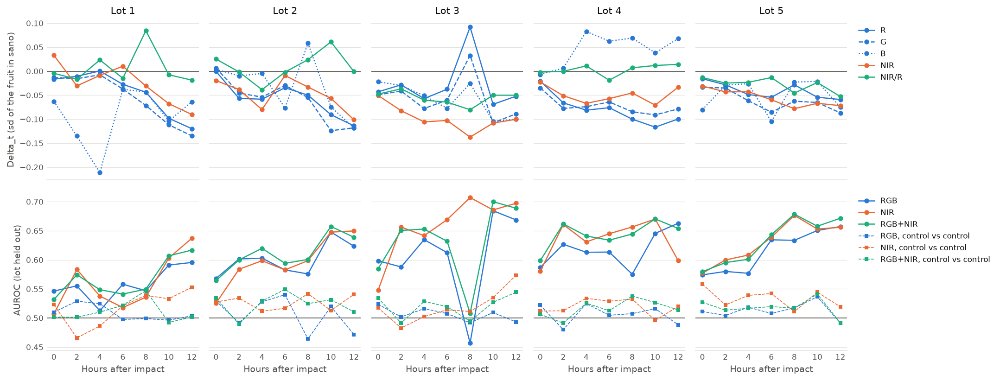

# E0: impact detectability per hour (boxes version)

Generated by `scripts/e0_detectability.py --mode boxes`; plan in [`docs/tesis/plan-experimental.md`](../../../docs/tesis/plan-experimental.md), E0.
This report states what the plan's reading table compares and chooses none of its sentences.

| | |
|:--|:--|
| Lots | 1, 2, 3, 4, 5 |
| Faces, moments measured | 500, 3385 |
| Excluded moments | no_control_zone: 81 |
| Latent hours (`LATENT_HOURS`) | 0, 2, 4, 6 |
| Registration | ECC against the face's `sano` crop; correlation inside the fruit after alignment: median 0.96, 5th percentile 0.89, minimum 0.72 |
| Logistic models | one fold per lot; a patch has the mean and local sd of each channel, as a change against `sano` |
| Bootstrap | 2000 replicates, mangos resampled within lot, seed 0 |

## Detectability per patch: AUROC, impact vs control [95% CI]

| | +0 h (latent) | +2 h (latent) | +4 h (latent) | +6 h (latent) | +8 h | +10 h | +12 h |
|:--|--:|--:|--:|--:|--:|--:|--:|
| n patches (one class / the other) | 4765 / 4839 | 4844 / 4869 | 4927 / 4982 | 4562 / 4562 | 4392 / 4425 | 4322 / 4331 | 4168 / 4173 |
| RGB | 0.57 [0.55, 0.59] | 0.58 [0.56, 0.61] | 0.58 [0.55, 0.60] | 0.59 [0.57, 0.61] | 0.55 [0.53, 0.57] | 0.64 [0.61, 0.67] | 0.64 [0.61, 0.66] |
| NIR | 0.54 [0.52, 0.55] | 0.59 [0.57, 0.61] | 0.58 [0.56, 0.59] | 0.59 [0.57, 0.60] | 0.61 [0.59, 0.64] | 0.64 [0.61, 0.66] | 0.62 [0.59, 0.64] |
| RGB+NIR | 0.57 [0.55, 0.59] | 0.60 [0.58, 0.62] | 0.60 [0.58, 0.62] | 0.59 [0.57, 0.61] | 0.58 [0.55, 0.60] | 0.65 [0.63, 0.68] | 0.64 [0.61, 0.66] |

## Negative control: AUROC, control zone vs another region not hit [95% CI]

The plan expects about 0.5 at every hour. Moments without room for a second region: 364.

| | +0 h (latent) | +2 h (latent) | +4 h (latent) | +6 h (latent) | +8 h | +10 h | +12 h |
|:--|--:|--:|--:|--:|--:|--:|--:|
| n patches (one class / the other) | 4839 / 3843 | 4869 / 3875 | 4982 / 3635 | 4562 / 3819 | 4425 / 3736 | 4331 / 3847 | 4173 / 3591 |
| RGB | 0.52 [0.50, 0.54] | 0.50 [0.48, 0.52] | 0.53 [0.51, 0.55] | 0.51 [0.49, 0.53] | 0.50 [0.48, 0.52] | 0.51 [0.49, 0.53] | 0.49 [0.46, 0.51] |
| NIR | 0.52 [0.50, 0.54] | 0.49 [0.47, 0.51] | 0.50 [0.48, 0.52] | 0.52 [0.50, 0.54] | 0.52 [0.50, 0.54] | 0.51 [0.49, 0.54] | 0.53 [0.50, 0.55] |
| RGB+NIR | 0.52 [0.50, 0.54] | 0.49 [0.47, 0.51] | 0.52 [0.50, 0.55] | 0.53 [0.50, 0.55] | 0.52 [0.50, 0.55] | 0.51 [0.49, 0.54] | 0.50 [0.48, 0.52] |

Hours whose interval excludes 0.5: RGB: +4 h; NIR: +0 h, +12 h; RGB+NIR: +0 h, +6 h.

## What the reading table compares

Differences of AUROC at the same hour [95% CI], with the same mangos resampled on both sides, and how many
lots the sign holds in. Hours marked latent come from `LATENT_HOURS`.

| | +0 h (latent) | +2 h (latent) | +4 h (latent) | +6 h (latent) | +8 h | +10 h | +12 h |
|:--|--:|--:|--:|--:|--:|--:|--:|
| NIR - RGB | -0.04 [-0.06, -0.01] | +0.01 [-0.01, +0.03] | +0.00 [-0.02, +0.03] | -0.00 [-0.02, +0.02] | +0.06 [+0.04, +0.09] | -0.00 [-0.03, +0.02] | -0.02 [-0.04, +0.00] |
| lots with NIR > RGB | 1 of 5 | 4 of 5 | 4 of 5 | 4 of 5 | 4 of 5 | 4 of 5 | 3 of 5 |
| RGB - negative control | +0.05 [+0.02, +0.08] | +0.08 [+0.05, +0.11] | +0.04 [+0.01, +0.08] | +0.08 [+0.05, +0.11] | +0.05 [+0.03, +0.07] | +0.13 [+0.09, +0.16] | +0.15 [+0.11, +0.19] |
| lots with RGB > negative control | 5 of 5 | 5 of 5 | 4 of 5 | 5 of 5 | 4 of 5 | 5 of 5 | 5 of 5 |

Per lot, in the latent hours:

| quantity | hour | lot 1 | lot 2 | lot 3 | lot 4 | lot 5 |
|:--|:--|--:|--:|--:|--:|--:|
| NIR - RGB | +0 h | -0.04 | -0.04 | -0.05 | -0.01 | +0.00 |
| NIR - RGB | +2 h | +0.03 | -0.02 | +0.07 | +0.03 | +0.02 |
| NIR - RGB | +4 h | +0.03 | -0.00 | +0.01 | +0.02 | +0.03 |
| NIR - RGB | +6 h | -0.04 | +0.00 | +0.06 | +0.03 | +0.00 |
| RGB - negative control | +0 h | +0.04 | +0.04 | +0.07 | +0.06 | +0.06 |
| RGB - negative control | +2 h | +0.03 | +0.11 | +0.09 | +0.15 | +0.08 |
| RGB - negative control | +4 h | -0.01 | +0.07 | +0.12 | +0.09 | +0.06 |
| RGB - negative control | +6 h | +0.06 | +0.04 | +0.10 | +0.11 | +0.13 |

## Delta_t, in sd of the fruit in `sano` [95% CI]

`[impact_t - impact_sano] - [control_t - control_sano]`. Negative means the box got darker than the control.

| | +0 h (latent) | +2 h (latent) | +4 h (latent) | +6 h (latent) | +8 h | +10 h | +12 h |
|:--|--:|--:|--:|--:|--:|--:|--:|
| R | -0.01 [-0.03, +0.01] | -0.04 [-0.05, -0.02] | -0.04 [-0.06, -0.02] | -0.04 [-0.05, -0.02] | -0.01 [-0.05, +0.02] | -0.08 [-0.10, -0.05] | -0.08 [-0.11, -0.06] |
| G | -0.02 [-0.04, -0.00] | -0.05 [-0.06, -0.03] | -0.05 [-0.07, -0.03] | -0.05 [-0.07, -0.03] | -0.05 [-0.07, -0.02] | -0.09 [-0.11, -0.07] | -0.10 [-0.12, -0.07] |
| B | -0.05 [-0.08, -0.02] | -0.06 [-0.10, -0.02] | -0.07 [-0.13, -0.01] | -0.09 [-0.15, -0.03] | -0.08 [-0.15, -0.02] | -0.09 [-0.15, -0.04] | -0.08 [-0.12, -0.04] |
| NIR | -0.01 [-0.04, +0.01] | -0.05 [-0.07, -0.04] | -0.05 [-0.07, -0.03] | -0.05 [-0.06, -0.03] | -0.07 [-0.09, -0.05] | -0.08 [-0.10, -0.06] | -0.08 [-0.10, -0.06] |
| NIR/R | -0.01 [-0.03, +0.01] | -0.01 [-0.04, +0.01] | -0.01 [-0.03, +0.01] | -0.02 [-0.04, +0.00] | -0.02 [-0.05, +0.00] | -0.01 [-0.04, +0.02] | -0.02 [-0.05, +0.01] |

## Median per mango [range between lots]

Faces are averaged per mango first. The range goes from the lowest to the highest median of a lot. The AUROC of
a mango is that of its own patches, with the scores of the fold that held its lot out. Also in `table.csv`.

| | +0 h (latent) | +2 h (latent) | +4 h (latent) | +6 h (latent) | +8 h | +10 h | +12 h |
|:--|--:|--:|--:|--:|--:|--:|--:|
| delta R | -0.01 [-0.04, -0.00] | -0.03 [-0.07, -0.01] | -0.06 [-0.08, +0.00] | -0.05 [-0.08, -0.03] | -0.04 [-0.10, +0.09] | -0.09 [-0.12, -0.05] | -0.08 [-0.12, -0.05] |
| delta G | -0.03 [-0.05, +0.01] | -0.04 [-0.08, -0.02] | -0.06 [-0.08, -0.01] | -0.06 [-0.09, -0.03] | -0.05 [-0.08, +0.03] | -0.10 [-0.12, -0.07] | -0.09 [-0.13, -0.08] |
| delta B | -0.03 [-0.08, +0.00] | -0.03 [-0.14, +0.01] | -0.03 [-0.21, +0.08] | -0.05 [-0.11, +0.06] | +0.00 [-0.04, +0.07] | -0.07 [-0.10, +0.04] | -0.07 [-0.12, +0.07] |
| delta NIR | -0.02 [-0.05, +0.03] | -0.05 [-0.08, -0.03] | -0.05 [-0.11, -0.01] | -0.05 [-0.10, +0.01] | -0.07 [-0.14, -0.03] | -0.07 [-0.11, -0.06] | -0.07 [-0.10, -0.03] |
| delta NIR/R | -0.01 [-0.05, +0.03] | -0.01 [-0.04, -0.00] | -0.02 [-0.06, +0.02] | -0.02 [-0.06, -0.00] | -0.02 [-0.08, +0.08] | -0.01 [-0.05, +0.06] | -0.02 [-0.05, +0.01] |
| AUROC RGB | 0.59 [0.55, 0.62] | 0.61 [0.52, 0.65] | 0.61 [0.52, 0.66] | 0.60 [0.57, 0.66] | 0.55 [0.50, 0.62] | 0.67 [0.60, 0.69] | 0.64 [0.54, 0.69] |
| AUROC NIR | 0.55 [0.43, 0.59] | 0.62 [0.51, 0.65] | 0.61 [0.59, 0.64] | 0.62 [0.56, 0.65] | 0.64 [0.55, 0.72] | 0.66 [0.61, 0.67] | 0.66 [0.59, 0.70] |
| AUROC RGB+NIR | 0.59 [0.53, 0.60] | 0.62 [0.54, 0.66] | 0.63 [0.59, 0.68] | 0.62 [0.57, 0.69] | 0.61 [0.53, 0.68] | 0.68 [0.61, 0.71] | 0.66 [0.58, 0.68] |
| negative control RGB | 0.52 [0.50, 0.55] | 0.51 [0.48, 0.54] | 0.54 [0.54, 0.55] | 0.51 [0.48, 0.55] | 0.49 [0.46, 0.52] | 0.52 [0.49, 0.53] | 0.50 [0.47, 0.55] |
| negative control NIR | 0.55 [0.53, 0.57] | 0.51 [0.49, 0.52] | 0.53 [0.47, 0.55] | 0.52 [0.42, 0.54] | 0.54 [0.53, 0.55] | 0.52 [0.51, 0.59] | 0.56 [0.49, 0.63] |
| negative control RGB+NIR | 0.53 [0.52, 0.56] | 0.49 [0.47, 0.53] | 0.55 [0.52, 0.60] | 0.52 [0.46, 0.59] | 0.54 [0.50, 0.54] | 0.54 [0.49, 0.59] | 0.51 [0.46, 0.59] |

## Onset

First hour whose AUROC interval stays above 0.5 from there on (uncorrected).

| modality | onset hour |
|:--|--:|
| RGB | +0 h |
| NIR | +0 h |
| RGB+NIR | +0 h |

## Limits

- The box of a moment reaches `sano` through a rigid ECC alignment of a fruit placed by hand; the plan describes
  SIFT + RANSAC, and residual 3D pose differences add noise to both regions.
- Most boxes of the latent hours were drawn by hand on the NIR view (plan 3.2), so the region measured here
  was chosen looking at that modality, which can favor the NIR. They can also be larger than the real bruise,
  which dilutes the mean of the box in early hours.
- The NIR comes as the dataset holds it, so any residual of its RGB-NIR registration moves the bruise inside the
  NIR crop while the box stays put.
- Intervals are descriptive (plan section 8.4): they resample mangos inside each lot, not lots, and are not
  corrected for multiplicity. The unit of inference is the lot, hence the per-lot values.
